## Overview

The capstone is one CornerStore copy with all 23 patterns applied in the required order. Each pattern folder starts from the baseline and changes one seam. The capstone preserves those individual refactors while integrating their shared workflows. Its golden-master test checks that the trading-day transcript still matches the baseline.

Build and test the capstone with:

```powershell
dotnet build capstone\Capstone.slnx -c Release
dotnet test capstone\Capstone.slnx -c Release
```

## Pattern map

| Smell | Pattern | Capstone implementation | Standalone pattern |
| --- | --- | --- | --- |
| S05 | Singleton | `src/CornerStore/Log.cs`, `src/CornerStore/Config.cs`, `src/CornerStore/IdSequence.cs` | [Singleton](../patterns/creational/singleton/) |
| S04 | Prototype | `src/CornerStore/Catalog/Product.cs`, `src/CornerStore/Catalog/Catalog.cs` | [Prototype](../patterns/creational/prototype/) |
| S08 | Composite | `src/CornerStore/Catalog/ICatalogItem.cs`, `src/CornerStore/Catalog/Bundle.cs`, `src/CornerStore/Catalog/Category.cs` | [Composite](../patterns/structural/composite/) |
| S16 | Iterator | `src/CornerStore/Catalog/ICategoryIterator.cs`, `src/CornerStore/Catalog/DepthFirstCategoryIterator.cs`, `src/CornerStore/Catalog/BreadthFirstCategoryIterator.cs`, `src/CornerStore/Catalog/Catalog.cs` | [Iterator](../patterns/behavioral/iterator/) |
| S11 | Flyweight | `src/CornerStore/Catalog/ProductSpec.cs`, `src/CornerStore/Catalog/ProductSpecFactory.cs`, `src/CornerStore/Catalog/Listing.cs` | [Flyweight](../patterns/structural/flyweight/) |
| S01 | Abstract Factory | `src/CornerStore/Pricing/IRegionFactory.cs`, `src/CornerStore/Pricing/AustraliaRegionFactory.cs`, `src/CornerStore/Pricing/NewZealandRegionFactory.cs`, `src/CornerStore/Pricing/RegionalPricing.cs`, `src/CornerStore/Pricing/RegionFactoryProvider.cs` | [Abstract Factory](../patterns/creational/abstract-factory/) |
| S21 | Strategy | `src/CornerStore/Pricing/IShippingCostStrategy.cs`, `src/CornerStore/Pricing/StandardShippingCostStrategy.cs`, `src/CornerStore/Pricing/ExpressShippingCostStrategy.cs`, `src/CornerStore/Pricing/PickupShippingCostStrategy.cs`, `src/CornerStore/Pricing/PricingService.cs` | [Strategy](../patterns/behavioral/strategy/) |
| S09 | Decorator | `src/CornerStore/Pricing/IAddOnPriceComponent.cs`, `src/CornerStore/Pricing/BaseAddOnPriceComponent.cs`, `src/CornerStore/Pricing/GiftWrapPriceDecorator.cs`, `src/CornerStore/Pricing/InsurancePriceDecorator.cs` | [Decorator](../patterns/structural/decorator/) |
| S15 | Interpreter | `src/CornerStore/Pricing/PromoExpression.cs`, `src/CornerStore/Pricing/PromoRuleParser.cs`, `src/CornerStore/Pricing/PromoEngine.cs` | [Interpreter](../patterns/behavioral/interpreter/) |
| S03 | Factory Method | `src/CornerStore/Checkout/PaymentProcessorCreator.cs`, `src/CornerStore/Checkout/CardProcessorCreator.cs`, `src/CornerStore/Checkout/PayPalProcessorCreator.cs`, `src/CornerStore/Checkout/AfterpayProcessorCreator.cs` | [Factory Method](../patterns/creational/factory-method/) |
| S06 | Adapter | `src/CornerStore/Checkout/IShippingProvider.cs`, `src/CornerStore/Checkout/ShipFastAdapter.cs` | [Adapter](../patterns/structural/adapter/) |
| S02 | Builder | `src/CornerStore/Orders/OrderBuilder.cs`, `src/CornerStore/Orders/InvoiceBuilder.cs` | [Builder](../patterns/creational/builder/) |
| S13 | Chain of Responsibility | `src/CornerStore/Checkout/OrderValidationHandler.cs`, `src/CornerStore/Checkout/StockValidationHandler.cs`, `src/CornerStore/Checkout/AddressValidationHandler.cs`, `src/CornerStore/Checkout/FraudValidationHandler.cs`, `src/CornerStore/Checkout/CreditLimitValidationHandler.cs` | [Chain of Responsibility](../patterns/behavioral/chain-of-responsibility/) |
| S10 | Facade | `src/CornerStore/Checkout/CheckoutFacade.cs` | [Facade](../patterns/structural/facade/) |
| S18 | Memento | `src/CornerStore/Cart/CartMemento.cs`, `src/CornerStore/Cart/Cart.cs` | [Memento](../patterns/behavioral/memento/) |
| S17 | Mediator | `src/CornerStore/Widgets/CartMediator.cs`, `src/CornerStore/Widgets/ItemListWidget.cs`, `src/CornerStore/Widgets/PromoBoxWidget.cs`, `src/CornerStore/Widgets/ShippingSelectorWidget.cs`, `src/CornerStore/Widgets/TotalsPanelWidget.cs` | [Mediator](../patterns/behavioral/mediator/) |
| S20 | State | `src/CornerStore/Orders/OrderState.cs`, `src/CornerStore/Orders/PendingOrderState.cs`, `src/CornerStore/Orders/PaidOrderState.cs`, `src/CornerStore/Orders/ShippedOrderState.cs`, `src/CornerStore/Orders/DeliveredOrderState.cs`, `src/CornerStore/Orders/CancelledOrderState.cs`, `src/CornerStore/Orders/RefundedOrderState.cs` | [State](../patterns/behavioral/state/) |
| S19 | Observer | `src/CornerStore/Orders/IOrderStatusObserver.cs`, `src/CornerStore/Orders/InventoryOrderStatusObserver.cs`, `src/CornerStore/Orders/NotificationOrderStatusObserver.cs`, `src/CornerStore/Orders/LoyaltyOrderStatusObserver.cs`, `src/CornerStore/Orders/AnalyticsOrderStatusObserver.cs`, `src/CornerStore/Orders/OrderService.cs`, `src/CornerStore/StoreConsole.cs` | [Observer](../patterns/behavioral/observer/) |
| S07 | Bridge | `src/CornerStore/Notifications/IChannel.cs`, `src/CornerStore/Notifications/OrderMessage.cs`, `src/CornerStore/Notifications/OrderConfirmedMessage.cs`, `src/CornerStore/Notifications/OrderShippedMessage.cs`, `src/CornerStore/Notifications/EmailSender.cs`, `src/CornerStore/Notifications/SmsSender.cs` | [Bridge](../patterns/structural/bridge/) |
| S12 | Proxy | `src/CornerStore/Inventory/IInventoryService.cs`, `src/CornerStore/Inventory/CachingInventoryProxy.cs`, `src/CornerStore/Inventory/ProtectionInventoryProxy.cs`, `src/CornerStore/Inventory/InventoryService.cs` | [Proxy](../patterns/structural/proxy/) |
| S14 | Command | `src/CornerStore/Orders/ICommand.cs`, `src/CornerStore/Orders/CommandInvoker.cs`, `src/CornerStore/Orders/AdjustStockCommand.cs`, `src/CornerStore/Orders/LookupStockCommand.cs`, `src/CornerStore/Orders/RefundCommand.cs`, `src/CornerStore/Orders/CancelCommand.cs`, `src/CornerStore/Orders/BackOffice.cs` | [Command](../patterns/behavioral/command/) |
| S22 | Template Method | `src/CornerStore/Reporting/ReportExporter.cs`, `src/CornerStore/Reporting/CsvReportExporter.cs`, `src/CornerStore/Reporting/JsonReportExporter.cs` | [Template Method](../patterns/behavioral/template-method/) |
| S23 | Visitor | `src/CornerStore/Catalog/ILineItemVisitor.cs`, `src/CornerStore/Catalog/Product.cs`, `src/CornerStore/Pricing/TaxVisitor.cs`, `src/CornerStore/Pricing/WeightVisitor.cs`, `src/CornerStore/Reporting/ReportTotalsVisitor.cs` | [Visitor](../patterns/behavioral/visitor/) |

## Where patterns meet

The catalog combines Prototype, Composite, Flyweight, Iterator, and Singleton. Catalog items form one tree that supports nested bundles and categories. Product variants clone their parent, imported listings share product specifications, and iterators handle category traversal. The singleton log, configuration, and ID sequence serve the integrated application.

Pricing combines Abstract Factory, Strategy, Decorator, and Interpreter. A region factory provides a matched pricing family, the shipping strategy selects a method-specific cost, decorators add optional charges, and the promo expression tree evaluates discount rules.

Checkout combines Factory Method, Chain of Responsibility, Builder, Facade, and Adapter. The facade builds a quote, runs the ordered validation chain, selects a payment processor, asks the order service to build the order, reserves inventory, and books shipping through the adapter.

Cart undo and widget refresh use Memento and Mediator together. The caretaker stores a cart memento before a successful change, while widgets notify the mediator to refresh the other views in their established order.

Order lifecycle combines State, Observer, and Bridge. A state object owns each allowed transition and notifies the order service after a successful change. The service notifies its subscribers, and the notification observer creates message abstractions that deliver through the customer's email or SMS channel.

Proxy and Command meet in back-office inventory actions. Commands use the protected inventory interface, the caching proxy keeps reads current after reservations and stock changes, and the invoker records results and supports undo for stock adjustments. The inventory observer uses the same inventory interface for status-change lookups.

Template Method and Visitor meet in reporting. The report exporter owns the shared filter and aggregation workflow, while the report totals visitor dispatches each product type. CSV and JSON exporters only define their output format. Tax and weight calculations use the same visitor interface with separate visitors.

## Checkout to order lifecycle

```mermaid
flowchart LR
    Cart["Cart state<br/>Memento"] --> Mediator["CartMediator<br/>Mediator"]
    Mediator --> Facade["CheckoutFacade<br/>Facade"]
    Facade --> Pricing["PricingService<br/>Abstract Factory, Strategy,<br/>Decorator, Interpreter"]
    Pricing --> Validation["OrderValidator<br/>Chain of Responsibility"]
    Validation --> Payment["PaymentProcessorCreator<br/>Factory Method"]
    Payment --> Orders["OrderService and builders<br/>Builder"]
    Orders --> Inventory["Inventory proxies<br/>Proxy"]
    Inventory --> Shipping["ShipFastAdapter<br/>Adapter"]
    Shipping --> State["OrderState<br/>State"]
    State --> Subscribers["OrderService.NotifyObservers<br/>Observer"]
    Subscribers --> Messages["Order messages and IChannel<br/>Bridge"]
    Orders --> Reports["ReportService"]
    Reports --> Exporter["ReportExporter<br/>Template Method"]
    Exporter --> Visitor["ReportTotalsVisitor<br/>Visitor"]
```



## Reading the history

The capstone history has one baseline-copy commit followed by one commit for each pattern. Read these 24 commits in order:

1. `chore(capstone): copy baseline unchanged`: start with an unchanged source and test copy.
2. `refactor(capstone): apply Singleton (S05)`: centralize shared configuration, logging, and IDs.
3. `refactor(capstone): apply Prototype (S04)`: clone product variants from their parent.
4. `refactor(capstone): apply Composite (S08)`: treat bundles and categories as catalog items.
5. `refactor(capstone): apply Iterator (S16)`: add reusable category traversal.
6. `refactor(capstone): apply Flyweight (S11)`: share product specifications across listings.
7. `refactor(capstone): apply Abstract Factory (S01)`: create matched regional pricing services.
8. `refactor(capstone): apply Strategy (S21)`: select shipping cost behavior by method.
9. `refactor(capstone): apply Decorator (S09)`: compose add-on pricing components.
10. `refactor(capstone): apply Interpreter (S15)`: parse and evaluate promo expressions.
11. `refactor(capstone): apply Factory Method (S03)`: create payment processors through creators.
12. `refactor(capstone): apply Adapter (S06)`: translate the shipping provider contract.
13. `refactor(capstone): apply Builder (S02)`: construct orders and invoices with builders.
14. `refactor(capstone): apply Chain of Responsibility (S13)`: order validation handlers.
15. `refactor(capstone): apply Facade (S10)`: route checkout through one entry point.
16. `refactor(capstone): apply Memento (S18)`: capture and restore cart state.
17. `refactor(capstone): coordinate cart widgets with mediator`: centralize cart widget refreshes.
18. `refactor(capstone): model order lifecycle with state objects`: move transitions into order states.
19. `refactor(capstone): notify order observers on state changes`: decouple lifecycle effects from transitions.
20. `refactor(capstone): bridge order messages to channels`: separate message types from delivery channels.
21. `refactor(capstone): protect and cache inventory access`: add caching and access-control proxies.
22. `refactor(capstone): encapsulate back-office actions as commands`: record actions and support stock adjustment undo.
23. `refactor(capstone): share report export workflow`: centralize report filtering and aggregation.
24. `refactor(capstone): dispatch product behavior through visitors`: dispatch tax, weight, and report calculations by product type.
