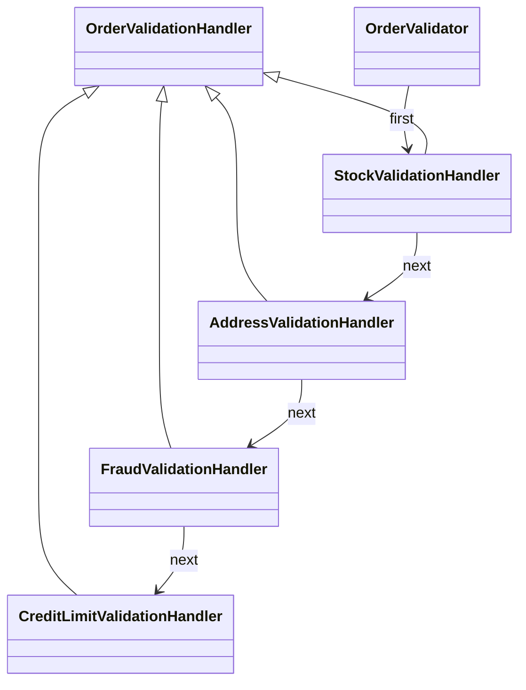

# ChainOfResponsibility

## Intent

Chain of Responsibility passes a request through ordered handlers until one
handles it or the chain is exhausted, separating checks into independent
steps (GoF, chapter 5).

## The smell

`OrderValidator.Validate` combined stock, address, fraud, and credit checks in
one nested method. The baseline marker is in
[`OrderValidator.cs`](../../../baseline/src/CornerStore/Checkout/OrderValidator.cs).

## The refactor

`OrderValidator` creates an ordered chain: `StockValidationHandler`,
`AddressValidationHandler`, `FraudValidationHandler`, then
`CreditLimitValidationHandler`. Each handler returns an error to stop the
chain or passes the context to the next handler. Stock validation still groups
duplicate SKUs and checks them in ordinal order.

## Diff highlights

Validation now uses four short-circuit handlers in the original order. The
first error text, deterministic stock aggregation, and checkout transcript
remain unchanged. See [DIFF.md](DIFF.md) for the source and test changes.

## Trade-offs

Each rule adds a handler and chain composition. This pattern is unnecessary
when the checks are few, fixed, and unlikely to change independently; a direct
method can be simpler in that case.

## Related patterns and common confusions

Chain of Responsibility passes a request between handlers that may stop or
forward it. Decorator wraps an object to add behavior while preserving its
interface. A chain may end without handling a request, while a decorator
always wraps the next component.

## Modern .NET notes

ASP.NET Core middleware uses a related request pipeline with ordered
short-circuiting. This example keeps handlers in the domain layer and does not
depend on a web framework.

## Files changed

* `src/CornerStore/Checkout/OrderValidationContext.cs`
* `src/CornerStore/Checkout/OrderValidationHandler.cs`
* `src/CornerStore/Checkout/StockValidationHandler.cs`
* `src/CornerStore/Checkout/AddressValidationHandler.cs`
* `src/CornerStore/Checkout/FraudValidationHandler.cs`
* `src/CornerStore/Checkout/CreditLimitValidationHandler.cs`
* `src/CornerStore/Checkout/OrderValidator.cs`
* `src/CornerStore/CornerStore.csproj`
* `tests/CornerStore.Tests/ChainOfResponsibilityTests.cs`

## Blog post link

To be published.
