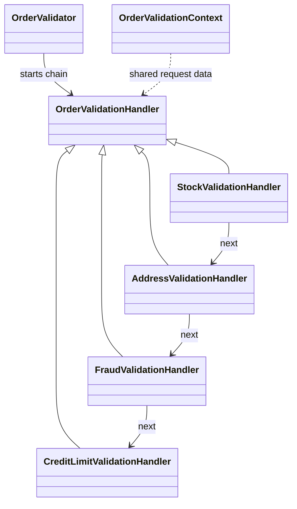
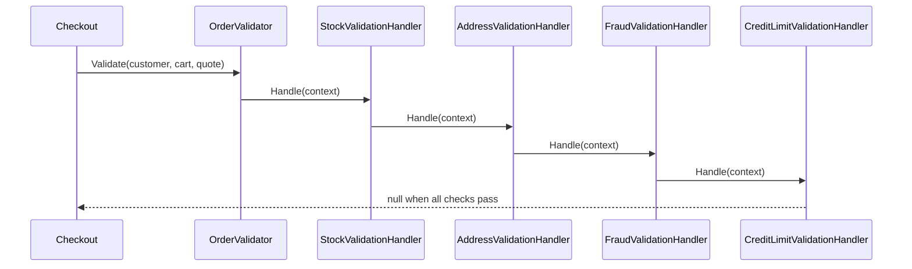

# Chain of Responsibility

## At a glance

| | |
| --- | --- |
| Intent | Pass a request through ordered handlers so each check can accept it, reject it, or pass it on. |
| Category | Behavioral |
| Smell fixed | S13: stock, address, fraud, and credit checks were nested in one validation method. |
| GoF chapter | Chapter 5, "Behavioral Patterns." |
| Files changed | `src/CornerStore/Checkout/AddressValidationHandler.cs`, `src/CornerStore/Checkout/CreditLimitValidationHandler.cs`, `src/CornerStore/Checkout/FraudValidationHandler.cs`, `src/CornerStore/Checkout/OrderValidationContext.cs`, `src/CornerStore/Checkout/OrderValidationHandler.cs`, `src/CornerStore/Checkout/OrderValidator.cs`, `src/CornerStore/Checkout/StockValidationHandler.cs`, `src/CornerStore/CornerStore.csproj`, `tests/CornerStore.Tests/ChainOfResponsibilityTests.cs` ([DIFF.md](DIFF.md)) |
| File count | 9 files ([DIFF.md](DIFF.md)) |
| Previous pattern | [Proxy](../../structural/proxy/README.md) |
| Next pattern | [Command](../command/README.md) |

## The problem

The baseline combines stock, address, fraud, and credit checks in one nested method. The order of checks determines which error is reported first, and mixing each rule into one method makes the validation flow harder to change. The smell is in [baseline `OrderValidator.cs`](../../../baseline/src/CornerStore/Checkout/OrderValidator.cs).

```csharp
string? error = null;
var requestedStock = new Dictionary<string, int>(StringComparer.Ordinal);
foreach (var line in cart.Lines)
{
    requestedStock[line.Product.Sku] = requestedStock.GetValueOrDefault(line.Product.Sku) + line.Quantity;
}
```

## The pattern

Each handler owns one validation rule. A handler either returns its error or passes the same validation context to the next handler. The chain keeps the check order explicit and short-circuits on the first failure.

| Role | CornerStore participant |
| --- | --- |
| Client | `StoreConsole`, through `OrderValidator` |
| Chain composer | `OrderValidator` |
| Handler contract | `OrderValidationHandler` |
| Shared request data | `OrderValidationContext` |
| Concrete handlers | `StockValidationHandler`, `AddressValidationHandler`, `FraudValidationHandler`, `CreditLimitValidationHandler` |

## The refactor

`OrderValidator` now composes stock, address, fraud, and credit handlers in that order. Stock validation still groups repeated SKUs and checks them in ordinal order, preserving deterministic behavior and the first-error result.

Before, [`baseline OrderValidator.cs`](../../../baseline/src/CornerStore/Checkout/OrderValidator.cs) held all checks together:

```csharp
if (error is null)
{
    if (customer.Address == "")
    {
        error = "address required";
    }
```

After, [`OrderValidator.cs`](src/CornerStore/Checkout/OrderValidator.cs) delegates the context to the first handler:

```csharp
return firstHandler.Handle(new OrderValidationContext(customer, cart, quote));
```



## How it runs

During checkout, `OrderValidator.Validate` creates one context and sends it to the stock handler. If stock is sufficient, each handler forwards it in order. The first failed check returns its error; if all handlers pass, validation returns no error.



## Run it

Run these commands from the repository root. All three were verified for this solution.

```powershell
dotnet build .\patterns\behavioral\chain-of-responsibility\ChainOfResponsibility.slnx
dotnet test .\patterns\behavioral\chain-of-responsibility\ChainOfResponsibility.slnx
dotnet run --project .\patterns\behavioral\chain-of-responsibility\src\CornerStore\CornerStore.csproj -- .\scenarios\trading-day.json
```

## Trade-offs

The chain adds handler types and makes composition part of the design. It is unnecessary when a few checks are fixed and unlikely to change independently; a direct method can be easier to read. The order of handlers also matters because the first failure wins.

## Related patterns

Chain of Responsibility passes a request between handlers that may stop or forward it. [Decorator](../../structural/decorator/README.md) wraps an object to add behavior while preserving its interface. A chain may end without handling a request, while a decorator always wraps the next component. [Command](../command/README.md) packages an operation for dispatch or undo.

## Modern .NET notes

ASP.NET Core middleware uses a related ordered pipeline with short-circuiting. This example keeps the handlers in the domain layer and does not depend on a web framework.

## Further reading

GoF, Chapter 5, "Behavioral Patterns."

Blog post: coming soon <!-- blog-link -->
