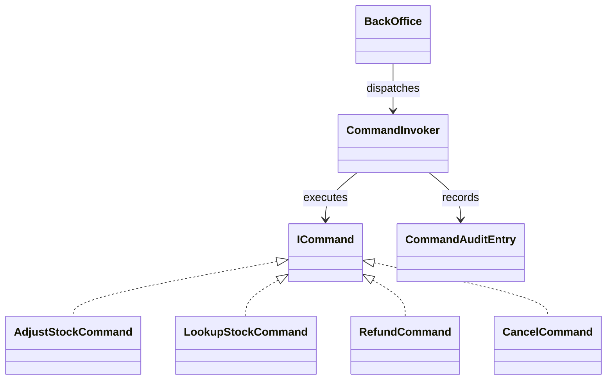

# Command

## Intent

Command packages a request and its receiver details as an object, so callers
can dispatch, record, or reverse an operation without embedding its work in
the caller (GoF, chapter 5).

## The smell

S14 has four back-office operations implemented inline in `BackOffice`. The
baseline markers are in
[`BackOffice.cs`](../../../baseline/src/CornerStore/Orders/BackOffice.cs).

## The refactor

`BackOffice` retains its staff checks and dispatches stock adjustment, stock
lookup, refund, and cancellation commands through `CommandInvoker`. The invoker
records each result in an in-memory audit log. A stock adjustment can be
undone. Lookup is read-only, while refunds and cancellations change order
state and trigger other effects, so those commands explicitly reject undo.
Audit entries do not appear in the business transcript.

## Diff highlights

Each S14 action is represented by a command. The invoker preserves the
existing result text, records audit entries, and supports undo for the
reversible stock adjustment. The staff checks and duplicate stock read remain
unchanged as part of S12. See [DIFF.md](DIFF.md) for the source and test
changes.

## Trade-offs

Commands add a type and dispatch path per operation, plus state for undo and
audit. They are unnecessary for a few simple actions that need neither
queuing, history, nor independent composition. Undo also needs care when an
operation has irreversible effects.

## Related patterns and common confusions

Command encapsulates a request to execute. Strategy selects an algorithm for
the same kind of work. Use Command when the request itself needs dispatch,
audit, or undo; use Strategy when callers choose between interchangeable
algorithms.

See [Command vs Memento for undo](../../../docs/comparisons.md#command-vs-memento-for-undo) for a side-by-side comparison.

## Modern .NET notes

An in-memory command object is enough for this synchronous example. Durable
queues and persistent audit records require additional infrastructure and
reliability decisions beyond the pattern.

## Files changed

* `src/CornerStore/Orders/BackOffice.cs`
* `src/CornerStore/Orders/ICommand.cs`
* `src/CornerStore/Orders/CommandInvoker.cs`
* `src/CornerStore/Orders/CommandAuditEntry.cs`
* `src/CornerStore/Orders/AdjustStockCommand.cs`
* `src/CornerStore/Orders/LookupStockCommand.cs`
* `src/CornerStore/Orders/RefundCommand.cs`
* `src/CornerStore/Orders/CancelCommand.cs`
* `src/CornerStore/CornerStore.csproj`
* `tests/CornerStore.Tests/CommandTests.cs`

## Blog post link

To be published.
