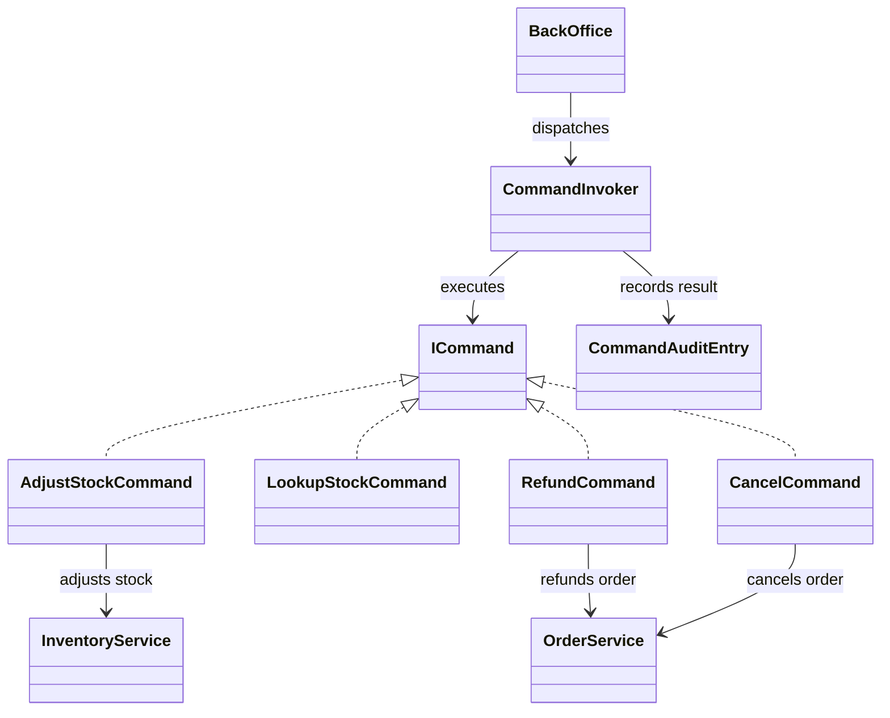
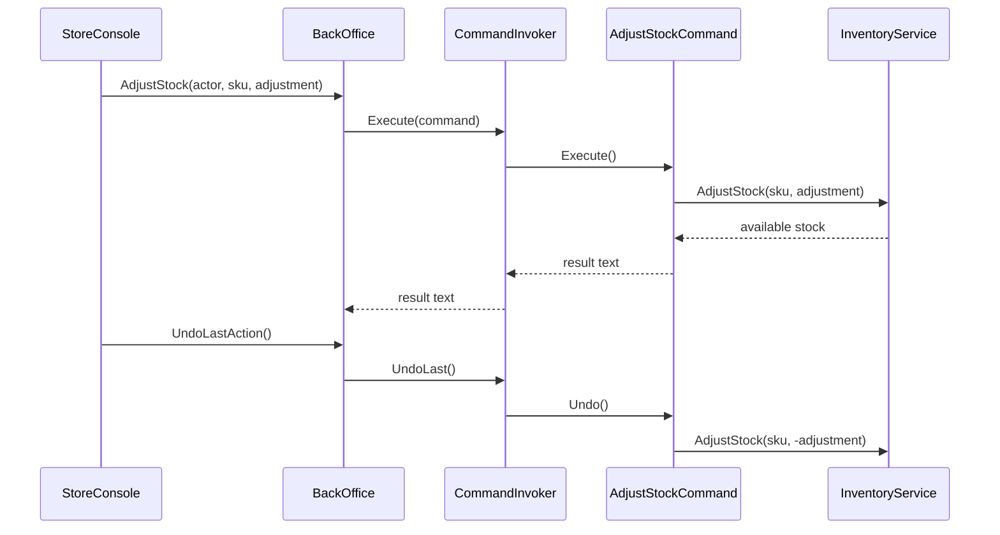

# Command

## At a glance

| | |
| --- | --- |
| Intent | Package an operation as an object so it can be dispatched, audited, or undone independently of the caller. |
| Category | Behavioral |
| Smell fixed | S14: back-office operations ran inline without command objects, an audit trail, or undo. |
| GoF chapter | Chapter 5, "Behavioral Patterns." |
| Files changed | `src/CornerStore/CornerStore.csproj`, `src/CornerStore/Orders/AdjustStockCommand.cs`, `src/CornerStore/Orders/BackOffice.cs`, `src/CornerStore/Orders/CancelCommand.cs`, `src/CornerStore/Orders/CommandAuditEntry.cs`, `src/CornerStore/Orders/CommandInvoker.cs`, `src/CornerStore/Orders/ICommand.cs`, `src/CornerStore/Orders/LookupStockCommand.cs`, `src/CornerStore/Orders/RefundCommand.cs`, `tests/CornerStore.Tests/CommandTests.cs` ([DIFF.md](DIFF.md)) |
| File count | 10 files ([DIFF.md](DIFF.md)) |
| Previous pattern | [Chain of Responsibility](../chain-of-responsibility/README.md) |
| Next pattern | [Interpreter](../interpreter/README.md) |

## The problem

In the baseline, `BackOffice` performs stock adjustment, stock lookup, refunds, and cancellations directly. The action logic cannot be independently recorded or reversed without adding more coordination to the back-office service. The smell is in [baseline `BackOffice.cs`](../../../baseline/src/CornerStore/Orders/BackOffice.cs).

```csharp
var stock = inventory.AdjustStock(sku, adjustment);
return "stock " + sku + " adjusted by " + adjustment.ToString(System.Globalization.CultureInfo.InvariantCulture)
    + ", now " + stock.ToString(System.Globalization.CultureInfo.InvariantCulture);
```

## The pattern

A command object carries the details needed to perform an operation. The invoker calls the command, records its result, and can ask a reversible command to undo its work. The receiver remains responsible for the actual domain operation.

| Role | CornerStore participant |
| --- | --- |
| Client | `BackOffice` |
| Command contract | `ICommand` |
| Invoker | `CommandInvoker` |
| Concrete commands | `AdjustStockCommand`, `LookupStockCommand`, `RefundCommand`, `CancelCommand` |
| Receivers | `InventoryService` and `OrderService` |
| Audit record | `CommandAuditEntry` |

## The refactor

`BackOffice` retains its staff authorization checks and sends each allowed action to `CommandInvoker`. The invoker records command results, but audit entries do not appear in the business transcript. Stock adjustment can be undone; lookup is read-only, while refund and cancellation explicitly reject undo because they trigger other effects. The existing duplicate stock read remains part of the separate S12 smell.

Before, [`baseline BackOffice.cs`](../../../baseline/src/CornerStore/Orders/BackOffice.cs) performed the adjustment inline:

```csharp
var stock = inventory.AdjustStock(sku, adjustment);
```

After, [`BackOffice.cs`](src/CornerStore/Orders/BackOffice.cs) creates a command and dispatches it:

```csharp
return commandInvoker.Execute(new AdjustStockCommand(inventory, sku, adjustment));
```



## How it runs

For a staff stock adjustment, `BackOffice` checks the actor, creates an `AdjustStockCommand`, and passes it to the invoker. The invoker executes it, records its result, and remembers it as the latest command. An undo request checks that the latest command allows undo, reverses the adjustment, and records the undo result.



## Run it

Run these commands from the repository root. All three were verified for this solution.

```powershell
dotnet build .\patterns\behavioral\command\Command.slnx
dotnet test .\patterns\behavioral\command\Command.slnx
dotnet run --project .\patterns\behavioral\command\src\CornerStore\CornerStore.csproj -- .\scenarios\trading-day.json
```

## Trade-offs

Commands add a type and dispatch path for each operation, plus state for undo and audit. They are unnecessary for a few simple actions that need neither history, queuing, nor independent composition. Undo also needs care when an operation has irreversible effects.

## Related patterns

[Command vs Memento for undo](../../../docs/comparisons.md#command-vs-memento-for-undo) explains the distinction between recording an action and preserving state. [Memento](../memento/README.md) keeps an originator's snapshot opaque to its caretaker. [Strategy](../strategy/README.md) selects an interchangeable algorithm rather than representing a request.

## Modern .NET notes

An in-memory command object is sufficient for this synchronous example. Durable queues and persistent audit records require additional infrastructure and reliability decisions beyond the pattern.

## Further reading

GoF, Chapter 5, "Behavioral Patterns."

Blog post: coming soon <!-- blog-link -->
