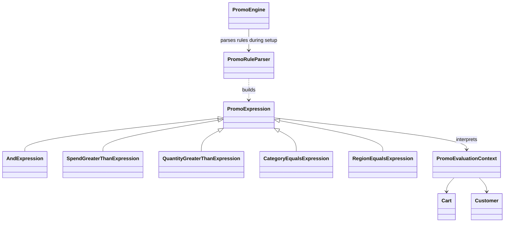
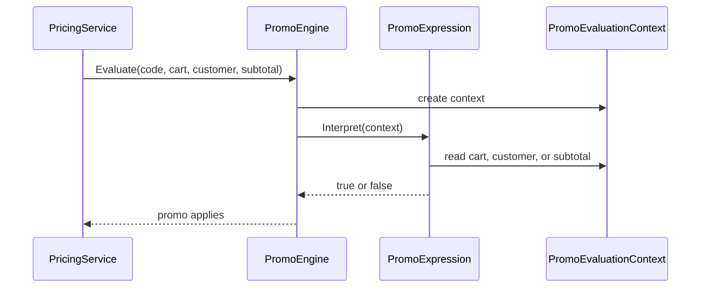

# Interpreter

## At a glance

| | |
| --- | --- |
| Intent | Represent a small grammar as expressions that can be parsed and evaluated against domain data. |
| Category | Behavioral |
| Smell fixed | S15: promo rule strings were parsed with `Split` and `IndexOf` every time they were evaluated. |
| GoF chapter | Chapter 5, "Behavioral Patterns." |
| Files changed | `src/CornerStore/CornerStore.csproj`, `src/CornerStore/Pricing/PromoEngine.cs`, `src/CornerStore/Pricing/PromoEvaluationContext.cs`, `src/CornerStore/Pricing/PromoExpression.cs`, `src/CornerStore/Pricing/PromoRuleParser.cs`, `tests/CornerStore.Tests/InterpreterTests.cs` ([DIFF.md](DIFF.md)) |
| Previous pattern | [Command](../command/README.md) |
| Next pattern | [Iterator](../iterator/README.md) |

## The problem

The baseline parses configured promo rules such as `SPEND>100 AND CATEGORY=Shoes` with string splitting and character searches on every evaluation. The parsing logic and the meaning of each rule are interleaved in `PromoEngine`. The smell is in [baseline `PromoEngine.cs`](../../../baseline/src/CornerStore/Pricing/PromoEngine.cs).

```csharp
var terms = Promos[code].Rule.Split(" AND ");
foreach (var term in terms)
{
    var greater = term.IndexOf('>');
```

## The pattern

Interpreter turns each rule into expression objects that implement the grammar. A parser builds the expression tree once when promo definitions are initialized. The engine later evaluates that tree using a context containing the cart, customer, and subtotal.

| Role | CornerStore participant |
| --- | --- |
| Client and expression context provider | `PromoEngine` |
| Grammar parser | `PromoRuleParser` |
| Expression contract | `PromoExpression` |
| Composite expression | `AndExpression` |
| Terminal expressions | `SpendGreaterThanExpression`, `QuantityGreaterThanExpression`, `CategoryEqualsExpression`, `RegionEqualsExpression` |
| Evaluation data | `PromoEvaluationContext` |

The supported grammar is a sequence of predicates joined by `AND`:

```text
rule       ::= predicate (whitespace "AND" whitespace predicate)*
predicate  ::= "SPEND>" number
             | "QTY>" number
             | "CATEGORY=" identifier
             | "REGION=" identifier
number     ::= digits ("." digits)?
identifier ::= letter (letter | digit | "_" | "-")*
```

Whitespace may surround a predicate operator and operand. Numbers use invariant-culture decimal notation. `SPEND` and `QTY` use strict greater-than comparisons; quantity is summed across cart lines, category succeeds when any line matches, and region must equal the customer's region. The parser preserves the original rule string for display.

## The refactor

`PromoRuleParser` converts configured rule text to an expression tree during promo initialization. `PromoEngine.Evaluate` builds a `PromoEvaluationContext` and asks the stored expression to interpret it. The original text remains available for display.

Before, [`baseline PromoEngine.cs`](../../../baseline/src/CornerStore/Pricing/PromoEngine.cs) split the rule on each evaluation:

```csharp
var terms = Promos[code].Rule.Split(" AND ");
```

After, [`PromoEngine.cs`](src/CornerStore/Pricing/PromoEngine.cs) evaluates the stored expression:

```csharp
var context = new PromoEvaluationContext(cart, customer, subtotal);
return Promos[code].Expression.Interpret(context);
```



## How it runs

When pricing evaluates a promo, the engine creates the context and calls `Interpret` on the stored root expression. An `AndExpression` evaluates both predicates with short-circuiting. A terminal expression reads the relevant subtotal, cart, or customer property and returns whether that predicate matches.



## Run it

Run these commands from the repository root. All three were verified for this solution.

```powershell
dotnet build .\patterns\behavioral\interpreter\Interpreter.slnx
dotnet test .\patterns\behavioral\interpreter\Interpreter.slnx
dotnet run --project .\patterns\behavioral\interpreter\src\CornerStore\CornerStore.csproj -- .\scenarios\trading-day.json
```

## Trade-offs

Each grammar rule needs parsing logic and an expression type. Interpreter is unnecessary for a few fixed rules that read more clearly as ordinary code, and it is a poor fit for a large or frequently changing language that needs a dedicated parser or rules engine.

## Related patterns

[Composite](../../structural/composite/README.md) represents individual objects and groups through one component contract; the expression tree here uses composition to represent grammar structure. [Strategy](../strategy/README.md) selects an algorithm for an operation, while Interpreter evaluates expressions in a language.

## Modern .NET notes

These expression objects are ordinary domain types. `System.Linq.Expressions` provides expression trees for building and inspecting executable code, but it is not needed for this small promo-rule grammar.

## Further reading

GoF, Chapter 5, "Behavioral Patterns."

Blog post: coming soon <!-- blog-link -->
