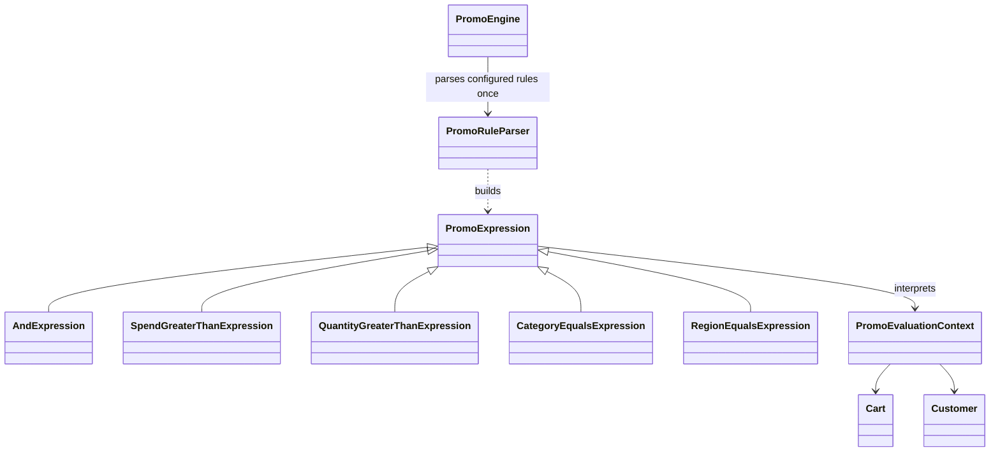

# Interpreter

## Intent

Interpreter represents a small language with grammar rules and expression objects that evaluate those rules. The pattern is described in Chapter 5, "Behavioral Patterns," of *Design Patterns: Elements of Reusable Object-Oriented Software*.

## The smell

S15 parses promo rules such as `SPEND>100 AND CATEGORY=Shoes` with `Split` and `IndexOf` whenever a promotion is evaluated.

## The refactor

`PromoRuleParser` reads the configured rule grammar and builds an expression tree once when the promo definitions are initialized. `AndExpression` composes predicate expressions for spending threshold, quantity, category and customer region. The tree interprets a `PromoEvaluationContext` containing the cart, customer and subtotal. Original rule strings remain available to the transcript.

The grammar accepts one or more predicates separated by `AND`:

```text
rule       ::= predicate (whitespace "AND" whitespace predicate)*
predicate  ::= "SPEND>" number
             | "QTY>" number
             | "CATEGORY=" identifier
             | "REGION=" identifier
number     ::= digits ("." digits)?
identifier ::= letter (letter | digit | "_" | "-")*
whitespace ::= one or more whitespace characters
```

Whitespace may also surround a predicate operator and operand. The numeric grammar uses invariant-culture decimal notation. `SPEND` and `QTY` use strict greater-than comparisons. Quantity is summed across cart lines, category succeeds when any line matches, and region must equal the customer's region.



## Diff highlights

Promo definitions now store both their original display text and a parsed expression. Evaluation interprets the existing expression tree instead of splitting and inspecting rule text on each call. See [DIFF.md](DIFF.md) for the source and test changes.

## Trade-offs

Each grammar rule needs a parser path and an expression type, and new language features add both. Interpreter is unnecessary for a few fixed rules that are clearer as ordinary code. It is also a poor fit for a large or frequently changing language, where a dedicated parser or rules engine is more suitable.

## Related patterns and common confusions

Interpreter evaluates sentences in a defined language. Command packages an operation to execute, while Interpreter focuses on the meaning of expressions in a grammar. The expressions form a small tree because the current rules support conjunction, not a general-purpose logical language.

## Modern .NET notes

The expression objects here are ordinary domain types. `System.Linq.Expressions` provides expression trees for building and inspecting executable code, but it is not needed for this small promo-rule grammar.

## Files changed

* `src/CornerStore/CornerStore.csproj`
* `src/CornerStore/Pricing/PromoEngine.cs`
* `src/CornerStore/Pricing/PromoEvaluationContext.cs`
* `src/CornerStore/Pricing/PromoExpression.cs`
* `src/CornerStore/Pricing/PromoRuleParser.cs`
* `tests/CornerStore.Tests/InterpreterTests.cs`

## Blog post link

To be published.
