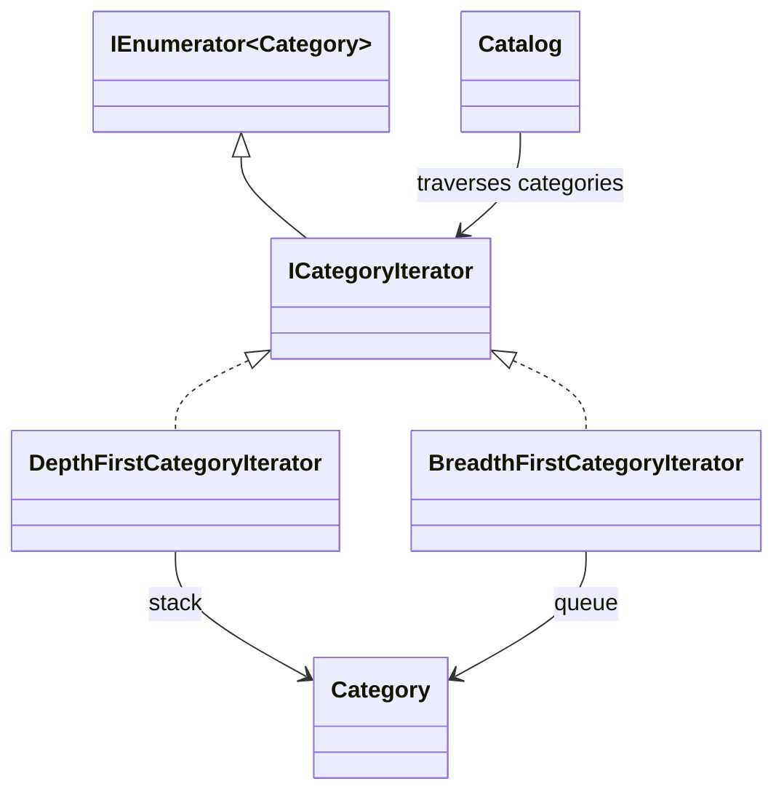

# Iterator

## Intent

Iterator lets clients visit the elements of a collection in sequence without
depending on how that collection is represented (GoF, chapter 5).

## The smell

`Catalog.PrintTree`, `CountProducts`, and `CollectSkus` each manually recursed
through category children. The S16 markers are in
[`Catalog.cs`](../../../baseline/src/CornerStore/Catalog/Catalog.cs).

## The refactor

`ICategoryIterator` follows the .NET `IEnumerator<Category>` protocol and
reports traversal depth for display. `DepthFirstCategoryIterator` uses a
stack; `BreadthFirstCategoryIterator` uses a queue. Catalog's existing browse,
count, and SKU collection operations use the depth-first iterator, preserving
the original parent-first order and sibling order.

## Diff highlights

Three recursive walks now consume the same depth-first traversal protocol.
The breadth-first iterator is available for level-order consumers and has a
separate ordering test. Existing browse output, product count, and import SKU
order remain unchanged. See [DIFF.md](DIFF.md) for the exact changes.

## Trade-offs

Explicit iterator state adds code for lifecycle and traversal order. It is
unnecessary for a small collection with one simple traversal, where a direct
loop is easier to read.

## Related patterns and common confusions

Iterator controls how a collection is traversed without exposing its
representation. Composite represents individual items and groups through a
shared component contract. An iterator can traverse a composite, but the two
patterns solve different problems.

## Modern .NET notes

`IEnumerable<T>` and `yield return` let C# generate an iterator state machine
for straightforward traversals. This example uses explicit
`IEnumerator<T>` implementations to show and test the traversal protocol and
to provide both depth-first and breadth-first behavior.

## Files changed

* `src/CornerStore/Catalog/BreadthFirstCategoryIterator.cs`
* `src/CornerStore/Catalog/Catalog.cs`
* `src/CornerStore/Catalog/DepthFirstCategoryIterator.cs`
* `src/CornerStore/Catalog/ICategoryIterator.cs`
* `src/CornerStore/CornerStore.csproj`
* `tests/CornerStore.Tests/IteratorTests.cs`

## Blog post link

To be published.
