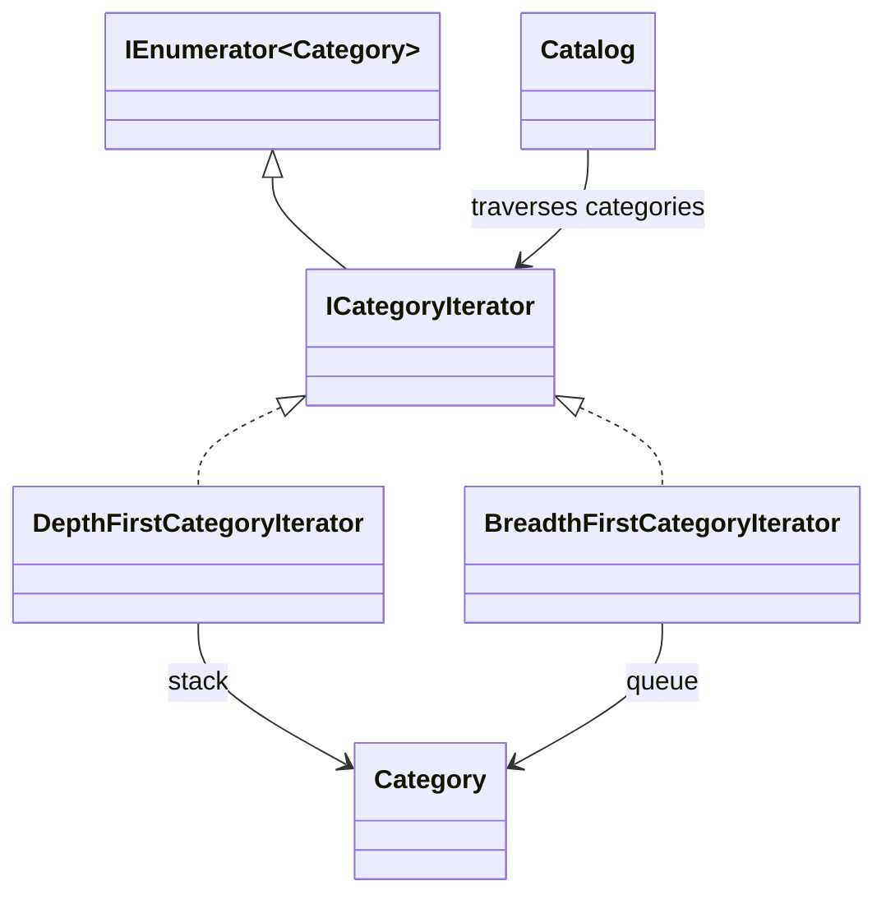

# Iterator

## At a glance

| | |
| --- | --- |
| Intent | Traverse a collection in a defined order without making callers depend on its internal representation. |
| Category | Behavioral |
| Smell fixed | S16: several catalog operations repeated manual recursion through category children. |
| GoF chapter | Chapter 5, "Behavioral Patterns." |
| Files changed | `src/CornerStore/Catalog/BreadthFirstCategoryIterator.cs`, `src/CornerStore/Catalog/Catalog.cs`, `src/CornerStore/Catalog/DepthFirstCategoryIterator.cs`, `src/CornerStore/Catalog/ICategoryIterator.cs`, `src/CornerStore/CornerStore.csproj`, `tests/CornerStore.Tests/IteratorTests.cs` ([DIFF.md](DIFF.md)) |
| Previous pattern | [Interpreter](../interpreter/README.md) |
| Next pattern | [Mediator](../mediator/README.md) |

## The problem

The baseline manually recurses through category children to print the tree, count products, and collect SKUs. Each copy encodes traversal order and depth handling separately. The smell is in [baseline `Catalog.cs`](../../../baseline/src/CornerStore/Catalog/Catalog.cs).

```csharp
foreach (var child in category.Children)
{
    PrintTree(child, depth + 1);
}
```

## The pattern

An iterator owns the state needed to move through a collection and exposes one item at a time. The catalog can use the same traversal protocol for several operations without implementing the recursion each time.

| Role | CornerStore participant |
| --- | --- |
| Collection client | `Catalog` |
| Iterator contract | `ICategoryIterator`, extending `IEnumerator<Category>` and exposing depth |
| Depth-first iterator | `DepthFirstCategoryIterator` |
| Breadth-first iterator | `BreadthFirstCategoryIterator` |
| Elements | `Category` |

## The refactor

`Catalog` now uses a depth-first iterator for printing, counting, and SKU collection. The explicit iterator uses a stack and preserves the original parent-first, sibling order. A breadth-first iterator is also available for level-order traversal and has a separate ordering test. Existing browse output, product count, and import SKU order remain unchanged.

Before, [`baseline Catalog.cs`](../../../baseline/src/CornerStore/Catalog/Catalog.cs) recursively called itself:

```csharp
foreach (var child in category.Children)
{
    count += CountProducts(child);
}
```

After, [`Catalog.cs`](src/CornerStore/Catalog/Catalog.cs) consumes the iterator:

```csharp
using var iterator = new DepthFirstCategoryIterator(category);
while (iterator.MoveNext())
{
    count += iterator.Current.Products.Count;
}
```



## How it runs

For a product count, `Catalog` creates a `DepthFirstCategoryIterator` for the root. Each `MoveNext` advances to the next category; the catalog adds that category's product count until traversal is exhausted. The same iterator also supplies the depth required by tree printing.

## Run it

Run these commands from the repository root. All three were verified for this solution.

```powershell
dotnet build .\patterns\behavioral\iterator\Iterator.slnx
dotnet test .\patterns\behavioral\iterator\Iterator.slnx
dotnet run --project .\patterns\behavioral\iterator\src\CornerStore\CornerStore.csproj -- .\scenarios\trading-day.json
```

## Trade-offs

An explicit iterator adds lifecycle and traversal-order code. It is unnecessary for a small collection with one simple traversal, where a loop or compiler-generated iterator is easier to follow.

## Related patterns

[Composite](../../structural/composite/README.md) gives individual catalog items and groups a shared interface. Iterator can traverse a composite structure, but it answers a different question: how the elements are visited. [Mediator](../mediator/README.md) centralizes coordination among collaborating objects rather than traversing a collection.

## Modern .NET notes

`IEnumerable<T>` and `yield return` let C# generate an iterator state machine for straightforward traversals. This example uses explicit `IEnumerator<T>` implementations to make traversal state visible and to provide both depth-first and breadth-first ordering.

## Further reading

GoF, Chapter 5, "Behavioral Patterns."

Blog post: coming soon <!-- blog-link -->
