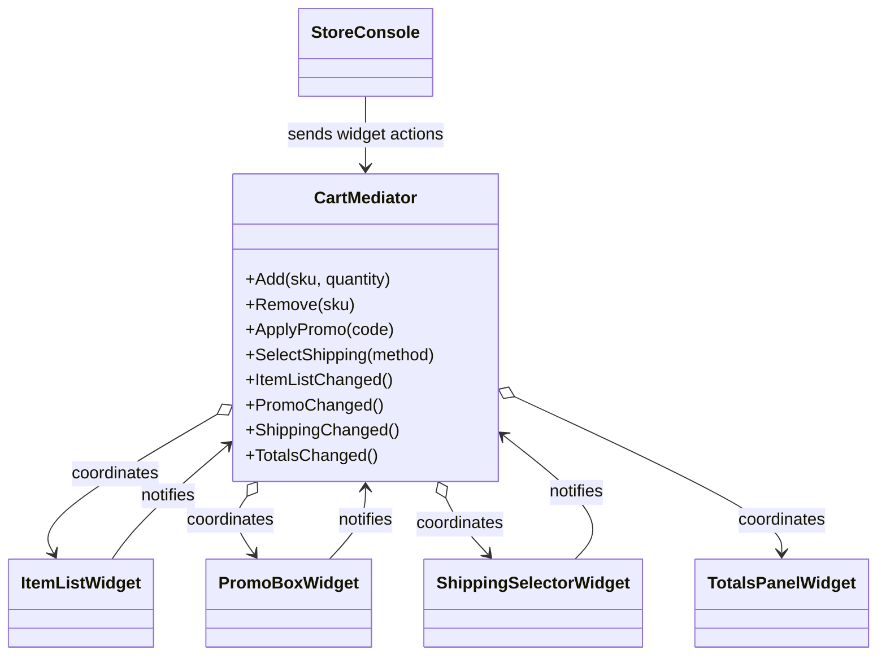

# Mediator

## Intent

Mediator centralizes communication among a group of collaborators. Each collaborator reports changes to the mediator, which decides which peers to update. This example follows the Mediator chapter in *Design Patterns: Elements of Reusable Object-Oriented Software*.

## The smell

S17 cart widgets held references to peer widgets and refreshed them directly. Adding or changing a widget required understanding and editing the other widgets' refresh logic. The markers were in the four classes under `Widgets/`.

## The refactor

`CartMediator` owns the four widgets for a cart. Each widget depends on the mediator, not on its peers. Item, promo and shipping widgets notify the mediator when their state changes. The mediator controls the established refresh order and exposes the widget actions used by `StoreConsole`.

## Diff highlights

The peer fields and four `Connect` methods are removed. `CartMediator` creates the widgets, receives their change notifications, and preserves the refresh sequence for item, promo, shipping and totals changes. See [DIFF.md](DIFF.md).

## Trade-offs

The mediator prevents peer-to-peer coupling but becomes responsible for the coordination rules. It is not needed for a small group of widgets with no cross-updates or when a direct event subscription is enough.

## Related patterns and common confusions

Observer distributes a notification to subscribers without choosing their coordination policy. Mediator centralizes that policy and routes interactions among a known group of collaborators. A mediator can use events internally, but the event mechanism is not the pattern itself.

See [Facade vs Mediator](../../../docs/comparisons.md#facade-vs-mediator) for a side-by-side comparison.

## Modern .NET notes

Interfaces, delegates and events can all carry notifications in .NET. This example uses a concrete mediator because the cart widgets have a small, fixed collaboration group and require ordered updates.

## Files changed

* `src/CornerStore/CornerStore.csproj`
* `src/CornerStore/StoreConsole.cs`
* `src/CornerStore/Widgets/CartMediator.cs`
* `src/CornerStore/Widgets/ItemListWidget.cs`
* `src/CornerStore/Widgets/PromoBoxWidget.cs`
* `src/CornerStore/Widgets/ShippingSelectorWidget.cs`
* `src/CornerStore/Widgets/TotalsPanelWidget.cs`
* `tests/CornerStore.Tests/MediatorTests.cs`

## Blog post link

To be published.
