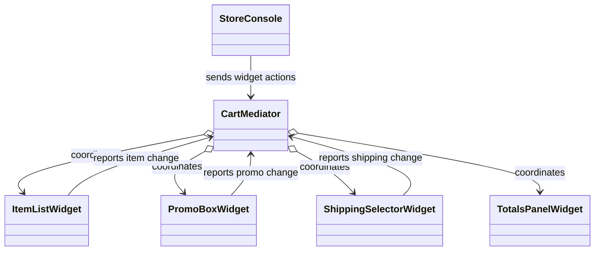
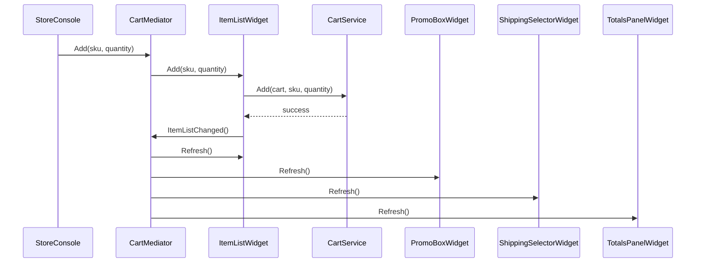

# Mediator

## At a glance

| | |
| --- | --- |
| Intent | Centralize coordination among a group of collaborators so they do not need direct references to one another. |
| Category | Behavioral |
| Smell fixed | S17: cart widgets directly referenced peers and refreshed them after changes. |
| GoF chapter | Chapter 5, "Behavioral Patterns." |
| Files changed | `src/CornerStore/CornerStore.csproj`, `src/CornerStore/StoreConsole.cs`, `src/CornerStore/Widgets/CartMediator.cs`, `src/CornerStore/Widgets/ItemListWidget.cs`, `src/CornerStore/Widgets/PromoBoxWidget.cs`, `src/CornerStore/Widgets/ShippingSelectorWidget.cs`, `src/CornerStore/Widgets/TotalsPanelWidget.cs`, `tests/CornerStore.Tests/MediatorTests.cs` ([DIFF.md](DIFF.md)) |
| File count | 8 files ([DIFF.md](DIFF.md)) |
| Previous pattern | [Iterator](../iterator/README.md) |
| Next pattern | [Memento](../memento/README.md) |

## The problem

In the baseline, each cart widget holds references to other widgets and refreshes peers directly after a change. Updating the group requires understanding the dependencies and refresh order across several classes. The smell appears in the baseline widget files, including [baseline `ItemListWidget.cs`](../../../baseline/src/CornerStore/Widgets/ItemListWidget.cs).

```csharp
public void RefreshAfterChange()
{
    // SMELL S17: this widget refreshes its peers directly after a cart change
    Refresh();
    promoBox?.Refresh();
    shippingSelector?.Refresh();
    totalsPanel?.Refresh();
}
```

## The pattern

Widgets report changes to a mediator instead of coordinating their peers. The mediator owns the collaboration group and decides which widgets to refresh and in what order.

| Role | CornerStore participant |
| --- | --- |
| Client | `StoreConsole` |
| Mediator | `CartMediator` |
| Colleague widgets | `ItemListWidget`, `PromoBoxWidget`, `ShippingSelectorWidget`, `TotalsPanelWidget` |
| Shared cart operations | `CartService`, `PricingService`, and `PromoEngine` used by the mediator and widgets |

## The refactor

`CartMediator` constructs and coordinates the four widgets for a cart. The widgets' peer fields and `Connect` methods are removed. Widgets notify the mediator when their state changes; `StoreConsole` sends widget actions through it. The mediator preserves the established refresh order for each kind of change.

Before, [`baseline ItemListWidget.cs`](../../../baseline/src/CornerStore/Widgets/ItemListWidget.cs) refreshed its peers itself:

```csharp
promoBox?.Refresh();
shippingSelector?.Refresh();
totalsPanel?.Refresh();
```

After, [`ItemListWidget.cs`](src/CornerStore/Widgets/ItemListWidget.cs) reports a successful change:

```csharp
if (error is null)
{
    mediator.ItemListChanged();
}
```



## How it runs

When an item is added, `StoreConsole` calls the cart mediator. The mediator calls `ItemListWidget.Add`; after a successful cart update, that widget calls `ItemListChanged`. The mediator then refreshes the item list, promo, shipping, and totals widgets in the original order.



## Run it

Run these commands from the repository root. All three were verified for this solution.

```powershell
dotnet build .\patterns\behavioral\mediator\Mediator.slnx
dotnet test .\patterns\behavioral\mediator\Mediator.slnx
dotnet run --project .\patterns\behavioral\mediator\src\CornerStore\CornerStore.csproj -- .\scenarios\trading-day.json
```

## Trade-offs

The mediator removes peer-to-peer coupling but becomes responsible for the coordination rules. It is unnecessary for a small group with no cross-updates, or when a direct event subscription expresses the relationship clearly.

## Related patterns

[Facade vs Mediator](../../../docs/comparisons.md#facade-vs-mediator) contrasts a caller-facing subsystem entry point with coordination among peers. [Facade](../../structural/facade/README.md) provides a simplified entry point to a subsystem; [Observer](../observer/README.md) distributes notifications without defining the group coordination policy.

## Modern .NET notes

Interfaces, delegates, and events can carry notifications in .NET. This example uses a concrete mediator because the widgets form a small, fixed group with ordered updates.

## Further reading

GoF, Chapter 5, "Behavioral Patterns."

Blog post: coming soon <!-- blog-link -->
