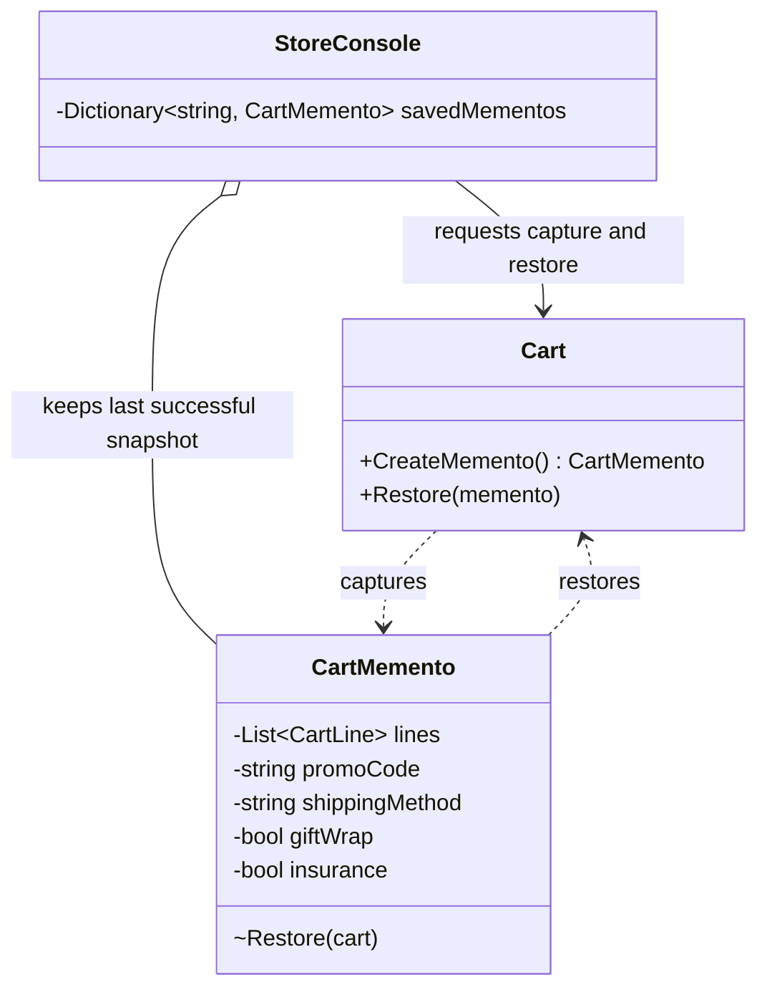

# Memento

## Intent

Memento lets an object preserve and restore its state without exposing the snapshot's details to the object that keeps it. The pattern is described in Chapter 5, "Behavioral Patterns," of *Design Patterns: Elements of Reusable Object-Oriented Software*.

## The smell

S18 lets `StoreConsole` copy and restore each cart field to implement undo. The caller must know the cart's mutable fields and every field in each cart line.

## The refactor

`Cart` captures and restores a `CartMemento`. The memento stores cart values privately and receives a defensive copy of the cart lines. `Cart` creates a fresh set of line objects both when capturing and restoring. `StoreConsole` is the caretaker: it keeps one pre-change memento per customer after a successful item change, restores it on undo, then discards it.

## Diff highlights

The caller's five saved-state dictionaries and cart-line copy helper are replaced by one dictionary of opaque mementos. The memento preserves cart values and creates independent cart-line objects when capturing and restoring. See [DIFF.md](DIFF.md).

## Trade-offs

Snapshots duplicate state and need a clear lifetime. This implementation keeps one memento per customer and discards it after undo. Memento is unnecessary when the state is small and immutable, or when undo is not required.

## Related patterns and common confusions

Command represents an action that can be executed and potentially undone. Memento preserves an object's state so it can be restored later. A command may use a memento for undo, but the two patterns solve different parts of the problem.

## Modern .NET notes

Immutable records are a natural way to represent snapshot values. A small private snapshot is often simpler than serializing an object graph, especially when only selected fields need restoration.

## Files changed

* `src/CornerStore/Cart/Cart.cs`
* `src/CornerStore/Cart/CartMemento.cs`
* `src/CornerStore/CornerStore.csproj`
* `src/CornerStore/StoreConsole.cs`
* `tests/CornerStore.Tests/MementoTests.cs`

The project file grants the test assembly internal visibility so focused tests can exercise the cart and memento without making them public.

## Blog post link

To be published.
