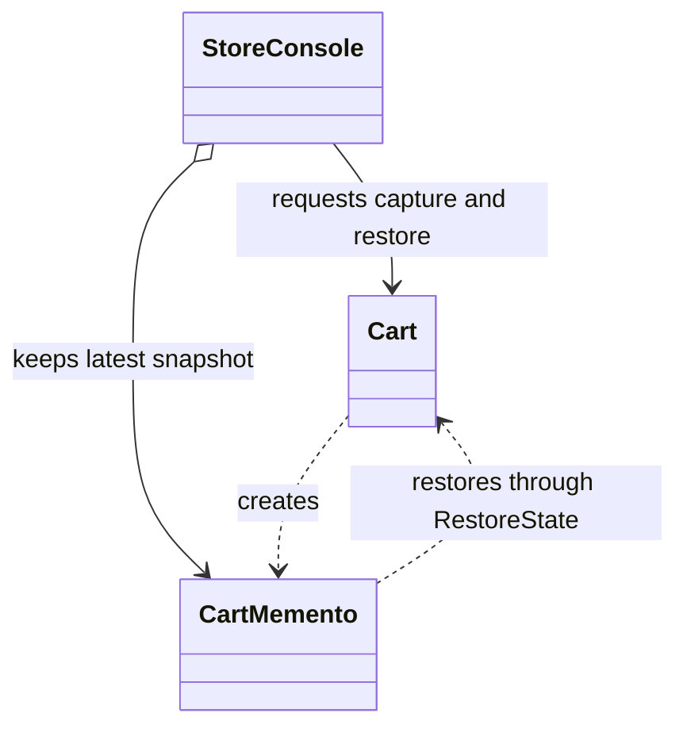
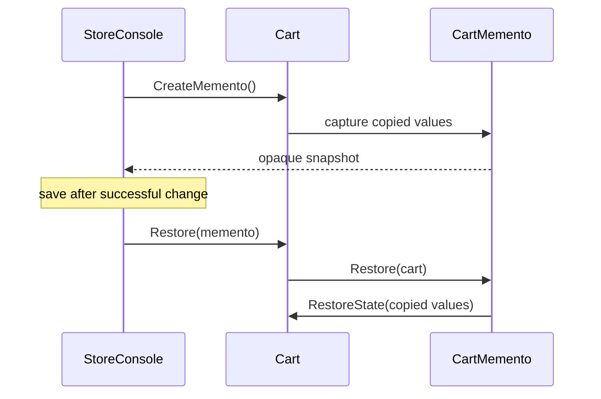

# Memento

## At a glance

| | |
| --- | --- |
| Intent | Let an object capture and restore its state while keeping snapshot details opaque to the object that stores it. |
| Category | Behavioral |
| Smell fixed | S18: `StoreConsole` copied and restored individual cart fields to implement undo. |
| GoF chapter | Chapter 5, "Behavioral Patterns." |
| Files changed | `src/CornerStore/Cart/Cart.cs`, `src/CornerStore/Cart/CartMemento.cs`, `src/CornerStore/CornerStore.csproj`, `src/CornerStore/StoreConsole.cs`, `tests/CornerStore.Tests/MementoTests.cs` ([DIFF.md](DIFF.md)) |
| Previous pattern | [Mediator](../mediator/README.md) |
| Next pattern | [Observer](../observer/README.md) |

## The problem

The baseline lets `StoreConsole` copy and restore each cart field to implement undo. The caller must know the cart's mutable fields and the contents of each cart line, so a change to cart state also changes the undo logic. The smell is in [baseline `StoreConsole.cs`](../../../baseline/src/CornerStore/StoreConsole.cs).

```csharp
cart.Lines = lines;
cart.PromoCode = savedPromo[cart.CustomerId];
cart.ShippingMethod = savedShipping[cart.CustomerId];
cart.GiftWrap = savedGiftWrap[cart.CustomerId];
cart.Insurance = savedInsurance[cart.CustomerId];
```

## The pattern

The originator creates a snapshot containing the state it can restore. A caretaker stores and returns that snapshot without interpreting its contents.

| Role | CornerStore participant |
| --- | --- |
| Originator | `Cart` |
| Memento | `CartMemento` |
| Caretaker | `StoreConsole`, which keeps the latest successful pre-change snapshot per customer |
| Snapshot contents | Cart lines, promo code, shipping method, gift wrap, and insurance |

## The refactor

`Cart.CreateMemento` makes defensive copies of cart lines and stores the relevant values in `CartMemento`. `Cart.Restore` delegates the restoration to that object. `StoreConsole` keeps one memento per customer after a successful item change, restores it on undo, and then discards it. Fresh cart-line objects are created on capture and restore.

Before, [`baseline StoreConsole.cs`](../../../baseline/src/CornerStore/StoreConsole.cs) assigned saved values directly back to the cart:

```csharp
cart.Lines = lines;
cart.PromoCode = savedPromo[cart.CustomerId];
```

After, [`Cart.cs`](src/CornerStore/Cart/Cart.cs) captures a memento:

```csharp
public CartMemento CreateMemento()
{
    return new CartMemento(
        CopyLines(Lines),
        PromoCode,
        ShippingMethod,
        GiftWrap,
        Insurance);
}
```



## How it runs

Before an item change, `StoreConsole` asks the cart for a memento. If the change succeeds, it saves the memento for that customer. On undo, it asks the cart to restore from the saved memento and removes the snapshot from the caretaker's collection.



## Run it

Run these commands from the repository root. All three were verified for this solution.

```powershell
dotnet build .\patterns\behavioral\memento\Memento.slnx
dotnet test .\patterns\behavioral\memento\Memento.slnx
dotnet run --project .\patterns\behavioral\memento\src\CornerStore\CornerStore.csproj -- .\scenarios\trading-day.json
```

## Trade-offs

Snapshots duplicate state and need a clear lifetime. This solution keeps one snapshot per customer and discards it after undo. Memento is unnecessary when state is small and immutable or undo is not needed.

## Related patterns

[Command vs Memento for undo](../../../docs/comparisons.md#command-vs-memento-for-undo) compares an executable action with a saved state. [Command](../command/README.md) can describe and reverse a request; Memento keeps the saved values hidden from the caretaker.

## Modern .NET notes

Immutable records are a natural representation for snapshot values. A private, purpose-built snapshot is often simpler than serializing an object graph when only selected fields need restoration.

The project file grants the test assembly internal visibility so focused tests can exercise the cart and memento without making them public.

## Further reading

GoF, Chapter 5, "Behavioral Patterns."

Blog post: coming soon <!-- blog-link -->
