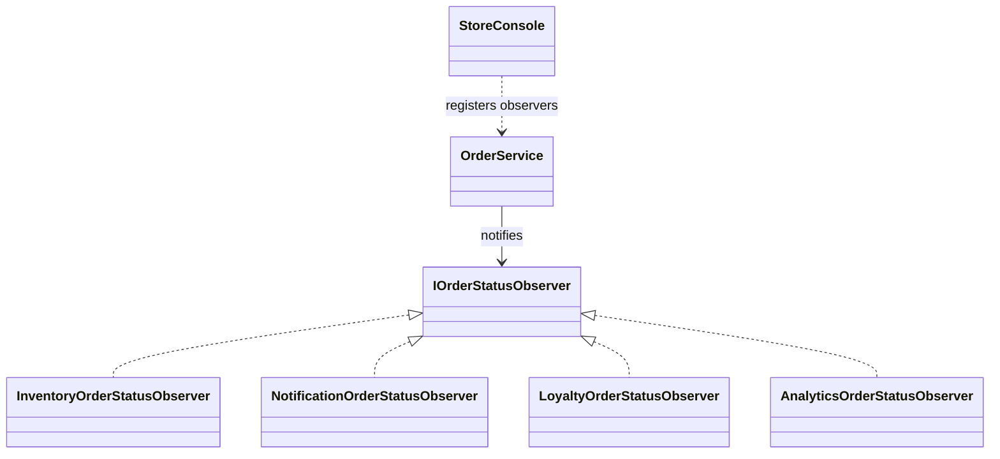

# Observer

## Intent

Observer lets a subject notify a set of interested objects when its state
changes, without owning each reaction directly (GoF, chapter 5).

## The smell

After an order status changed, `OrderService` directly queried inventory and
called notification, loyalty, and analytics services. Adding another reaction
required editing the order service. The baseline marker is in
[`OrderService.cs`](../../../baseline/src/CornerStore/Orders/OrderService.cs).

## The refactor

`OrderService` publishes each successful status change to its registered
`IOrderStatusObserver` instances. `StoreConsole` composes observers for
inventory, notifications, loyalty, and analytics. The ordered list preserves
the existing transcript behavior.

## Diff highlights

Status transitions now notify an ordered observer list instead of calling
each reaction directly. Invalid transitions return before notification.
Existing side effects and the golden-master transcript are unchanged. See
[DIFF.md](DIFF.md) for the source and test changes.

## Trade-offs

Observers add registration and dispatch complexity. Observer is unnecessary
when one fixed reaction always belongs to the subject and there is no need to
add or remove reactions independently.

## Related patterns and common confusions

Observer notifies subscribers about a subject's state changes. Mediator
coordinates interactions among peer objects, often replacing their direct
references to one another. Observers react to a published change; they do not
coordinate the subject's peers.

## Modern .NET notes

The .NET `event` and `EventHandler<TEventArgs>` types provide a built-in
Observer form. `IObservable<T>` and `IObserver<T>` support stream-style
subscriptions. This example uses an explicit internal interface so the
subscription order and domain payload remain visible to the reader.

## Files changed

* `src/CornerStore/Orders/IOrderStatusObserver.cs`
* `src/CornerStore/Orders/InventoryOrderStatusObserver.cs`
* `src/CornerStore/Orders/NotificationOrderStatusObserver.cs`
* `src/CornerStore/Orders/LoyaltyOrderStatusObserver.cs`
* `src/CornerStore/Orders/AnalyticsOrderStatusObserver.cs`
* `src/CornerStore/Orders/OrderService.cs`
* `src/CornerStore/StoreConsole.cs`
* `src/CornerStore/CornerStore.csproj`
* `tests/CornerStore.Tests/ObserverTests.cs`

## Blog post link

To be published.
