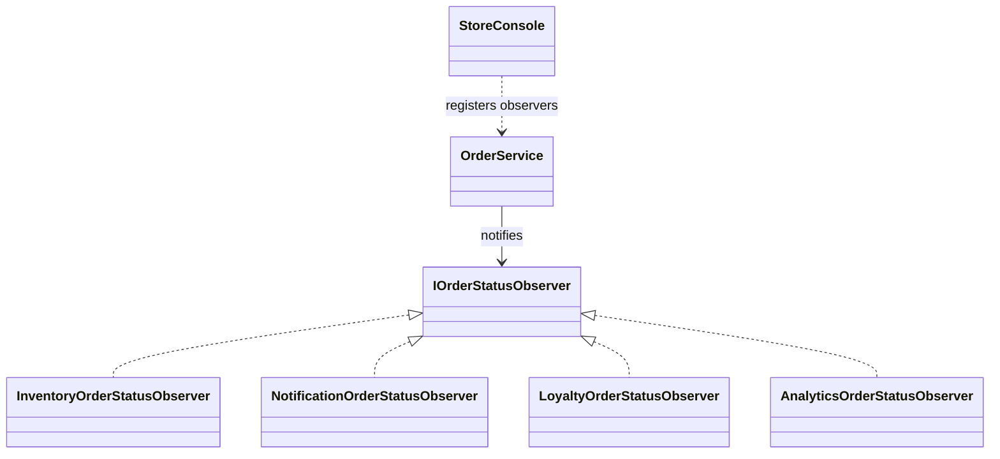
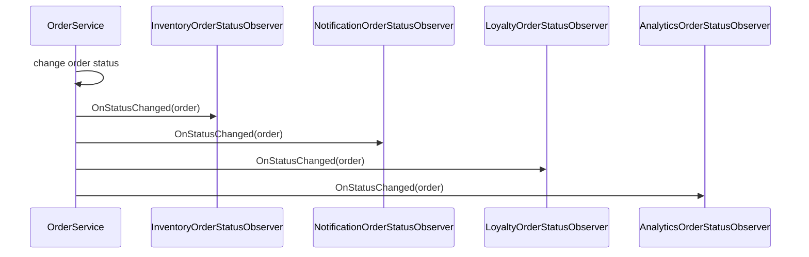

# Observer

## At a glance

| | |
| --- | --- |
| Intent | Notify registered observers when a subject changes so reactions can be added without placing them all in the subject. |
| Category | Behavioral |
| Smell fixed | S19: `OrderService` directly called inventory, notification, loyalty, and analytics reactions after status changes. |
| GoF chapter | Chapter 5, "Behavioral Patterns." |
| Files changed | `src/CornerStore/CornerStore.csproj`, `src/CornerStore/Orders/AnalyticsOrderStatusObserver.cs`, `src/CornerStore/Orders/InventoryOrderStatusObserver.cs`, `src/CornerStore/Orders/IOrderStatusObserver.cs`, `src/CornerStore/Orders/LoyaltyOrderStatusObserver.cs`, `src/CornerStore/Orders/NotificationOrderStatusObserver.cs`, `src/CornerStore/Orders/OrderService.cs`, `src/CornerStore/StoreConsole.cs`, `tests/CornerStore.Tests/ObserverTests.cs` ([DIFF.md](DIFF.md)) |
| Previous pattern | [Memento](../memento/README.md) |
| Next pattern | [State](../state/README.md) |

## The problem

After a status change, the baseline `OrderService` directly checks inventory, sends email or SMS, records loyalty activity, and updates analytics. Adding a new reaction requires editing this service and risks changing the established side-effect order. The smell is in [baseline `OrderService.cs`](../../../baseline/src/CornerStore/Orders/OrderService.cs).

```csharp
loyalty.RecordStatusChange(order);
analytics.RecordStatusChange(order);
```

## The pattern

A subject publishes a change to observers that have subscribed to it. Each observer owns one reaction, while the subject does not need to know its concrete implementation.

| Role | CornerStore participant |
| --- | --- |
| Subject | `OrderService` |
| Observer contract | `IOrderStatusObserver` |
| Concrete observers | `InventoryOrderStatusObserver`, `NotificationOrderStatusObserver`, `LoyaltyOrderStatusObserver`, `AnalyticsOrderStatusObserver` |
| Subscription composition | `StoreConsole` |
| Observed data | The changed `Order` and its current status |

## The refactor

`OrderService` publishes successful status changes to its registered observers. `StoreConsole` subscribes the inventory, notification, loyalty, and analytics observers in the existing order. Invalid transitions still return before observers are notified, and the business transcript remains unchanged.

Before, [`baseline OrderService.cs`](../../../baseline/src/CornerStore/Orders/OrderService.cs) knew and called each reaction:

```csharp
loyalty.RecordStatusChange(order);
analytics.RecordStatusChange(order);
```

After, [`OrderService.cs`](src/CornerStore/Orders/OrderService.cs) dispatches to the observer list:

```csharp
private void NotifyObservers(Order order)
{
    foreach (var observer in observers)
    {
        observer.OnStatusChanged(order);
    }
}
```



## How it runs

When an order changes status successfully, `OrderService` calls `NotifyObservers`. The registered observers receive the order in subscription order and perform their respective inventory, notification, loyalty, or analytics work.



## Run it

Run these commands from the repository root. All three were verified for this solution.

```powershell
dotnet build .\patterns\behavioral\observer\Observer.slnx
dotnet test .\patterns\behavioral\observer\Observer.slnx
dotnet run --project .\patterns\behavioral\observer\src\CornerStore\CornerStore.csproj -- .\scenarios\trading-day.json
```

## Trade-offs

Observers add registration and dispatch complexity. They are unnecessary when one fixed reaction always belongs to the subject and does not need to vary independently. Observer order can also matter when reactions have externally visible effects.

## Related patterns

[Mediator](../mediator/README.md) centralizes coordination among a known group of peers. Observer publishes a change to subscribers without making the subject responsible for choosing a collaboration policy. [Facade vs Mediator](../../../docs/comparisons.md#facade-vs-mediator) provides a related contrast in coordination responsibilities.

## Modern .NET notes

The .NET `event` and `EventHandler<TEventArgs>` types provide a built-in Observer form. `IObservable<T>` and `IObserver<T>` support stream-style subscriptions. This example uses an explicit domain interface so subscription order and payload are visible.

## Further reading

GoF, Chapter 5, "Behavioral Patterns."

Blog post: coming soon <!-- blog-link -->
