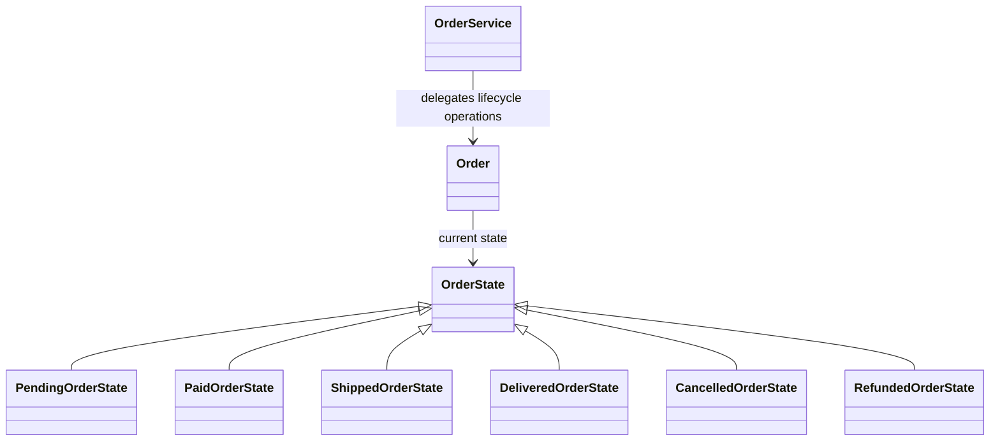
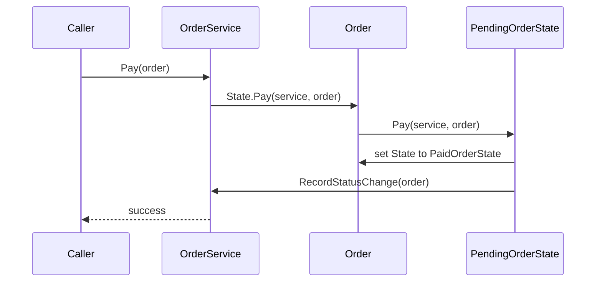

# State

## At a glance

| | |
| --- | --- |
| Intent | Delegate lifecycle operations to an object representing the current state, so allowed behavior changes with that state. |
| Category | Behavioral |
| Smell fixed | S20: order lifecycle methods checked the status string to decide which transitions were allowed. |
| GoF chapter | Chapter 5, "Behavioral Patterns." |
| Files changed | `src/CornerStore/CornerStore.csproj`, `src/CornerStore/Orders/CancelledOrderState.cs`, `src/CornerStore/Orders/DeliveredOrderState.cs`, `src/CornerStore/Orders/Order.cs`, `src/CornerStore/Orders/OrderService.cs`, `src/CornerStore/Orders/OrderState.cs`, `src/CornerStore/Orders/PaidOrderState.cs`, `src/CornerStore/Orders/PendingOrderState.cs`, `src/CornerStore/Orders/RefundedOrderState.cs`, `src/CornerStore/Orders/ShippedOrderState.cs`, `tests/CornerStore.Tests/StateTests.cs` ([DIFF.md](DIFF.md)) |
| Previous pattern | [Observer](../observer/README.md) |
| Next pattern | [Strategy](../strategy/README.md) |

## The problem

The baseline checks `order.Status` in Pay, Ship, Deliver, Cancel, and Refund to decide whether each operation is valid. Each method must encode its own allowed source statuses and status updates. The smell is in [baseline `OrderService.cs`](../../../baseline/src/CornerStore/Orders/OrderService.cs).

```csharp
if (order.Status != "Pending")
{
    return "cannot pay from " + order.Status;
}

order.Status = "Paid";
```

## The pattern

An object delegates state-dependent operations to its current state object. Concrete states implement the transitions they permit; the context stores the current state and exposes its name for existing reporting.

| Role | CornerStore participant |
| --- | --- |
| Context | `Order` |
| State contract | `OrderState` |
| Concrete states | `PendingOrderState`, `PaidOrderState`, `ShippedOrderState`, `DeliveredOrderState`, `CancelledOrderState`, `RefundedOrderState` |
| Operation entry point | `OrderService`, which delegates lifecycle calls to `Order.State` |

## The refactor

`OrderService` delegates Pay, Ship, Deliver, Cancel, and Refund to `Order.State`. Each concrete state owns its valid transitions and uses `OrderService` for shared side effects. Valid transitions, invalid-transition messages, tracking assignment, and stock restoration remain unchanged. `Order.Status` remains a string projection of the state name, preserving reporting and notification output.

Before, [`baseline OrderService.cs`](../../../baseline/src/CornerStore/Orders/OrderService.cs) compared and assigned a string:

```csharp
if (order.Status != "Pending")
{
    return "cannot pay from " + order.Status;
}
```

After, [`OrderService.cs`](src/CornerStore/Orders/OrderService.cs) delegates the operation:

```csharp
public string? Pay(Order order)
{
    return order.State.Pay(this, order);
}
```



## How it runs

For a pending order, `OrderService.Pay` delegates to `PendingOrderState.Pay`. That state replaces itself with `PaidOrderState` and asks the service to record the status change. If an operation is not supported by the current state, the base state returns the existing `cannot <operation> from <status>` error.



## Run it

Run these commands from the repository root. All three were verified for this solution.

```powershell
dotnet build .\patterns\behavioral\state\State.slnx
dotnet test .\patterns\behavioral\state\State.slnx
dotnet run --project .\patterns\behavioral\state\src\CornerStore\CornerStore.csproj -- .\scenarios\trading-day.json
```

## Trade-offs

Each lifecycle state adds a type and transition methods. State can be unnecessary when an object has a few stable statuses and transitions that are unlikely to grow; a small conditional may be clearer.

## Related patterns

[Strategy vs State](../../../docs/comparisons.md#strategy-vs-state) compares algorithm selection with lifecycle behavior. [Strategy](../strategy/README.md) selects an interchangeable algorithm for an operation, while State represents the object's current lifecycle stage and its transitions.

## Modern .NET notes

.NET does not provide a built-in State abstraction. Enums and pattern matching can suit small state sets; state objects help when each state owns substantial behavior.

## Further reading

GoF, Chapter 5, "Behavioral Patterns."

Blog post: coming soon <!-- blog-link -->
