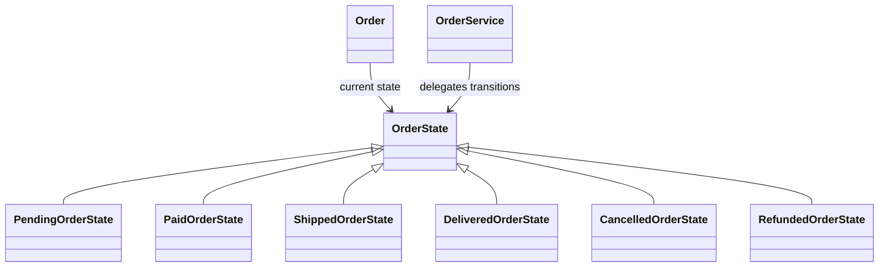

# State

## Intent

State lets an object change its behavior when its internal state changes by
delegating state-specific operations to state objects (GoF, chapter 5).

## The smell

`OrderService` checked the `Status` string in Pay, Ship, Deliver, Cancel, and
Refund to decide which transitions were valid. The baseline marker is in
[`OrderService.cs`](../../../baseline/src/CornerStore/Orders/OrderService.cs).

## The refactor

`Order` holds its current `OrderState`. Each concrete state owns the
transitions it permits and delegates shared side effects to `OrderService`.
`Order.Status` remains a string projection so reporting and notification
output retain their existing contract.

## Diff highlights

The status comparisons have moved into lifecycle state objects. Valid
transitions, invalid-transition messages, tracking assignment, and stock
restoration remain unchanged. See [DIFF.md](DIFF.md) for the source and test
changes.

## Trade-offs

Each lifecycle state adds a type and transition methods. State is unnecessary
when an object has only a few stable statuses and transitions that are unlikely
to grow; a small conditional can be clearer in that case.

## Related patterns and common confusions

State models an object's lifecycle and lets the object transition between
state objects. Strategy packages interchangeable algorithms selected by a
caller; a strategy normally does not represent the object's lifecycle.

See [Strategy vs State](../../../docs/comparisons.md#strategy-vs-state) for a side-by-side comparison.

## Modern .NET notes

The .NET runtime does not provide a built-in State abstraction. Enums and
pattern matching can be a good fit for small state sets, while state objects
help when each state owns substantial behavior.

## Files changed

* `src/CornerStore/Orders/OrderState.cs`
* `src/CornerStore/Orders/PendingOrderState.cs`
* `src/CornerStore/Orders/PaidOrderState.cs`
* `src/CornerStore/Orders/ShippedOrderState.cs`
* `src/CornerStore/Orders/DeliveredOrderState.cs`
* `src/CornerStore/Orders/CancelledOrderState.cs`
* `src/CornerStore/Orders/RefundedOrderState.cs`
* `src/CornerStore/Orders/Order.cs`
* `src/CornerStore/Orders/OrderService.cs`
* `src/CornerStore/CornerStore.csproj`
* `tests/CornerStore.Tests/StateTests.cs`

## Blog post link

To be published.
