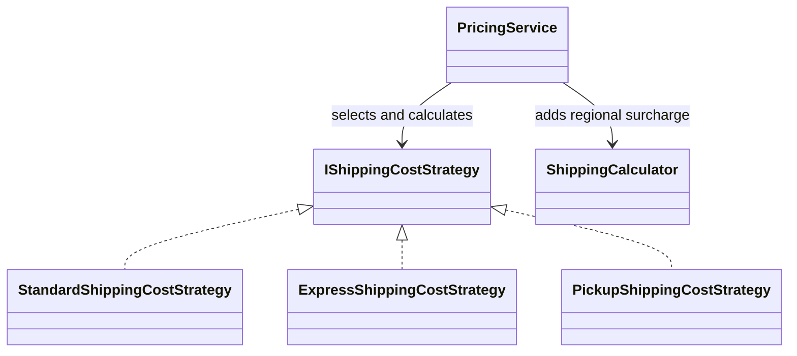

# Strategy

## Intent

Strategy defines interchangeable algorithms behind a common interface so a
caller can select behavior without embedding each algorithm's rules in its own
code (GoF, chapter 5).

## The smell

`PricingService.ShippingCost` used a `switch` to calculate standard, express,
and pickup shipping costs. Adding a method meant changing pricing code, and
the method rules were not independently replaceable. The baseline marker is in
[`PricingService.cs`](../../../baseline/src/CornerStore/Pricing/PricingService.cs).

## The refactor

`PricingService` looks up the selected method in an injected strategy registry
and calls `IShippingCostStrategy.Calculate`. Standard, express, and pickup
implementations own their respective method costs. Regional surcharges remain
in `ShippingCalculator` and are applied after the selected strategy.

## Diff highlights

The shipping-method switch is replaced with an injectable registry. The
existing method costs, unknown-method rejection, and separate AU/NZ surcharge
are preserved. A test-only strategy can be supplied without changing pricing
code. See [DIFF.md](DIFF.md) for the source and test changes.

## Trade-offs

Each method adds a strategy type and selection entry. Strategy is overkill for
two branches that are stable and unlikely to vary; a small conditional can be
clearer when there is no need to replace or extend the algorithms.

## Related patterns and common confusions

Strategy selects an algorithm for a particular operation. State models an
object's lifecycle: its current state controls behavior and may transition to
another state. Strategy objects are normally selected by the caller, while
state transitions belong to the stateful object or its state objects.

## Modern .NET notes

The .NET dependency-injection container can register and provide strategy
implementations, but the pattern does not require a framework. The pricing
service accepts the strategy registry directly so tests and other compositions
can supply their own implementations.

## Files changed

* `src/CornerStore/Pricing/IShippingCostStrategy.cs`
* `src/CornerStore/Pricing/StandardShippingCostStrategy.cs`
* `src/CornerStore/Pricing/ExpressShippingCostStrategy.cs`
* `src/CornerStore/Pricing/PickupShippingCostStrategy.cs`
* `src/CornerStore/Pricing/PricingService.cs`
* `src/CornerStore/CornerStore.csproj`
* `tests/CornerStore.Tests/StrategyTests.cs`

## Blog post link

To be published.
