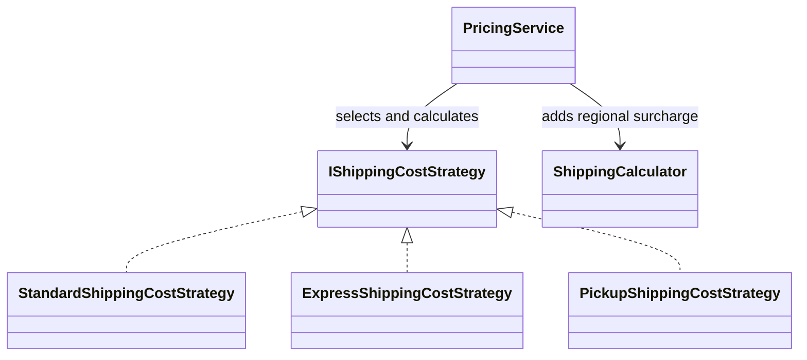
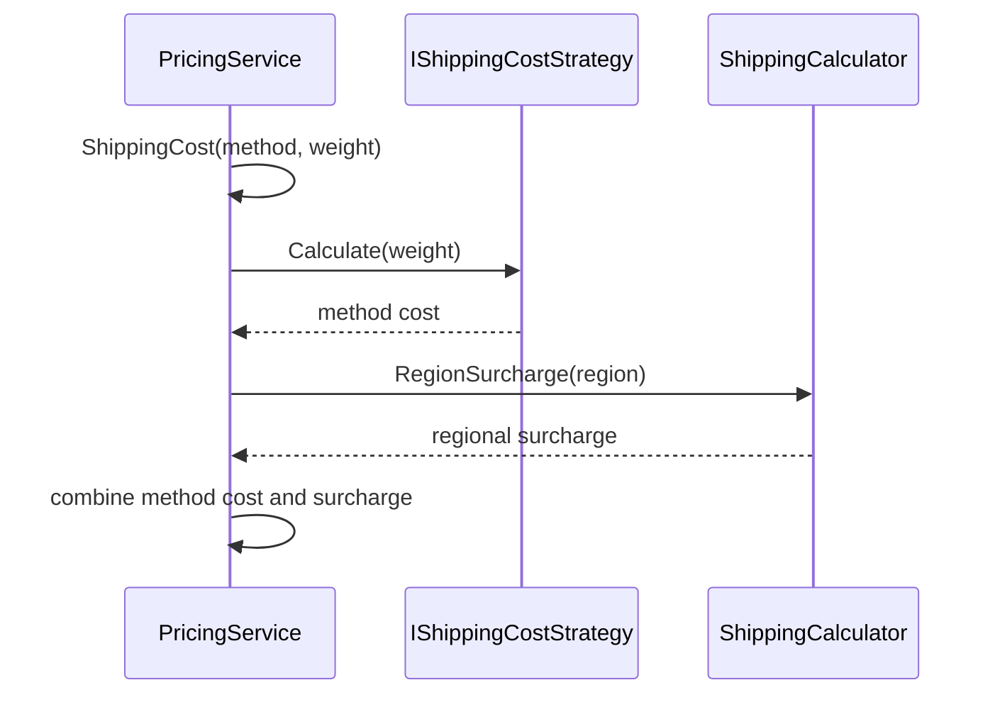

# Strategy

## At a glance

| | |
| --- | --- |
| Intent | Encapsulate interchangeable algorithms behind a shared contract so a service can select the one needed for an operation. |
| Category | Behavioral |
| Smell fixed | S21: pricing selected shipping cost with a switch on the shipping method string. |
| GoF chapter | Chapter 5, "Behavioral Patterns." |
| Files changed | `src/CornerStore/CornerStore.csproj`, `src/CornerStore/Pricing/ExpressShippingCostStrategy.cs`, `src/CornerStore/Pricing/IShippingCostStrategy.cs`, `src/CornerStore/Pricing/PickupShippingCostStrategy.cs`, `src/CornerStore/Pricing/PricingService.cs`, `src/CornerStore/Pricing/StandardShippingCostStrategy.cs`, `tests/CornerStore.Tests/StrategyTests.cs` ([DIFF.md](DIFF.md)) |
| File count | 7 files ([DIFF.md](DIFF.md)) |
| Previous pattern | [State](../state/README.md) |
| Next pattern | [Template Method](../template-method/README.md) |

## The problem

In the baseline, `PricingService.ShippingCost` switches on a string to calculate standard, express, or pickup costs. Adding another method requires changing the pricing method, where its algorithm is mixed with the selection logic. The smell is in [baseline `PricingService.cs`](../../../baseline/src/CornerStore/Pricing/PricingService.cs).

```csharp
switch (method)
{
    case "standard":
        return Math.Round(5.00m + 2.00m * weightKg, 2, MidpointRounding.AwayFromZero);
```

## The pattern

Each shipping calculation implements the same strategy interface. `PricingService` looks up the strategy for the selected method and delegates the calculation.

| Role | CornerStore participant |
| --- | --- |
| Context and strategy selector | `PricingService` |
| Strategy contract | `IShippingCostStrategy` |
| Concrete strategies | `StandardShippingCostStrategy`, `ExpressShippingCostStrategy`, `PickupShippingCostStrategy` |
| Separate regional adjustment | `ShippingCalculator` |

## The refactor

`PricingService` uses a strategy registry keyed by the shipping method. The strategy calculates the method cost; the existing regional surcharge is still applied afterward by `ShippingCalculator`. The standard, express, and pickup costs and unknown-method rejection remain unchanged. A test-only strategy can be injected without changing pricing code.

Before, [`baseline PricingService.cs`](../../../baseline/src/CornerStore/Pricing/PricingService.cs) selected the calculation with a switch:

```csharp
case "express":
    return Math.Round(12.00m + 4.00m * weightKg, 2, MidpointRounding.AwayFromZero);
```

After, [`PricingService.cs`](src/CornerStore/Pricing/PricingService.cs) looks up and invokes the strategy:

```csharp
return shippingStrategies.TryGetValue(method, out var strategy)
    ? strategy.Calculate(weightKg)
    : null;
```



## How it runs

While building a quote, `PricingService` asks for the method cost using the cart's shipping method and calculated weight. It looks up the matching strategy and calls `Calculate`. If no strategy is registered for that method, it returns no cost and quote construction rejects the unknown method.



## Run it

Run these commands from the repository root. All three were verified for this solution.

```powershell
dotnet build .\patterns\behavioral\strategy\Strategy.slnx
dotnet test .\patterns\behavioral\strategy\Strategy.slnx
dotnet run --project .\patterns\behavioral\strategy\src\CornerStore\CornerStore.csproj -- .\scenarios\trading-day.json
```

## Trade-offs

Each shipping method adds a strategy type and a selection entry. Strategy can be excessive for a couple of stable branches with no need for replacement or extension; a simple conditional may be clearer.

## Related patterns

[Strategy vs State](../../../docs/comparisons.md#strategy-vs-state) distinguishes selecting an algorithm from modeling lifecycle behavior. [Template Method vs Strategy](../../../docs/comparisons.md#template-method-vs-strategy) contrasts a composed algorithm with a fixed inheritance-based sequence. See [State](../state/README.md) and [Template Method](../template-method/README.md) for the corresponding examples.

## Modern .NET notes

The .NET dependency-injection container can register and provide strategy implementations, but the pattern does not require a framework. This service accepts a strategy registry so a composition can provide its own implementations.

## Further reading

GoF, Chapter 5, "Behavioral Patterns."

Blog post: coming soon <!-- blog-link -->
