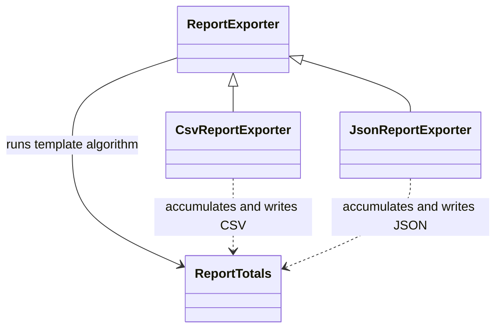

# TemplateMethod

## Intent

Template Method defines the fixed steps of an algorithm in a base class and
lets subclasses fill in selected steps without changing the overall sequence
(GoF, chapter 5).

## The smell

The CSV and JSON exporters each loaded orders, filtered status, traversed line
items, accumulated totals, and wrote the report. Only the output format
differed. The baseline markers are in
[`CsvReportExporter.cs`](../../../baseline/src/CornerStore/Reporting/CsvReportExporter.cs)
and
[`JsonReportExporter.cs`](../../../baseline/src/CornerStore/Reporting/JsonReportExporter.cs).

## The refactor

`ReportExporter.Export` owns status filtering, traversal, and the report
algorithm. Subclasses provide line-item accumulation and document writing.
The type switches stay in each subclass because they are the separate S23
seam.

## Diff highlights

Both exporters now inherit the common filter/traversal algorithm while
retaining their own type-specific accumulation and output steps. CSV and JSON
remain byte-for-byte compatible. See [DIFF.md](DIFF.md) for the changes.

## Trade-offs

The base class constrains the algorithm's sequence, and each format needs a
subclass. Template Method is not worthwhile when the steps vary independently
or when a single implementation is easier to follow than an inheritance
hierarchy.

## Related patterns and common confusions

Template Method shares an algorithm skeleton through inheritance and subclass
hooks. Strategy composes a replaceable algorithm object and usually selects it
at runtime. Prefer Strategy when the whole algorithm varies independently;
prefer Template Method when the sequence stays fixed and only a few steps
vary.

See [Template Method vs Strategy](../../../docs/comparisons.md#template-method-vs-strategy) for a side-by-side comparison.

## Modern .NET notes

LINQ and iterator methods can replace parts of a report pipeline, but they do
not by themselves provide an overridable algorithm skeleton. Use ordinary
composition instead when the shared steps do not form a stable sequence.

## Files changed

* `src/CornerStore/Reporting/ReportExporter.cs`
* `src/CornerStore/Reporting/ReportTotals.cs`
* `src/CornerStore/Reporting/CsvReportExporter.cs`
* `src/CornerStore/Reporting/JsonReportExporter.cs`
* `src/CornerStore/CornerStore.csproj`
* `tests/CornerStore.Tests/TemplateMethodTests.cs`

## Blog post link

To be published.
