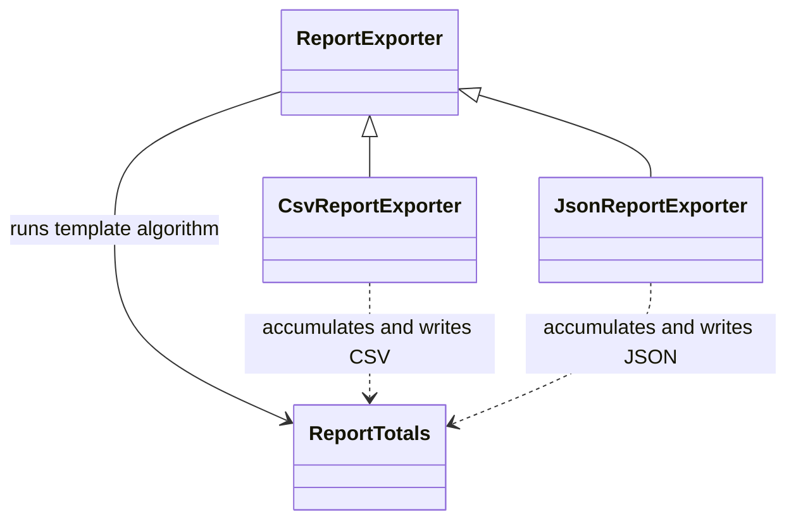
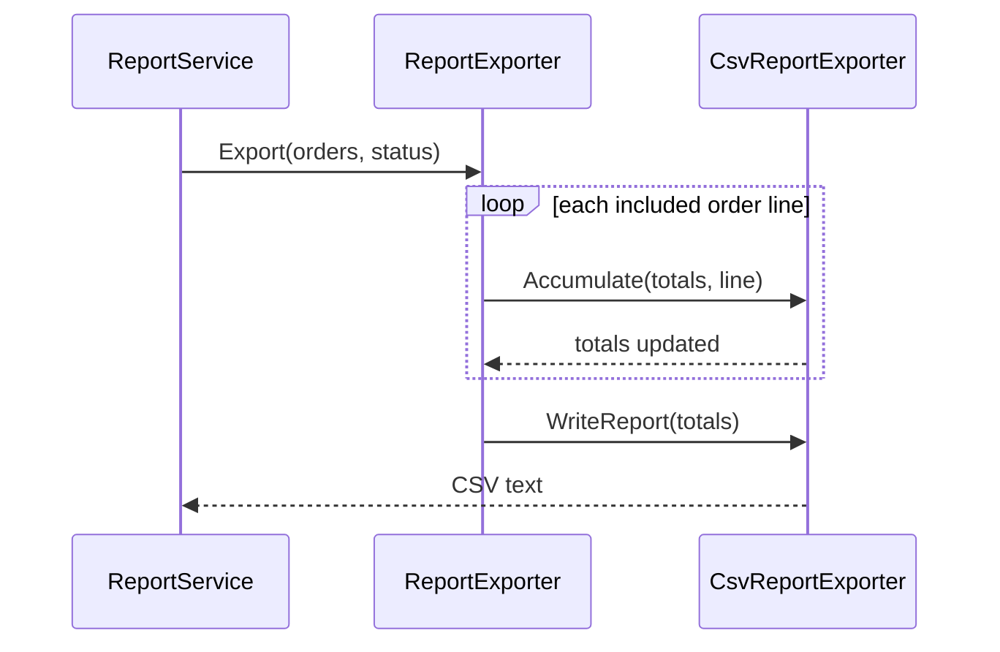

# Template Method

## At a glance

| | |
| --- | --- |
| Intent | Define a stable algorithm sequence in a base class and let subclasses supply selected steps. |
| Category | Behavioral |
| Smell fixed | S22: CSV and JSON exporters duplicated the same report-processing sequence. |
| GoF chapter | Chapter 5, "Behavioral Patterns." |
| Files changed | `src/CornerStore/CornerStore.csproj`, `src/CornerStore/Reporting/CsvReportExporter.cs`, `src/CornerStore/Reporting/JsonReportExporter.cs`, `src/CornerStore/Reporting/ReportExporter.cs`, `src/CornerStore/Reporting/ReportTotals.cs`, `tests/CornerStore.Tests/TemplateMethodTests.cs` ([DIFF.md](DIFF.md)) |
| File count | 6 files ([DIFF.md](DIFF.md)) |
| Previous pattern | [Strategy](../strategy/README.md) |
| Next pattern | [Visitor](../visitor/README.md) |

## The problem

The baseline CSV and JSON exporters each load and filter orders, traverse line items, aggregate totals, and write a report. Only the format-specific steps differ, so changes to the shared sequence must be repeated. The smell appears in [baseline `CsvReportExporter.cs`](../../../baseline/src/CornerStore/Reporting/CsvReportExporter.cs) and the corresponding JSON exporter.

```csharp
var orders = source.Where(order => status == "all" || order.Status == status).ToList();
var physical = 0m;
var digital = 0m;
var giftCard = 0m;
```

## The pattern

The base class owns the algorithm skeleton and calls subclass steps for the parts that vary. This keeps the shared order of work in one place while allowing each exporter to define its aggregation and output behavior.

| Role | CornerStore participant |
| --- | --- |
| Abstract template | `ReportExporter` |
| Template operation | `ReportExporter.Export` |
| Concrete implementations | `CsvReportExporter`, `JsonReportExporter` |
| Shared aggregation data | `ReportTotals` |

## The refactor

`ReportExporter.Export` filters orders, walks their lines, asks the subclass to accumulate each line, and then asks it to write the result. Type-specific line-item switches remain in the concrete exporters because those are the separate S23 seam. CSV and JSON output remain byte-for-byte compatible.

Before, the baseline CSV exporter filtered the source orders and then nested a line-item loop inside the order loop. The same traversal appeared separately in its JSON exporter.

After, [`ReportExporter.cs`](src/CornerStore/Reporting/ReportExporter.cs) provides the shared sequence:

```csharp
public string Export(List<Order> source, string status)
{
    var orders = source.Where(order => status == "all" || order.Status == status).ToList();
    var totals = new ReportTotals();
    foreach (var order in orders)
    {
        foreach (var line in order.Lines)
        {
            Accumulate(totals, line);
        }
    }

    return WriteReport(totals);
}
```



## How it runs

`ReportService` chooses the exporter for the requested format and calls `Export`. The base class filters the source orders and accumulates each line through the concrete hook. It then calls the concrete writer to produce CSV or JSON. Existing output formats remain unchanged.



## Run it

Run these commands from the repository root. All three were verified for this solution.

```powershell
dotnet build .\patterns\behavioral\template-method\TemplateMethod.slnx
dotnet test .\patterns\behavioral\template-method\TemplateMethod.slnx
dotnet run --project .\patterns\behavioral\template-method\src\CornerStore\CornerStore.csproj -- .\scenarios\trading-day.json
```

## Trade-offs

The base class constrains the algorithm sequence, and each format needs a subclass. Template Method is not worthwhile when the steps vary independently or one straightforward implementation is easier to follow than an inheritance hierarchy.

## Related patterns

[Template Method vs Strategy](../../../docs/comparisons.md#template-method-vs-strategy) contrasts a fixed sequence with a replaceable algorithm. [Strategy](../strategy/README.md) composes an interchangeable calculation, while this exporter keeps the sequence fixed and varies selected steps.

## Modern .NET notes

LINQ and iterator methods can replace parts of a report pipeline, but do not by themselves provide an overridable algorithm skeleton. Prefer composition when the shared steps do not form a stable sequence.

## Further reading

GoF, Chapter 5, "Behavioral Patterns."

Blog post: coming soon <!-- blog-link -->
