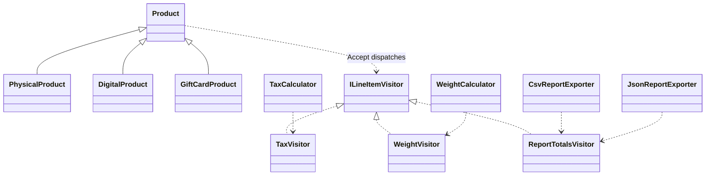
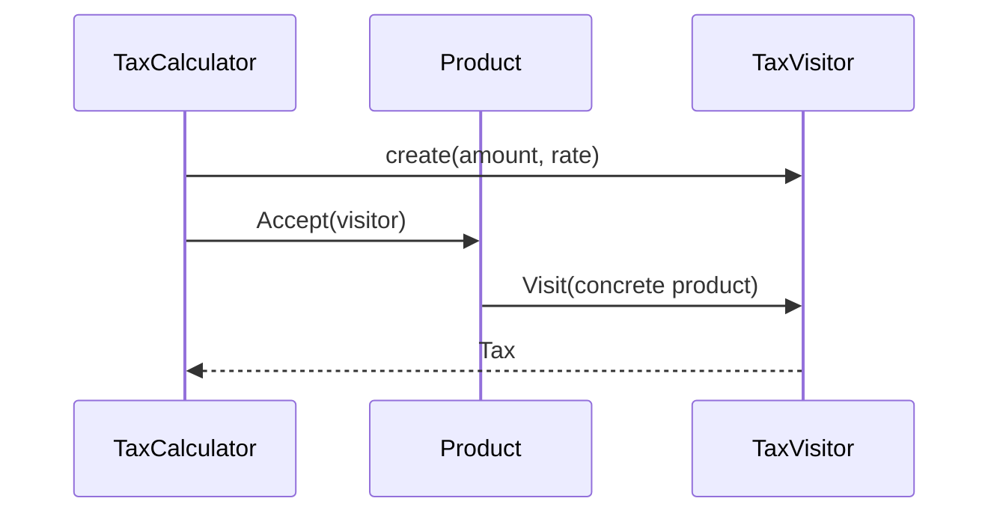

# Visitor

## At a glance

| | |
| --- | --- |
| Intent | Add operations over a stable set of element types by moving type-specific behavior into visitor objects. |
| Category | Behavioral |
| Smell fixed | S23: tax, weight, and report code used type switches for physical, digital, and gift card products. |
| GoF chapter | Chapter 5, "Behavioral Patterns." |
| Files changed | `src/CornerStore/Catalog/DigitalProduct.cs`, `src/CornerStore/Catalog/GiftCardProduct.cs`, `src/CornerStore/Catalog/ILineItemVisitor.cs`, `src/CornerStore/Catalog/PhysicalProduct.cs`, `src/CornerStore/Catalog/Product.cs`, `src/CornerStore/CornerStore.csproj`, `src/CornerStore/Pricing/TaxCalculator.cs`, `src/CornerStore/Pricing/TaxVisitor.cs`, `src/CornerStore/Pricing/WeightCalculator.cs`, `src/CornerStore/Pricing/WeightVisitor.cs`, `src/CornerStore/Reporting/CsvReportExporter.cs`, `src/CornerStore/Reporting/JsonReportExporter.cs`, `src/CornerStore/Reporting/ReportTotalsVisitor.cs`, `tests/CornerStore.Tests/VisitorTests.cs` ([DIFF.md](DIFF.md)) |
| Previous pattern | [Template Method](../template-method/README.md) |
| Next pattern | [Abstract Factory](../../creational/abstract-factory/README.md) |

## The problem

The baseline uses switches in tax, weight, and both report exporters to select behavior from each product's concrete type. Adding another operation repeats type handling, while adding a product type requires finding every switch. The tax example is in [baseline `TaxCalculator.cs`](../../../baseline/src/CornerStore/Pricing/TaxCalculator.cs).

```csharp
switch (product)
{
    case PhysicalProduct:
        return Math.Round(amount * rate, 2, MidpointRounding.AwayFromZero);
```

## The pattern

Each element accepts a visitor and dispatches to the visit method matching its concrete type. A visitor groups one operation across all supported element types; separate visitors implement tax, weight, and report-total operations.

| Role | CornerStore participant |
| --- | --- |
| Element contract | `Product`, which declares `Accept(ILineItemVisitor)` |
| Concrete elements | `PhysicalProduct`, `DigitalProduct`, `GiftCardProduct` |
| Visitor contract | `ILineItemVisitor` |
| Concrete visitors | `TaxVisitor`, `WeightVisitor`, `ReportTotalsVisitor` |
| Clients | `TaxCalculator`, `WeightCalculator`, `CsvReportExporter`, `JsonReportExporter` |

## The refactor

Each product implements `Accept` by calling the corresponding overload on `ILineItemVisitor`. Tax and weight calculations and report aggregation now use visitors. CSV and JSON exporters retain their own filtering and output code.

Before, [`baseline TaxCalculator.cs`](../../../baseline/src/CornerStore/Pricing/TaxCalculator.cs) switched on the product type:

```csharp
case GiftCardProduct:
    return 0m;
```

After, [`PhysicalProduct.cs`](src/CornerStore/Catalog/PhysicalProduct.cs) dispatches to the matching visitor method:

```csharp
internal override void Accept(ILineItemVisitor visitor)
{
    visitor.Visit(this);
}
```



## How it runs

For line tax, `TaxCalculator` creates a `TaxVisitor` with the amount and rate, then calls `Product.Accept`. Runtime dispatch selects the overload for the concrete product type. The visitor stores the resulting tax, which the calculator returns.



## Run it

Run these commands from the repository root. All three were verified for this solution.

```powershell
dotnet build .\patterns\behavioral\visitor\Visitor.slnx
dotnet test .\patterns\behavioral\visitor\Visitor.slnx
dotnet run --project .\patterns\behavioral\visitor\src\CornerStore\CornerStore.csproj -- .\scenarios\trading-day.json
```

## Trade-offs

Each new product type must be added to the visitor contract and every visitor implementation. Visitor is unnecessary when the element types change often, the operation set is small, or a switch expression is easier to maintain.

## Related patterns

[Strategy](../strategy/README.md) selects an interchangeable algorithm for a task. Visitor dispatches an operation across a stable set of element types. Use Strategy when choosing among algorithms and Visitor when several operations need type-specific behavior over the same elements.

## Modern .NET notes

C# switch expressions are concise for a small number of operations over a closed type set. Visitor is more useful when many separate operations act on stable element types and should remain organized independently.

The project file grants the test assembly internal visibility so focused tests can exercise the visitor participants without making them public.

## Further reading

GoF, Chapter 5, "Behavioral Patterns."

Blog post: coming soon <!-- blog-link -->
