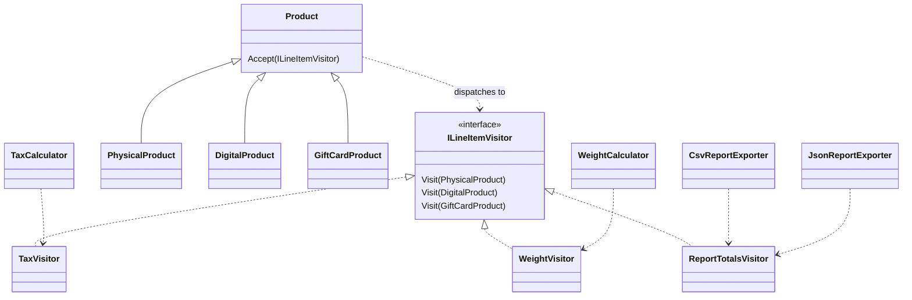

# Visitor

## Intent

Visitor adds operations over a stable set of element types by moving type-specific behavior into separate visitors. It is described in Chapter 5, "Behavioral Patterns," of *Design Patterns: Elements of Reusable Object-Oriented Software*.

## The smell

S23 handles physical, digital and gift card products with type switches in tax, weight and report code. The baseline tax switch is in [TaxCalculator.cs](../../../baseline/src/CornerStore/Pricing/TaxCalculator.cs).

## The refactor

Each `Product` accepts an `ILineItemVisitor` and dispatches itself to the matching visit method. `TaxVisitor`, `WeightVisitor` and `ReportTotalsVisitor` hold the product-specific behavior. The calculators and both exporters use these visitors; the existing report workflow remains unchanged.

## Diff highlights

Four product-type switches are replaced by double dispatch through `Accept`. The export visitor accumulates totals while the CSV and JSON exporters keep their separate filtering and output code. See [DIFF.md](DIFF.md).

## Trade-offs

Each new product type must be added to the visitor interface and every visitor implementation. Visitor is unnecessary when the element types change often, the operation set is small, or a straightforward switch expression is easier to maintain.

## Related patterns and common confusions

Strategy selects an interchangeable algorithm for a task. Visitor dispatches an operation across a set of element types. Use Strategy when the choice is between algorithms; use Visitor when several operations need type-specific behavior over a stable set of elements.

## Modern .NET notes

C# switch expressions are a concise option for a small number of operations over a closed type set. Visitor is more useful when many separate operations act on stable element types and should remain independently organized.

## Files changed

* `src/CornerStore/Catalog/ILineItemVisitor.cs`
* `src/CornerStore/Catalog/Product.cs`
* `src/CornerStore/Catalog/PhysicalProduct.cs`
* `src/CornerStore/Catalog/DigitalProduct.cs`
* `src/CornerStore/Catalog/GiftCardProduct.cs`
* `src/CornerStore/CornerStore.csproj`
* `src/CornerStore/Pricing/TaxCalculator.cs`
* `src/CornerStore/Pricing/WeightCalculator.cs`
* `src/CornerStore/Pricing/TaxVisitor.cs`
* `src/CornerStore/Pricing/WeightVisitor.cs`
* `src/CornerStore/Reporting/CsvReportExporter.cs`
* `src/CornerStore/Reporting/JsonReportExporter.cs`
* `src/CornerStore/Reporting/ReportTotalsVisitor.cs`
* `tests/CornerStore.Tests/VisitorTests.cs`

The project file grants the test assembly internal visibility so focused tests can exercise the visitor participants without making them public.

## Blog post link

To be published.
