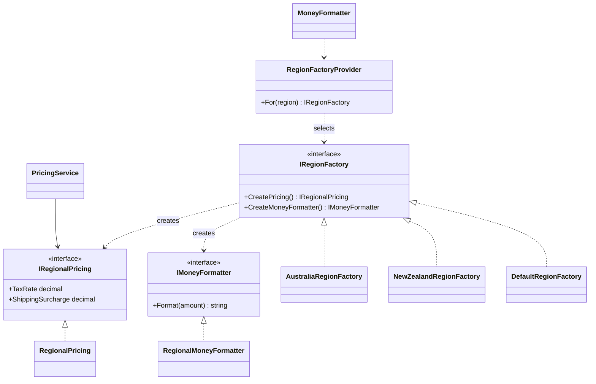

# Abstract Factory

## Intent

Abstract Factory provides an interface for creating related products as a family, so a client can use one regional set of rules without depending on their concrete implementations. This example follows the Abstract Factory chapter in *Design Patterns: Elements of Reusable Object-Oriented Software*.

## The smell

S01 had independent AU/NZ branches in tax, shipping and currency formatting. That scattered selection made it possible for callers to combine regional rules inconsistently. The baseline markers were in `Pricing/TaxCalculator.cs`, `Pricing/ShippingCalculator.cs` and `Pricing/MoneyFormatter.cs`.

## The refactor

`RegionFactoryProvider` selects a family factory for a region. Each factory creates a matching `IRegionalPricing` product and `IMoneyFormatter` product. `PricingService` uses one regional pricing product for both tax and shipping; the existing formatter entry point delegates to the family formatter. The default factory preserves the baseline behavior for unsupported region codes.

## Diff highlights

The three region branches are replaced by a family factory and two product contracts. The selected pricing product keeps tax and shipping surcharge together. The line-item tax switch for S23 remains unchanged. See [DIFF.md](DIFF.md).

## Trade-offs

The factories keep regional rules consistent, but they add interfaces, concrete factories and a selection point. They are not a good fit when there is only one product to create or when regional variations are few and unlikely to grow.

## Related patterns and common confusions

Factory Method delegates creation of one product to creator subclasses. Abstract Factory creates a family of related products. A concrete region factory here creates both pricing rules and a currency formatter, while Factory Method in the payment example creates one processor.

See [Factory Method vs Abstract Factory](../../../docs/comparisons.md#factory-method-vs-abstract-factory) for a side-by-side comparison.

## Modern .NET notes

Dependency injection can select and register a regional factory when the region is known at composition time. This console scenario selects a factory at runtime from a region code. Currency values continue to use invariant numeric formatting so the transcript is deterministic.

## Files changed

* `src/CornerStore/CornerStore.csproj`
* `src/CornerStore/Pricing/AustraliaRegionFactory.cs`
* `src/CornerStore/Pricing/DefaultRegionFactory.cs`
* `src/CornerStore/Pricing/IRegionFactory.cs`
* `src/CornerStore/Pricing/IMoneyFormatter.cs`
* `src/CornerStore/Pricing/IRegionalPricing.cs`
* `src/CornerStore/Pricing/MoneyFormatter.cs`
* `src/CornerStore/Pricing/NewZealandRegionFactory.cs`
* `src/CornerStore/Pricing/PricingService.cs`
* `src/CornerStore/Pricing/RegionalMoneyFormatter.cs`
* `src/CornerStore/Pricing/RegionalPricing.cs`
* `src/CornerStore/Pricing/RegionFactoryProvider.cs`
* `src/CornerStore/Pricing/ShippingCalculator.cs` (removed)
* `src/CornerStore/Pricing/TaxCalculator.cs`
* `tests/CornerStore.Tests/AbstractFactoryTests.cs`

## Blog post link

To be published.
