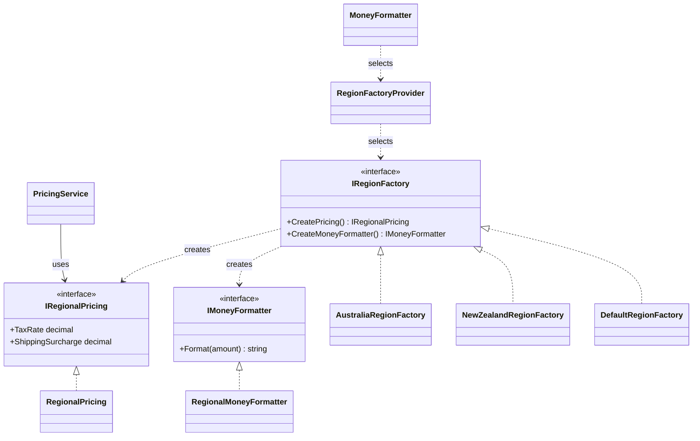
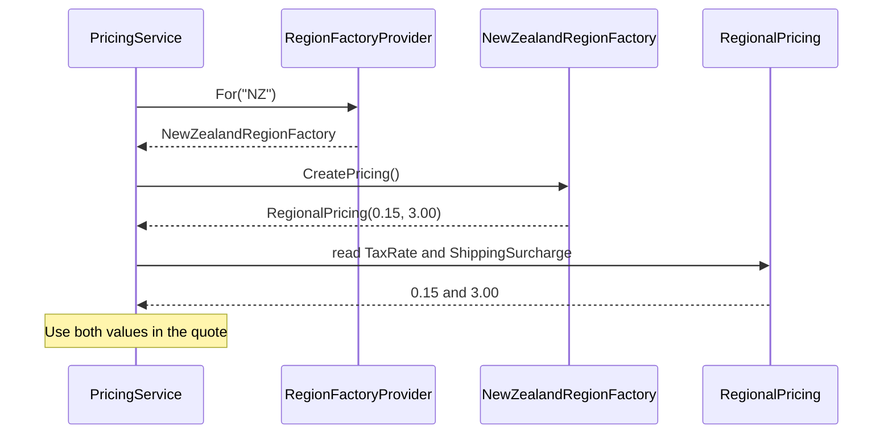

# Abstract Factory

## At a glance

| | |
| --- | --- |
| Intent | Create matching regional pricing and currency-formatting products through one family factory. |
| Category | Creational |
| Smell fixed | S01: scattered regional pricing branches. |
| GoF chapter | Chapter 3, "Creational Patterns," section "Abstract Factory." |
| Files changed | `src/CornerStore/CornerStore.csproj`; `src/CornerStore/Pricing/AustraliaRegionFactory.cs`; `src/CornerStore/Pricing/DefaultRegionFactory.cs`; `src/CornerStore/Pricing/IMoneyFormatter.cs`; `src/CornerStore/Pricing/IRegionFactory.cs`; `src/CornerStore/Pricing/IRegionalPricing.cs`; `src/CornerStore/Pricing/MoneyFormatter.cs`; `src/CornerStore/Pricing/NewZealandRegionFactory.cs`; `src/CornerStore/Pricing/PricingService.cs`; `src/CornerStore/Pricing/RegionalMoneyFormatter.cs`; `src/CornerStore/Pricing/RegionalPricing.cs`; `src/CornerStore/Pricing/RegionFactoryProvider.cs`; `src/CornerStore/Pricing/ShippingCalculator.cs` (removed); `src/CornerStore/Pricing/TaxCalculator.cs`; `tests/CornerStore.Tests/AbstractFactoryTests.cs` ([DIFF.md](DIFF.md)) |
| Previous pattern | [Start of book order](../README.md) |
| Next pattern | [Builder](../builder/README.md) |

## The problem

The baseline selected tax, shipping surcharge and currency symbol with separate AU/NZ branches. These independent choices could combine rules from different regions. The baseline marks S01 in [`TaxCalculator.cs`](../../../baseline/src/CornerStore/Pricing/TaxCalculator.cs), [`ShippingCalculator.cs`](../../../baseline/src/CornerStore/Pricing/ShippingCalculator.cs) and [`MoneyFormatter.cs`](../../../baseline/src/CornerStore/Pricing/MoneyFormatter.cs).

```csharp
if (region == "AU")
{
    return 0.10m;
}
else if (region == "NZ")
{
    return 0.15m;
}
```

## The pattern

Abstract Factory gives a client one factory for creating related products as a family. The client depends on product contracts and does not select each concrete product independently.

| Role | CornerStore participant |
| --- | --- |
| Client | `PricingService` and `MoneyFormatter` |
| Abstract factory | `IRegionFactory` |
| Concrete factories | `AustraliaRegionFactory`, `NewZealandRegionFactory` and `DefaultRegionFactory` |
| Abstract products | `IRegionalPricing` and `IMoneyFormatter` |
| Concrete products | `RegionalPricing` and `RegionalMoneyFormatter` |
| Factory selector | `RegionFactoryProvider` |

## The refactor

`RegionFactoryProvider` selects a factory for the customer's region. `PricingService` uses the factory's pricing product for both the tax rate and shipping surcharge. `MoneyFormatter` delegates formatting to the same region family. The default factory preserves the baseline behavior for unsupported regions. The separate line-item tax switch for S23 remains unchanged.

Before, [`TaxCalculator.cs`](../../../baseline/src/CornerStore/Pricing/TaxCalculator.cs) selected the tax rate independently:

```csharp
if (region == "AU")
{
    return 0.10m;
}
else if (region == "NZ")
{
    return 0.15m;
}
```

After, [`PricingService.cs`](src/CornerStore/Pricing/PricingService.cs) gets tax and shipping values from one family product:

```csharp
var regionalPricing = RegionFactoryProvider.For(customer.Region).CreatePricing();
var shipping = methodCost + regionalPricing.ShippingSurcharge;

var rate = regionalPricing.TaxRate;
```

The factory and product relationships are:



## How it runs

When a quote is built, `PricingService` asks `RegionFactoryProvider` for the factory matching the customer's region. For an NZ customer, the provider returns `NewZealandRegionFactory`; its pricing product supplies a 15 percent tax rate and a 3.00 shipping surcharge. The service uses both values while building the quote. The formatter uses the selected factory separately when it formats a displayed amount.



## Run it

Run these commands from the repository root. Each command was run for this solution.

```powershell
dotnet build patterns/creational/abstract-factory/AbstractFactory.slnx
dotnet test patterns/creational/abstract-factory/AbstractFactory.slnx
dotnet run --project patterns/creational/abstract-factory/src/CornerStore/CornerStore.csproj -- scenarios/trading-day.json
```

## Trade-offs

The family factory keeps regional pricing and formatting choices together, but introduces product contracts, concrete factories and a selection point. It is unnecessary when there is only one product to create or when variations are unlikely to grow. Unsupported region codes still use the default family.

## Related patterns

[Factory Method vs Abstract Factory](../../../docs/comparisons.md#factory-method-vs-abstract-factory) compares creating one product through a creator hierarchy with creating a family of related products. [Factory Method](../factory-method/README.md) varies payment processor creation; [Builder](../builder/README.md) assembles an order or invoice through named steps.

## Modern .NET notes

Dependency injection can register a family factory when the region is known at composition time. This scenario selects a factory at runtime from a region code. Currency values continue to use invariant numeric formatting so the transcript is deterministic.

## Further reading

GoF, Chapter 3, "Creational Patterns," section "Abstract Factory."

Blog post: coming soon <!-- blog-link -->
