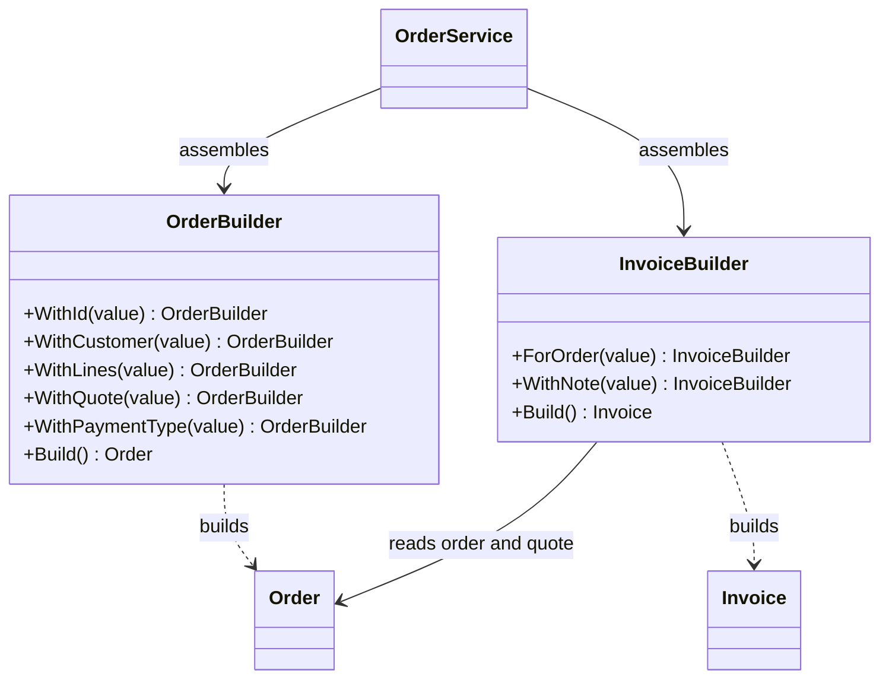
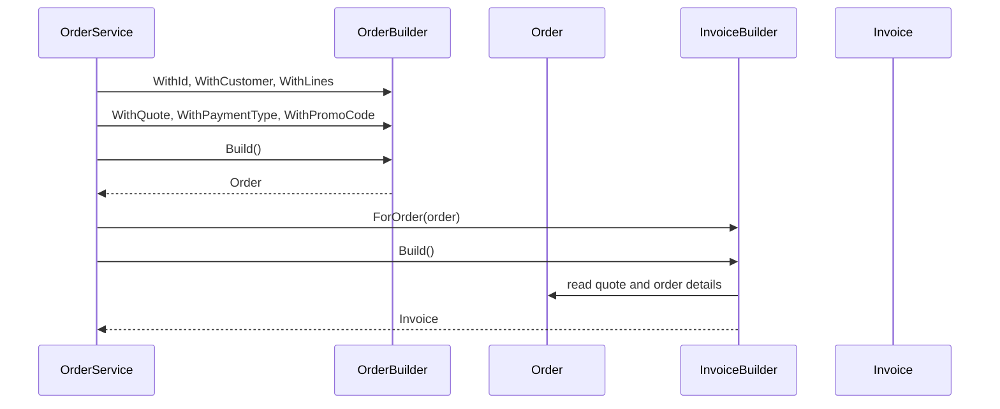

# Builder

## At a glance

| | |
| --- | --- |
| Intent | Assemble an order or invoice from named values, then validate and construct it. |
| Category | Creational |
| Smell fixed | S02: long positional order and invoice constructors. |
| GoF chapter | Chapter 3, "Creational Patterns," section "Builder." |
| Files changed | `src/CornerStore/CornerStore.csproj`; `src/CornerStore/Orders/InvoiceBuilder.cs`; `src/CornerStore/Orders/OrderBuilder.cs`; `src/CornerStore/Orders/OrderService.cs`; `tests/CornerStore.Tests/BuilderTests.cs` ([DIFF.md](DIFF.md)) |
| Previous pattern | [Abstract Factory](../abstract-factory/README.md) |
| Next pattern | [Factory Method](../factory-method/README.md) |

## The problem

`OrderService` passed eleven positional values to both `Order` and `Invoice`, including nulls for optional fields. Call sites were hard to read and easy to misorder. The baseline marks S02 in [`OrderService.cs`](../../../baseline/src/CornerStore/Orders/OrderService.cs).

```csharp
var order = new Order(
    ids.NextOrderId(), customer, "Pending",
    cart.Lines.Select(CopyLine).ToList(), quote, paymentType,
    cart.PromoCode == "" ? null : cart.PromoCode, null, null, null, null);
```

## The pattern

Builder separates a stepwise construction process from the object being built. Named calls make supplied values visible, while `Build()` checks that required values are present before creating the product.

| Role | CornerStore participant |
| --- | --- |
| Director and client | `OrderService` |
| Order builder | `OrderBuilder` |
| Order product | `Order` |
| Invoice builder | `InvoiceBuilder` |
| Invoice product | `Invoice` |

## The refactor

`OrderService` now supplies required and optional order values through `OrderBuilder`, which validates required inputs in `Build()`. It uses `InvoiceBuilder` to derive an invoice from its source order and quote. Optional values retain their null defaults. The project grants the test assembly internal visibility so focused tests can exercise internal builders without making them public.

Before, [`OrderService.cs`](../../../baseline/src/CornerStore/Orders/OrderService.cs) passed order values by position:

```csharp
var order = new Order(
    ids.NextOrderId(), customer, "Pending",
    cart.Lines.Select(CopyLine).ToList(), quote, paymentType,
    cart.PromoCode == "" ? null : cart.PromoCode, null, null, null, null);
```

After, [`OrderService.cs`](src/CornerStore/Orders/OrderService.cs) names those values:

```csharp
var order = new OrderBuilder()
    .WithId(ids.NextOrderId())
    .WithCustomer(customer)
    .WithLines(cart.Lines.Select(CopyLine).ToList())
    .WithQuote(quote)
    .WithPaymentType(paymentType)
    .WithPromoCode(cart.PromoCode == "" ? null : cart.PromoCode)
    .Build();
```

The builders keep construction responsibilities next to their products:



## How it runs

When checkout creates an order, `OrderService.Create` sets the ID, customer, copied cart lines, quote, payment type and optional promo code on `OrderBuilder`. `Build()` rejects missing required values and creates the order. `CreateInvoice` then gives that order to `InvoiceBuilder`; the builder reads its quote and builds the corresponding invoice with the same totals.



## Run it

Run these commands from the repository root. Each command was run for this solution.

```powershell
dotnet build patterns/creational/builder/Builder.slnx
dotnet test patterns/creational/builder/Builder.slnx
dotnet run --project patterns/creational/builder/src/CornerStore/CornerStore.csproj -- scenarios/trading-day.json
```

## Trade-offs

Each built type adds a builder and construction methods. Builder is unnecessary when an object has only a few required values and no optional parts; a direct constructor can be clearer.

## Related patterns

There is no Builder-specific comparison in the [comparison guide](../../../docs/comparisons.md). [Factory Method](../factory-method/README.md) lets subclasses choose which product implementation to create, while Builder focuses on assembling a particular object. [Abstract Factory](../abstract-factory/README.md) creates a family of related products.

## Modern .NET notes

Object initializers and records with `with` expressions can replace simple builders in modern C#. A dedicated builder remains useful when construction needs validation or many optional values.

## Further reading

GoF, Chapter 3, "Creational Patterns," section "Builder."

Blog post: coming soon <!-- blog-link -->
