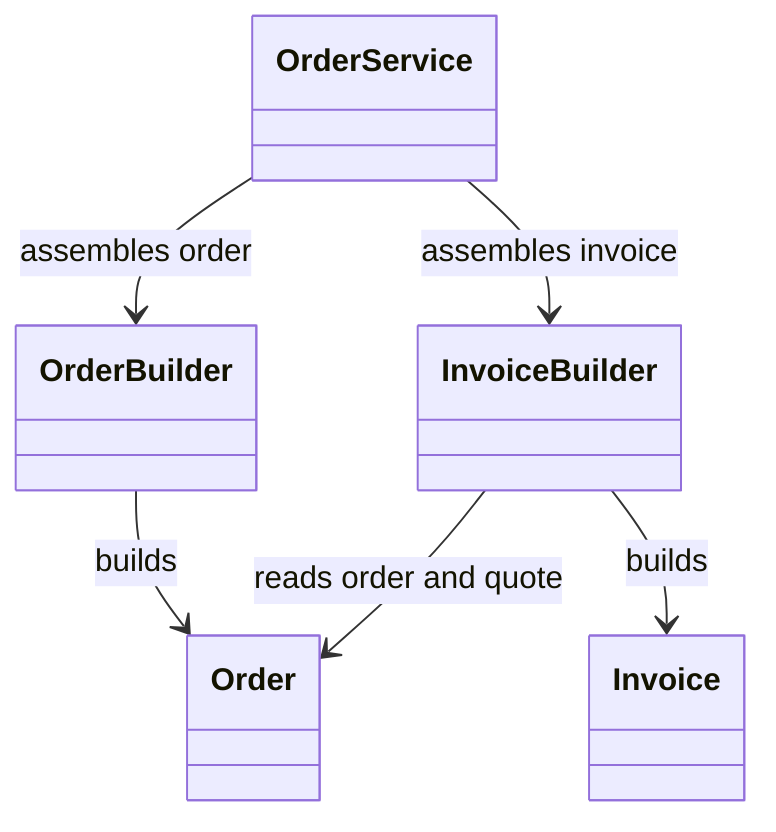

# Builder

## Intent

Builder separates a complex object's construction from its representation by
assembling named parts through a stepwise API (GoF, chapter 3).

## The smell

`OrderService` passed eleven positional values to both `Order` and `Invoice`,
including several null optionals. Call sites were hard to read and easy to
misorder. The baseline markers are in
[`OrderService.cs`](../../../baseline/src/CornerStore/Orders/OrderService.cs).

## The refactor

`OrderBuilder` names each required order value and defaults optional fields to
null. `InvoiceBuilder` takes its source order and builds the corresponding
invoice from the order's quote. Each builder validates required inputs in
`Build()`.

## Diff highlights

The two positional constructor calls are replaced by fluent builders. Required
values are checked before construction, optional fields keep their null
defaults, and invoice totals still come from the order quote. See
[DIFF.md](DIFF.md) for the source and test changes.

## Trade-offs

Each built type adds a builder and construction methods. Builder is unnecessary
when an object has only a few required values and no optional parts; a direct
constructor can be clearer in that case.

## Related patterns and common confusions

Builder assembles one object from a sequence of named values. Factory Method
lets subclasses choose which product implementation to create. Builder focuses
on construction steps, not selecting a product type.

## Modern .NET notes

Object initializers and records with `with` expressions can replace simple
builders in modern C#. A dedicated builder remains useful when construction
needs validation or many optional values.

## Files changed

* `src/CornerStore/Orders/OrderBuilder.cs`
* `src/CornerStore/Orders/InvoiceBuilder.cs`
* `src/CornerStore/Orders/OrderService.cs`
* `src/CornerStore/CornerStore.csproj`
* `tests/CornerStore.Tests/BuilderTests.cs`

## Blog post link

To be published.
