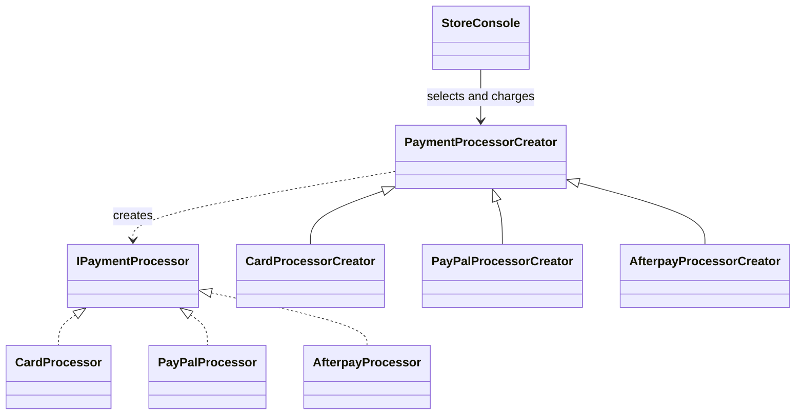

# FactoryMethod

## Intent

Factory Method lets a creator defer product construction to subclasses while
keeping the operation that uses the product in the shared creator workflow
(GoF, chapter 3).

## The smell

Checkout selected a processor with a switch and constructed the card, PayPal,
or Afterpay implementation inline. Adding a processor changed the checkout
method. The baseline marker is in
[`StoreConsole.cs`](../../../baseline/src/CornerStore/StoreConsole.cs).

## The refactor

`StoreConsole` selects a `PaymentProcessorCreator`. Its `Charge` operation
calls the overridable `CreateProcessor` factory method, and each concrete
creator constructs its matching `IPaymentProcessor`.

## Diff highlights

Processor construction now lives in concrete creator overrides. The console
still selects by payment type, while all three payment outputs and unknown
type rejection remain unchanged. See [DIFF.md](DIFF.md) for the source and
test changes.

## Trade-offs

Each product variation adds a creator subclass. Factory Method is unnecessary
when construction is trivial and stable, or when there is no meaningful
variation in the product being created.

## Related patterns and common confusions

Factory Method creates one product through subclass polymorphism. Abstract
Factory creates a family of related products through a factory object. Use
Abstract Factory when the application must keep several related product
choices consistent; use Factory Method when one product construction varies.

## Modern .NET notes

Dependency injection can provide a selected creator, but the .NET platform
does not require a framework for this pattern. The example keeps the creator
and product hierarchy explicit.

## Files changed

* `src/CornerStore/Checkout/PaymentProcessorCreator.cs`
* `src/CornerStore/Checkout/CardProcessorCreator.cs`
* `src/CornerStore/Checkout/PayPalProcessorCreator.cs`
* `src/CornerStore/Checkout/AfterpayProcessorCreator.cs`
* `src/CornerStore/StoreConsole.cs`
* `src/CornerStore/CornerStore.csproj`
* `tests/CornerStore.Tests/FactoryMethodTests.cs`

## Blog post link

To be published.
