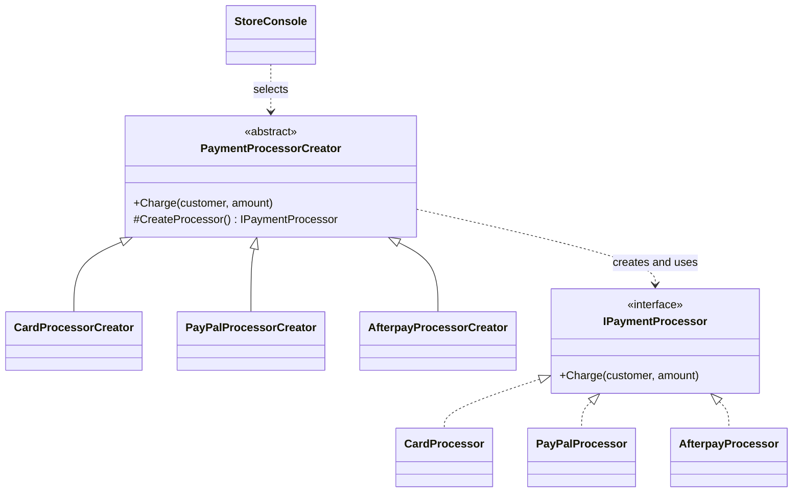
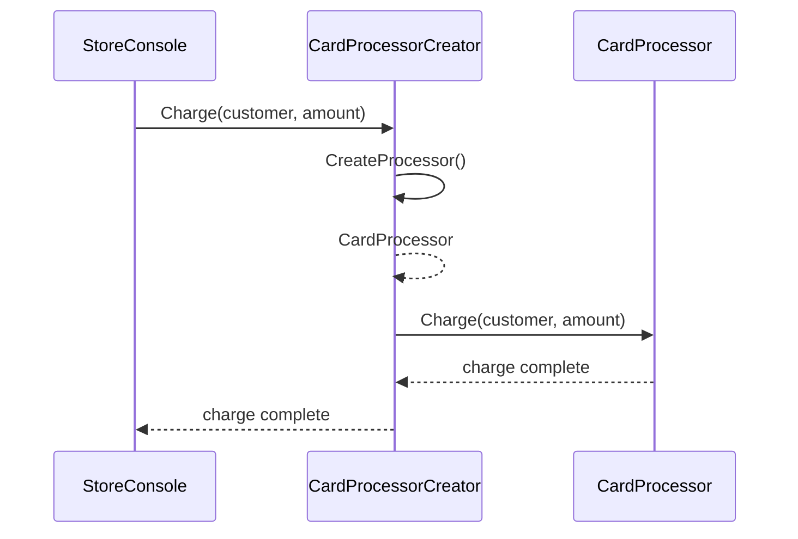

# Factory Method

## At a glance

| | |
| --- | --- |
| Intent | Let creator subclasses construct a payment processor while keeping the charge workflow in the creator. |
| Category | Creational |
| Smell fixed | S03: inline payment-processor construction. |
| GoF chapter | Chapter 3, "Creational Patterns," section "Factory Method." |
| Files changed | `src/CornerStore/Checkout/AfterpayProcessorCreator.cs`; `src/CornerStore/Checkout/CardProcessorCreator.cs`; `src/CornerStore/Checkout/PaymentProcessorCreator.cs`; `src/CornerStore/Checkout/PayPalProcessorCreator.cs`; `src/CornerStore/CornerStore.csproj`; `src/CornerStore/StoreConsole.cs`; `tests/CornerStore.Tests/FactoryMethodTests.cs` ([DIFF.md](DIFF.md)) |
| Previous pattern | [Builder](../builder/README.md) |
| Next pattern | [Prototype](../prototype/README.md) |

## The problem

Checkout selected a processor with a switch and constructed the card, PayPal or Afterpay implementation inline. Adding a processor changed the checkout method. The baseline marks S03 in [`StoreConsole.cs`](../../../baseline/src/CornerStore/StoreConsole.cs).

```csharp
IPaymentProcessor? processor = null;
switch (paymentType)
{
    case "card":
        processor = new CardProcessor();
        break;
    case "paypal":
        processor = new PayPalProcessor();
        break;
    case "afterpay":
        processor = new AfterpayProcessor();
        break;
}
```

## The pattern

Factory Method defines a creation operation in a creator and lets subclasses decide which concrete product to return. The creator can then use that product as part of its shared workflow.

| Role | CornerStore participant |
| --- | --- |
| Client and creator selector | `StoreConsole` |
| Creator | `PaymentProcessorCreator` |
| Concrete creators | `CardProcessorCreator`, `PayPalProcessorCreator` and `AfterpayProcessorCreator` |
| Product | `IPaymentProcessor` |
| Concrete products | `CardProcessor`, `PayPalProcessor` and `AfterpayProcessor` |

## The refactor

`StoreConsole` still selects a creator by payment type. Its creator's `Charge` method invokes the overridable `CreateProcessor` method, and each concrete creator returns its matching processor. Unknown payment types still return false and are rejected by checkout.

Before, [`StoreConsole.cs`](../../../baseline/src/CornerStore/StoreConsole.cs) constructed the processor directly:

```csharp
case "card":
    processor = new CardProcessor();
    break;
case "paypal":
    processor = new PayPalProcessor();
    break;
```

After, [`StoreConsole.cs`](src/CornerStore/StoreConsole.cs) selects a creator and calls its workflow:

```csharp
case "card":
    creator = new CardProcessorCreator();
    break;
case "paypal":
    creator = new PayPalProcessorCreator();
    break;
```

The creator hierarchy separates product construction from charging:



## How it runs

For a card payment, the console selects `CardProcessorCreator`. Its inherited `Charge` method calls the overridden `CreateProcessor`, receives a `CardProcessor`, and calls `Charge` on that product. PayPal and Afterpay follow the same creator workflow with their own concrete products.



## Run it

Run these commands from the repository root. Each command was run for this solution.

```powershell
dotnet build patterns/creational/factory-method/FactoryMethod.slnx
dotnet test patterns/creational/factory-method/FactoryMethod.slnx
dotnet run --project patterns/creational/factory-method/src/CornerStore/CornerStore.csproj -- scenarios/trading-day.json
```

## Trade-offs

Each product variation adds a creator subclass. Factory Method is unnecessary when construction is trivial and stable, or when there is no meaningful variation in the product being created.

## Related patterns

[Factory Method vs Abstract Factory](../../../docs/comparisons.md#factory-method-vs-abstract-factory) contrasts creation of one product through creator subclasses with creation of a related product family. [Abstract Factory](../abstract-factory/README.md) creates regional pricing and formatting products together. [Builder](../builder/README.md) assembles an order or invoice rather than choosing its product type.

## Modern .NET notes

Dependency injection can provide a selected creator, but the .NET platform does not require a framework for this pattern. The example keeps the creator and product hierarchy explicit.

## Further reading

GoF, Chapter 3, "Creational Patterns," section "Factory Method."

Blog post: coming soon <!-- blog-link -->
