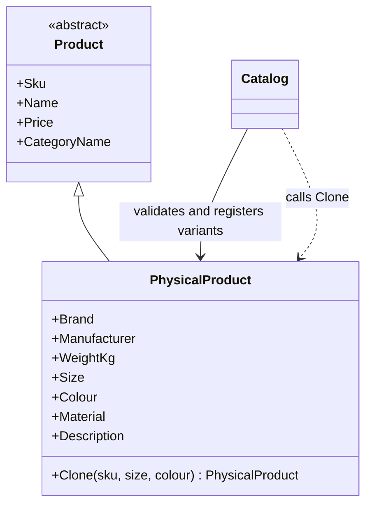

# Prototype

## Intent

Prototype creates new objects by copying an existing instance. It is described in Chapter 3, "Creational Patterns," of *Design Patterns: Elements of Reusable Object-Oriented Software*.

## The smell

S04 builds physical-product size and colour variants by copying each parent field directly in `Catalog.CreateVariant`.

## The refactor

`PhysicalProduct.Clone` copies product data from the prototype while applying the new SKU, size and colour. The catalog validates the request and registers the returned clone in the parent's category.

## Diff highlights

The field-by-field construction moves into `PhysicalProduct.Clone`, next to the state it copies. `Catalog.CreateVariant` delegates cloning and continues to own SKU checks, category registration and error handling. See [DIFF.md](DIFF.md).

## Trade-offs

Cloning is useful when a configured object has many attributes that should carry into a related variant. The clone operation must be updated when the object's state changes, and it must decide whether referenced values need deep copies. Prototype is a poor fit when objects are cheap to construct, when copying would duplicate state that should remain shared, or when the new object has substantially different responsibilities.

## Related patterns and common confusions

Prototype copies a configured instance. A factory creates objects through a separate construction process, which is preferable when creation rules are centralized or depend on external inputs.

## Modern .NET notes

Immutable C# records support non-destructive copying with `with` expressions, which can be a concise alternative when the copy and its overrides are simple. This example uses an explicit `Clone` operation to keep variant naming and field preservation with the physical product.

## Files changed

* `src/CornerStore/Catalog/Catalog.cs`
* `src/CornerStore/Catalog/PhysicalProduct.cs`
* `src/CornerStore/CornerStore.csproj`
* `tests/CornerStore.Tests/PrototypeTests.cs`

The project file grants the test assembly internal visibility so focused tests can exercise the internal product and catalog types without making them public.

## Blog post link

To be published.
