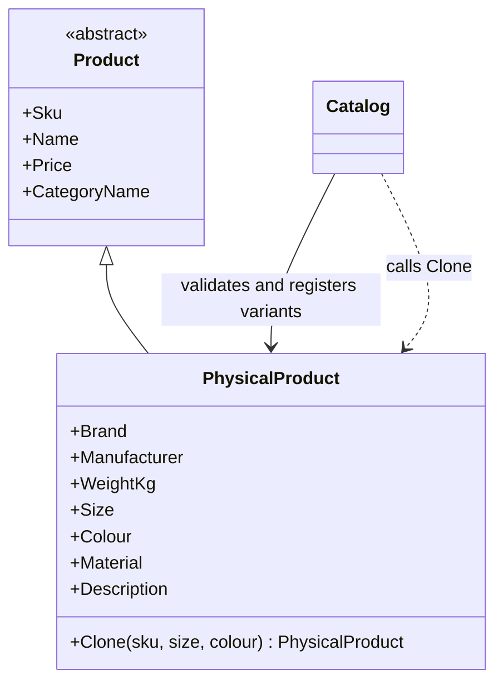
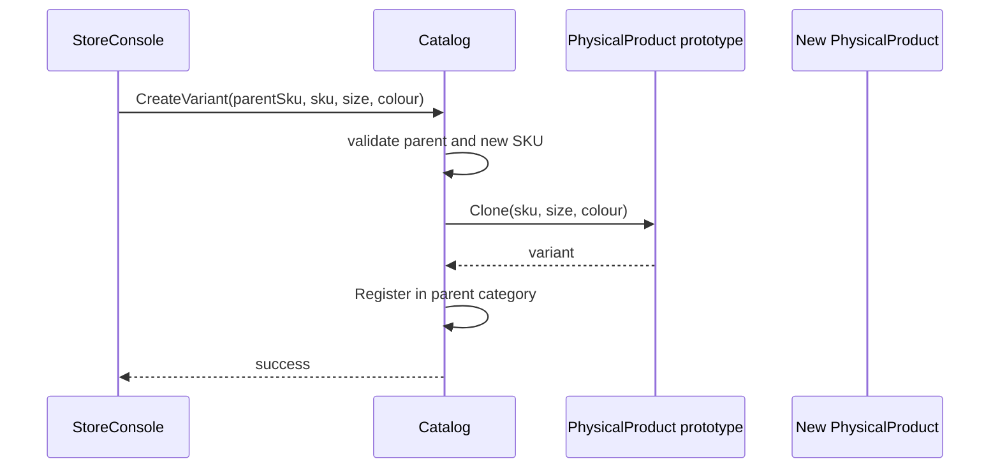

# Prototype

## At a glance

| | |
| --- | --- |
| Intent | Create a product variant by copying an existing product and applying its new SKU, size and colour. |
| Category | Creational |
| Smell fixed | S04: manual field-by-field variant copying. |
| GoF chapter | Chapter 3, "Creational Patterns," section "Prototype." |
| Files changed | `src/CornerStore/Catalog/Catalog.cs`; `src/CornerStore/Catalog/PhysicalProduct.cs`; `src/CornerStore/CornerStore.csproj`; `tests/CornerStore.Tests/PrototypeTests.cs` ([DIFF.md](DIFF.md)) |
| File count | 4 files ([DIFF.md](DIFF.md)) |
| Previous pattern | [Factory Method](../factory-method/README.md) |
| Next pattern | [Singleton](../singleton/README.md) |

## The problem

`Catalog.CreateVariant` built physical-product size and colour variants by copying each parent field directly. A new or changed product field could be omitted from this construction. The baseline marks S04 in [`Catalog.cs`](../../../baseline/src/CornerStore/Catalog/Catalog.cs).

```csharp
var variant = new PhysicalProduct
{
    Sku = sku,
    Name = parent.Name + " (" + size + ", " + colour + ")",
    Price = parent.Price,
    CategoryName = parent.CategoryName,
    Brand = parent.Brand,
    Manufacturer = parent.Manufacturer,
    WeightKg = parent.WeightKg,
    Size = size,
    Colour = colour,
    Material = parent.Material,
    Description = parent.Description,
};
```

## The pattern

Prototype creates a new object by asking an existing configured instance to copy itself. The prototype owns the knowledge of which state is copied and which values are replaced.

| Role | CornerStore participant |
| --- | --- |
| Client and registry | `Catalog` |
| Prototype | `PhysicalProduct` |
| Clone operation | `PhysicalProduct.Clone(sku, size, colour)` |
| Created product | A new `PhysicalProduct` registered in the parent's category |

## The refactor

`PhysicalProduct.Clone` copies the product data and applies the requested SKU, size and colour. `Catalog.CreateVariant` retains request validation, category registration and error handling, and delegates the copy to the product. The project grants the test assembly internal visibility so focused tests can exercise internal types without making them public.

Before, [`Catalog.cs`](../../../baseline/src/CornerStore/Catalog/Catalog.cs) copied each parent field itself:

```csharp
var variant = new PhysicalProduct
{
    Sku = sku,
    Name = parent.Name + " (" + size + ", " + colour + ")",
    Price = parent.Price,
    CategoryName = parent.CategoryName,
    Brand = parent.Brand,
    Manufacturer = parent.Manufacturer,
    WeightKg = parent.WeightKg,
    Size = size,
    Colour = colour,
    Material = parent.Material,
    Description = parent.Description,
};
```

After, [`Catalog.cs`](src/CornerStore/Catalog/Catalog.cs) asks the parent to clone, then registers the result:

```csharp
var variant = parent.Clone(sku, size, colour);
Register(categories[parent.CategoryName], variant);
```

[`PhysicalProduct.cs`](src/CornerStore/Catalog/PhysicalProduct.cs) keeps the copy operation with the product state:

```csharp
public PhysicalProduct Clone(string sku, string size, string colour)
{
    return new PhysicalProduct
    {
        Sku = sku,
        Name = Name + " (" + size + ", " + colour + ")",
        Price = Price,
        CategoryName = CategoryName,
        Brand = Brand,
        Manufacturer = Manufacturer,
        WeightKg = WeightKg,
        Size = size,
        Colour = colour,
        Material = Material,
        Description = Description,
    };
}
```



## How it runs

For a requested variant, `Catalog` checks that the parent SKU exists and names a physical product, and that the new SKU is unused. It then calls `Clone` with the new SKU, size and colour and registers the result in the parent's category. The original object remains unchanged.



## Run it

Run these commands from the repository root. Each command was run for this solution.

```powershell
dotnet build patterns/creational/prototype/Prototype.slnx
dotnet test patterns/creational/prototype/Prototype.slnx
dotnet run --project patterns/creational/prototype/src/CornerStore/CornerStore.csproj -- scenarios/trading-day.json
```

## Trade-offs

Cloning is useful when a configured object has many attributes that should carry into a related variant. The clone operation must be updated when the object's state changes, and it must decide whether referenced values need deep copies. Prototype is a poor fit when objects are cheap to construct, copying would duplicate state that should remain shared, or the new object has substantially different responsibilities.

## Related patterns

The [comparison guide](../../../docs/comparisons.md) has no Prototype-specific section. [Factory Method](../factory-method/README.md) creates a product through a separate construction process, which is preferable when rules are centralized or depend on external inputs. [Builder](../builder/README.md) assembles an object from named construction steps.

## Modern .NET notes

Immutable C# records support non-destructive copying with `with` expressions, which can be concise when the copy and its overrides are simple. This example uses an explicit `Clone` operation to keep variant naming and field preservation with the physical product.

## Further reading

GoF, Chapter 3, "Creational Patterns," section "Prototype."

Blog post: coming soon <!-- blog-link -->
