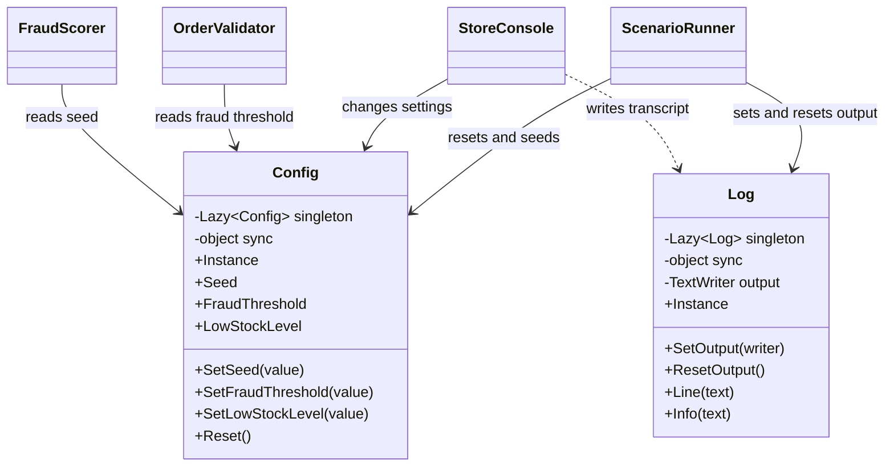

# Singleton

## Intent

Singleton provides one process-wide instance and a controlled access point for it. It is described in Chapter 3, "Creational Patterns," of *Design Patterns: Elements of Reusable Object-Oriented Software*.

## The smell

S05 exposes configuration and transcript output through static classes with public mutable fields. Any caller can replace the global values directly.

## The refactor

`Config` and `Log` are sealed instances created through thread-safe `Lazy<T>` properties. Configuration changes use synchronized methods and read-only properties. The logger synchronizes writer replacement and output. `ScenarioRunner` resets configuration and the writer for each run; callers use the shared instances.

## Diff highlights

The public static fields and direct static log calls are replaced by singleton instances. The `Lazy<T>` instances protect construction, while locks protect mutable configuration and log output. See [DIFF.md](DIFF.md).

## Trade-offs

Singleton access creates process-wide coupling and makes independent state harder to test or isolate. The thread-safe accessors prevent data races, but concurrent scenarios still share configuration and the output writer. Singleton is unnecessary when state belongs to a request, a scenario, or a test, or when more than one instance is useful.

## Related patterns and common confusions

A Singleton restricts construction and provides a global access point. Dependency injection can instead provide one instance per service provider without requiring callers to access a global property. In a host that already uses DI, register the existing instance with `services.AddSingleton(Config.Instance)` and inject `Config` into consumers. Do not retain manual global access as a second way to resolve it.

## Modern .NET notes

`Lazy<T>` with `LazyThreadSafetyMode.ExecutionAndPublication` provides thread-safe, deferred construction. A DI container's singleton lifetime is usually easier to substitute and scope in application tests. Registering an existing instance lets a host adopt this implementation without creating a second object; the CornerStore sample does not add a DI package.

## Files changed

* `src/CornerStore/Config.cs`
* `src/CornerStore/Log.cs`
* `src/CornerStore/ScenarioRunner.cs`
* `src/CornerStore/StoreConsole.cs`
* `src/CornerStore/Checkout/FraudScorer.cs`
* `src/CornerStore/Checkout/OrderValidator.cs`
* `src/CornerStore/Checkout/AfterpayProcessor.cs`
* `src/CornerStore/Checkout/CardProcessor.cs`
* `src/CornerStore/Checkout/PayPalProcessor.cs`
* `src/CornerStore/Checkout/ShipFastClient.cs`
* `src/CornerStore/Catalog/Catalog.cs`
* `src/CornerStore/Notifications/EmailSender.cs`
* `src/CornerStore/Notifications/SmsSender.cs`
* `src/CornerStore/Orders/AnalyticsService.cs`
* `src/CornerStore/Orders/LoyaltyService.cs`
* `src/CornerStore/Widgets/ItemListWidget.cs`
* `src/CornerStore/Widgets/PromoBoxWidget.cs`
* `src/CornerStore/Widgets/ShippingSelectorWidget.cs`
* `src/CornerStore/Widgets/TotalsPanelWidget.cs`
* `src/CornerStore/CornerStore.csproj`
* `tests/CornerStore.Tests/AssemblyAttributes.cs`
* `tests/CornerStore.Tests/SingletonTests.cs`

The project file grants the test assembly internal visibility so focused tests can exercise the singleton instances without making them public.

## Blog post link

To be published.
