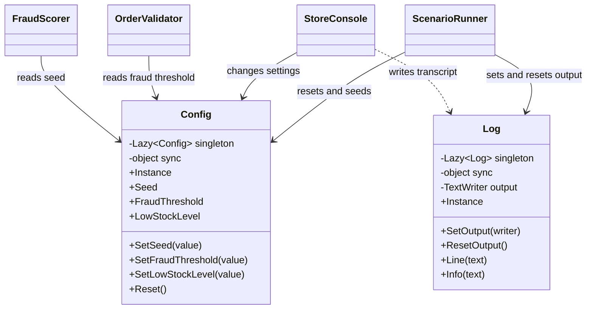
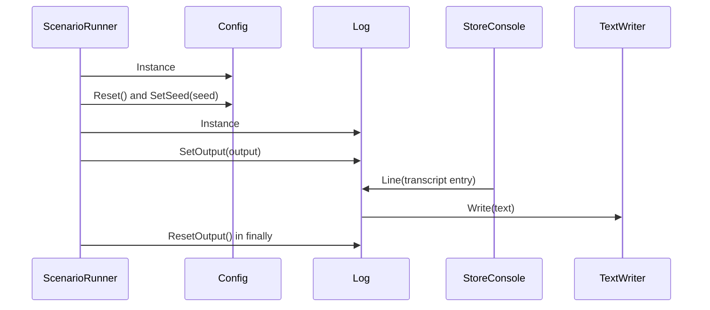

# Singleton

## At a glance

| | |
| --- | --- |
| Intent | Provide one shared, controlled instance for application configuration and transcript logging. |
| Category | Creational |
| Smell fixed | S05: mutable static global state. |
| GoF chapter | Chapter 3, "Creational Patterns," section "Singleton." |
| Files changed | `src/CornerStore/Catalog/Catalog.cs`; `src/CornerStore/Checkout/AfterpayProcessor.cs`; `src/CornerStore/Checkout/CardProcessor.cs`; `src/CornerStore/Checkout/FraudScorer.cs`; `src/CornerStore/Checkout/OrderValidator.cs`; `src/CornerStore/Checkout/PayPalProcessor.cs`; `src/CornerStore/Checkout/ShipFastClient.cs`; `src/CornerStore/Config.cs`; `src/CornerStore/CornerStore.csproj`; `src/CornerStore/Log.cs`; `src/CornerStore/Notifications/EmailSender.cs`; `src/CornerStore/Notifications/SmsSender.cs`; `src/CornerStore/Orders/AnalyticsService.cs`; `src/CornerStore/Orders/LoyaltyService.cs`; `src/CornerStore/ScenarioRunner.cs`; `src/CornerStore/StoreConsole.cs`; `src/CornerStore/Widgets/ItemListWidget.cs`; `src/CornerStore/Widgets/PromoBoxWidget.cs`; `src/CornerStore/Widgets/ShippingSelectorWidget.cs`; `src/CornerStore/Widgets/TotalsPanelWidget.cs`; `tests/CornerStore.Tests/AssemblyAttributes.cs`; `tests/CornerStore.Tests/SingletonTests.cs` ([DIFF.md](DIFF.md)) |
| File count | 22 files ([DIFF.md](DIFF.md)) |
| Previous pattern | [Prototype](../prototype/README.md) |
| Next pattern | [Adapter](../../structural/adapter/README.md) |

## The problem

The baseline exposed configuration and transcript output through static classes with public mutable fields. Any caller could replace those global values directly. The baseline marks S05 in [`Config.cs`](../../../baseline/src/CornerStore/Config.cs) and [`Log.cs`](../../../baseline/src/CornerStore/Log.cs).

```csharp
public static int Seed = 0;
public static int FraudThreshold = 80;
public static int LowStockLevel = 3;
```

## The pattern

Singleton controls construction and provides a shared access point to one instance. In this solution, `Config` and `Log` each expose a lazily created instance. Their methods control access to mutable configuration and the output writer.

| Role | CornerStore participant |
| --- | --- |
| Singleton configuration | `Config` |
| Singleton transcript logger | `Log` |
| Shared-instance access points | `Config.Instance` and `Log.Instance` |
| Scenario client | `ScenarioRunner` |
| Other clients | `StoreConsole`, `OrderValidator`, `FraudScorer` and services that write log output |

## The refactor

`Config` and `Log` are sealed instances created through thread-safe `Lazy<T>` properties. Configuration changes use synchronized methods and read-only properties. The logger synchronizes writer replacement and output. `ScenarioRunner` resets configuration and the writer for each run; callers use the shared instances.

Before, [`Config.cs`](../../../baseline/src/CornerStore/Config.cs) exposed public static fields:

```csharp
public static int Seed = 0;
public static int FraudThreshold = 80;
public static int LowStockLevel = 3;
```

After, [`Config.cs`](src/CornerStore/Config.cs) creates a shared instance lazily:

```csharp
private static readonly Lazy<Config> singleton =
    new(static () => new Config(), LazyThreadSafetyMode.ExecutionAndPublication);
```

The instance in [`Config.cs`](src/CornerStore/Config.cs) is accessed through a property:

```csharp
public static Config Instance => singleton.Value;
```

Configuration changes go through methods in [`Config.cs`](src/CornerStore/Config.cs):

```csharp
public void SetSeed(int value)
{
    lock (sync)
    {
        seed = value;
    }
}
```

[`Log.cs`](src/CornerStore/Log.cs) follows the same instance pattern and guards its output writer:

```csharp
public static Log Instance => singleton.Value;

public void SetOutput(TextWriter writer)
{
    ArgumentNullException.ThrowIfNull(writer);
    lock (sync)
    {
        output = writer;
    }
}
```



## How it runs

`ScenarioRunner` gets `Config.Instance`, resets it and sets the scenario seed. It gets `Log.Instance` and directs output to the supplied writer before running the scenario. Clients write through the shared logger. A `finally` block resets the writer after the run so later output does not keep going to the scenario's writer.



## Run it

Run these commands from the repository root. Each command was run for this solution.

```powershell
dotnet build patterns/creational/singleton/Singleton.slnx
dotnet test patterns/creational/singleton/Singleton.slnx
dotnet run --project patterns/creational/singleton/src/CornerStore/CornerStore.csproj -- scenarios/trading-day.json
```

## Trade-offs

Singleton access creates process-wide coupling and makes independent state harder to test or isolate. The thread-safe accessors prevent data races, but concurrent scenarios still share configuration and the output writer. Singleton is unnecessary when state belongs to a request, a scenario or a test, or when more than one instance is useful.

## Related patterns

The [comparison guide](../../../docs/comparisons.md) has no Singleton-specific section. [Factory Method](../factory-method/README.md) and [Abstract Factory](../abstract-factory/README.md) show other creational approaches that make object construction explicit. A dependency-injection singleton lifetime can provide one instance per service provider without requiring callers to access a global property.

## Modern .NET notes

`Lazy<T>` with `LazyThreadSafetyMode.ExecutionAndPublication` provides thread-safe, deferred construction. A dependency-injection container's singleton lifetime is usually easier to substitute and scope in application tests. A host can register the existing instance with `services.AddSingleton(Config.Instance)` and inject `Config` into consumers; it should not retain manual global access as a second resolution path. The CornerStore sample does not add a DI package.

## Further reading

GoF, Chapter 3, "Creational Patterns," section "Singleton."

Blog post: coming soon <!-- blog-link -->
