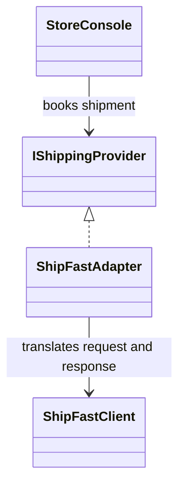
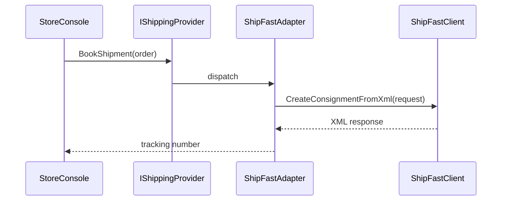

# Adapter

## At a glance

| | |
| --- | --- |
| Intent | Translate the courier SDK interface into a shipping contract the checkout flow can use. |
| Category | Structural |
| Smell fixed | S06: checkout depends directly on the courier's XML protocol and money units. |
| GoF chapter | Chapter 4, "Structural Patterns: Adapter." |
| Files changed | `src/CornerStore/Checkout/IShippingProvider.cs`; `src/CornerStore/Checkout/ShipFastAdapter.cs`; `src/CornerStore/CornerStore.csproj`; `src/CornerStore/StoreConsole.cs`; `tests/CornerStore.Tests/AdapterTests.cs` ([DIFF.md](DIFF.md)) |
| File count | 5 files ([DIFF.md](DIFF.md)) |
| Previous pattern | [Singleton](../../creational/singleton/README.md) |
| Next pattern | [Bridge](../bridge/README.md) |

## The problem

In the baseline, checkout builds the courier's XML request, converts the total to cents and parses the response. The console therefore knows details of the ShipFast API instead of depending on a shipping operation. The baseline S06 marker and implementation are in [`StoreConsole.cs`](../../../baseline/src/CornerStore/StoreConsole.cs).

```csharp
var response = shipFastClient.CreateConsignmentFromXml(request);
return XDocument.Parse(response).Root?.Element("tracking")?.Value ?? "";
```

## The pattern

An Adapter translates one interface into another without requiring changes to the existing implementation. The client uses its own domain contract, while the adapter handles the vendor's request and response format.

| Role | CornerStore participant |
| --- | --- |
| Client | `StoreConsole` |
| Target | `IShippingProvider` |
| Adapter | `ShipFastAdapter` |
| Adaptee | `ShipFastClient` |

## The refactor

The checkout flow now calls `IShippingProvider.BookShipment`. `ShipFastAdapter` keeps the existing XML protocol, cents conversion, escaping and response parsing at the integration boundary. `ShipFastClient` remains unchanged.

Before, [`StoreConsole.cs`](../../../baseline/src/CornerStore/StoreConsole.cs) contained courier-specific request and response handling:

```csharp
var response = shipFastClient.CreateConsignmentFromXml(request);
return XDocument.Parse(response).Root?.Element("tracking")?.Value ?? "";
```

After, [`StoreConsole.cs`](src/CornerStore/StoreConsole.cs) uses the target interface:

```csharp
order.TrackingNumber = shippingProvider.BookShipment(order);
```

The adapter implements the translation in [`ShipFastAdapter.cs`](src/CornerStore/Checkout/ShipFastAdapter.cs):

```csharp
var response = client.CreateConsignmentFromXml(request);
return XDocument.Parse(response).Root?.Element("tracking")?.Value ?? "";
```



## How it runs

After checkout reserves stock, `StoreConsole` calls `BookShipment` on its provider. The adapter escapes recipient data, converts the quote total to cents and creates the XML request. It calls ShipFast and returns the tracking value parsed from the response.



## Run it

Run these commands from the repository root. The build, tests and scenario command were verified for this solution.

```powershell
dotnet build patterns/structural/adapter/Adapter.slnx
dotnet test patterns/structural/adapter/Adapter.slnx
dotnet run --project patterns/structural/adapter/src/CornerStore/CornerStore.csproj -- scenarios/trading-day.json
```

## Trade-offs

The adapter adds a type and translation code, but isolates the client from a mismatched API. It is unnecessary when the existing interface already fits the caller or there is no meaningful incompatibility to isolate.

## Related patterns

[Adapter vs Bridge](../../../docs/comparisons.md#adapter-vs-bridge) contrasts translating an existing interface with separating two dimensions that vary independently. [Bridge](../bridge/README.md) separates message types from delivery channels. [Decorator](../decorator/README.md) keeps an interface and adds behavior rather than translating a protocol.

## Modern .NET notes

Adapters are common at third-party SDK and legacy-system boundaries. Dependency injection can supply an adapter through its target interface, but no framework is required here.

## Further reading

GoF, Chapter 4, "Structural Patterns: Adapter."

Blog post: coming soon <!-- blog-link -->
