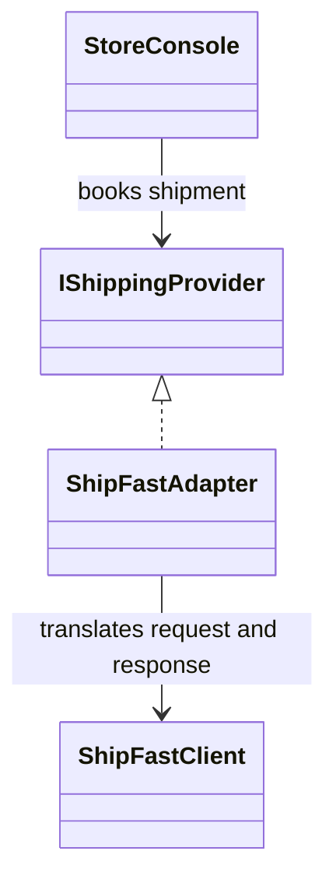

# Adapter

## Intent

Adapter translates one interface into another that its client can use, allowing
an existing implementation to fit a domain-level contract without changing
the implementation itself (GoF, chapter 4).

## The smell

Checkout previously constructed courier XML, converted the total to cents,
called `CreateConsignmentFromXml`, and parsed the response. The console had to
know ShipFast's wire format. The baseline marker is in
[`StoreConsole.cs`](../../../baseline/src/CornerStore/StoreConsole.cs).

## The refactor

Checkout now uses `IShippingProvider`. `ShipFastAdapter` translates the order
into the client's XML request, converts the amount to cents, calls
`ShipFastClient`, and extracts its tracking response. The vendor client remains
unchanged.

## Diff highlights

ShipFast-specific XML and cents handling now lives in the adapter. The
checkout flow depends on the provider interface, while the shared transcript
and tracking number remain unchanged. See [DIFF.md](DIFF.md) for the changes.

## Trade-offs

The adapter adds a type and translation code. It is unnecessary when the
existing interface already matches the client's needs or when there is no
meaningful incompatibility to isolate.

## Related patterns and common confusions

Adapter changes an interface so a client can use an existing implementation.
Decorator keeps the same interface and wraps an object to add behavior.

## Modern .NET notes

The .NET ecosystem commonly uses adapters to normalize third-party SDKs and
legacy interfaces. Dependency injection can supply an adapter through its
domain interface, but no framework is required here.

## Files changed

* `src/CornerStore/Checkout/IShippingProvider.cs`
* `src/CornerStore/Checkout/ShipFastAdapter.cs`
* `src/CornerStore/StoreConsole.cs`
* `src/CornerStore/CornerStore.csproj`
* `tests/CornerStore.Tests/AdapterTests.cs`

## Blog post link

To be published.
