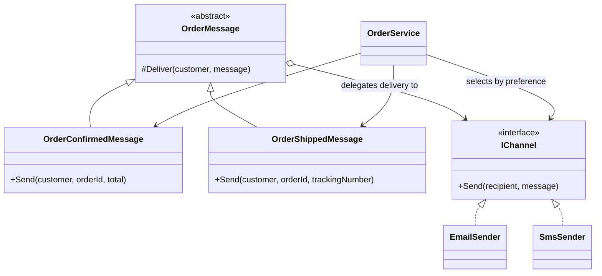

# Bridge

## Intent

Bridge separates an abstraction from the implementation that carries out its work. Each side can vary without creating a class for every combination. This example follows the Bridge chapter in *Design Patterns: Elements of Reusable Object-Oriented Software*.

## The smell

S07 combined each order message with a delivery channel. Confirmation email, confirmation SMS, shipping email and shipping SMS were four separate classes. The markers were in the four notification classes under `Notifications/`.

## The refactor

`OrderMessage` holds an `IChannel` implementation. `OrderConfirmedMessage` and `OrderShippedMessage` define the message-specific wording, while `EmailSender` and `SmsSender` deliver it. `OrderService` chooses a channel using the customer's existing preference and can combine either message with either channel.

## Diff highlights

The four message-channel classes are replaced by two message abstractions and a shared channel interface. The channel implementations now satisfy that interface. The customer preference and all emitted business text remain unchanged. See [DIFF.md](DIFF.md).

## Trade-offs

Bridge reduces combination-specific classes but adds an abstraction layer and explicit composition. It is unnecessary when there is only one message type or one channel and neither dimension is expected to change.

## Related patterns and common confusions

Adapter makes an existing incompatible interface usable by a client. Bridge separates two dimensions before they vary independently. `IChannel` is the delivery implementation behind the message abstraction, not an adapter for a third-party API.

## Modern .NET notes

Interfaces and dependency injection make the channel dimension easy to compose. The example wires email and SMS channels explicitly in `StoreConsole`; a larger application could register channel implementations with its service container.

## Files changed

* `src/CornerStore/CornerStore.csproj`
* `src/CornerStore/Notifications/EmailSender.cs`
* `src/CornerStore/Notifications/IChannel.cs`
* `src/CornerStore/Notifications/OrderConfirmedEmail.cs` (removed)
* `src/CornerStore/Notifications/OrderConfirmedMessage.cs`
* `src/CornerStore/Notifications/OrderConfirmedSms.cs` (removed)
* `src/CornerStore/Notifications/OrderMessage.cs`
* `src/CornerStore/Notifications/OrderShippedEmail.cs` (removed)
* `src/CornerStore/Notifications/OrderShippedMessage.cs`
* `src/CornerStore/Notifications/OrderShippedSms.cs` (removed)
* `src/CornerStore/Notifications/SmsSender.cs`
* `src/CornerStore/Orders/OrderService.cs`
* `src/CornerStore/StoreConsole.cs`
* `tests/CornerStore.Tests/BridgeTests.cs`

## Blog post link

To be published.
