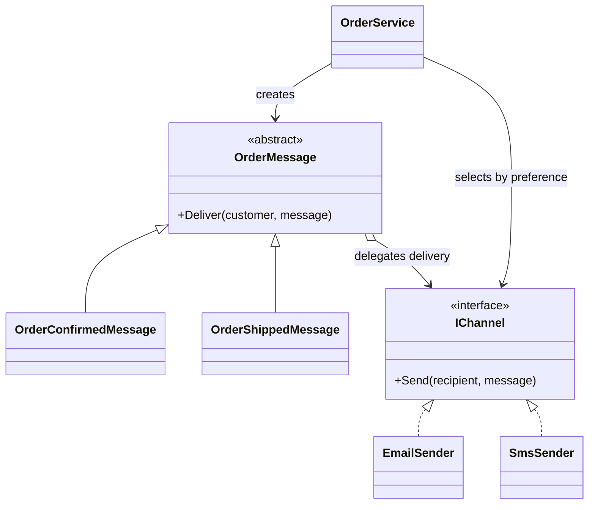
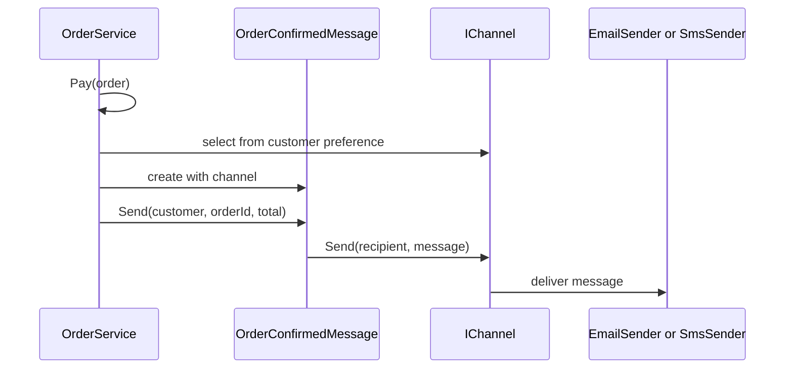

# Bridge

## At a glance

| | |
| --- | --- |
| Intent | Separate order-message wording from the channel that delivers it. |
| Category | Structural |
| Smell fixed | S07: each order-message class combines a message type with a delivery channel. |
| GoF chapter | Chapter 4, "Structural Patterns: Bridge." |
| Files changed | `src/CornerStore/CornerStore.csproj`; `src/CornerStore/Notifications/EmailSender.cs`; `src/CornerStore/Notifications/IChannel.cs`; `src/CornerStore/Notifications/OrderConfirmedEmail.cs` (removed); `src/CornerStore/Notifications/OrderConfirmedMessage.cs`; `src/CornerStore/Notifications/OrderConfirmedSms.cs` (removed); `src/CornerStore/Notifications/OrderMessage.cs`; `src/CornerStore/Notifications/OrderShippedEmail.cs` (removed); `src/CornerStore/Notifications/OrderShippedMessage.cs`; `src/CornerStore/Notifications/OrderShippedSms.cs` (removed); `src/CornerStore/Notifications/SmsSender.cs`; `src/CornerStore/Orders/OrderService.cs`; `src/CornerStore/StoreConsole.cs`; `tests/CornerStore.Tests/BridgeTests.cs` ([DIFF.md](DIFF.md)) |
| File count | 14 files ([DIFF.md](DIFF.md)) |
| Previous pattern | [Adapter](../adapter/README.md) |
| Next pattern | [Composite](../composite/README.md) |

## The problem

The baseline has separate classes for confirmation email, confirmation SMS, shipping email and shipping SMS. Each class combines message wording with a particular sender, so adding another message or channel creates more combinations. The S07 markers appear in the baseline notification classes, including [`OrderConfirmedEmail.cs`](../../../baseline/src/CornerStore/Notifications/OrderConfirmedEmail.cs).

```csharp
internal class OrderConfirmedEmail(EmailSender sender)
{
    // SMELL S07: confirmation email owns the email-specific wording and sender call
    public void Send(Customer customer, string orderId, decimal total)
    {
        sender.Send(customer.Name, "order " + orderId + " confirmed, total " + MoneyFormatter.Format(total, customer.Region));
    }
}
```

## The pattern

Bridge separates an abstraction from the implementation that carries out its work. Here, message classes decide what to say and channel implementations decide how to deliver it. Either dimension can be extended without adding a class for every combination.

| Role | CornerStore participant |
| --- | --- |
| Abstraction | `OrderMessage` |
| Refined abstractions | `OrderConfirmedMessage`, `OrderShippedMessage` |
| Implementor | `IChannel` |
| Concrete implementors | `EmailSender`, `SmsSender` |
| Client and composition point | `OrderService` |

## The refactor

`OrderMessage` holds an `IChannel` and uses it to deliver formatted text. Concrete message types provide message-specific wording; the email and SMS senders implement the channel interface. `OrderService` selects the channel using the customer's existing preference.

Before, [`OrderConfirmedEmail.cs`](../../../baseline/src/CornerStore/Notifications/OrderConfirmedEmail.cs) combined both dimensions:

```csharp
sender.Send(customer.Name, "order " + orderId + " confirmed, total " + MoneyFormatter.Format(total, customer.Region));
```

After, [`OrderConfirmedMessage.cs`](src/CornerStore/Notifications/OrderConfirmedMessage.cs) provides the message, while [`OrderMessage.cs`](src/CornerStore/Notifications/OrderMessage.cs) delegates delivery:

```csharp
Deliver(customer, "order " + orderId + " confirmed, total " + MoneyFormatter.Format(total, customer.Region));
```



## How it runs

When an order is paid, `OrderService` records the status change, chooses an `IChannel` from the customer's preference and creates an `OrderConfirmedMessage`. That message formats the confirmation and delegates delivery through the channel. A shipping transition follows the same structure with `OrderShippedMessage`.



## Run it

Run these commands from the repository root. The build, tests and scenario command were verified for this solution.

```powershell
dotnet build patterns/structural/bridge/Bridge.slnx
dotnet test patterns/structural/bridge/Bridge.slnx
dotnet run --project patterns/structural/bridge/src/CornerStore/CornerStore.csproj -- scenarios/trading-day.json
```

## Trade-offs

Bridge reduces classes that represent every message-channel combination, but introduces an abstraction layer and explicit composition. It is unnecessary when only one message type or one channel exists and neither dimension is expected to vary.

## Related patterns

[Adapter vs Bridge](../../../docs/comparisons.md#adapter-vs-bridge) compares interface translation with separating independent dimensions. [Adapter](../adapter/README.md) translates an existing incompatible API. [Strategy](../../behavioral/strategy/) also composes interchangeable implementations, but chooses an algorithm rather than separating an abstraction from its implementation.

## Modern .NET notes

Interfaces and dependency injection make the channel dimension straightforward to compose. This example wires the email and SMS implementations explicitly in `StoreConsole`; a larger application could register them with its service container.

## Further reading

GoF, Chapter 4, "Structural Patterns: Bridge."

Blog post: coming soon <!-- blog-link -->
