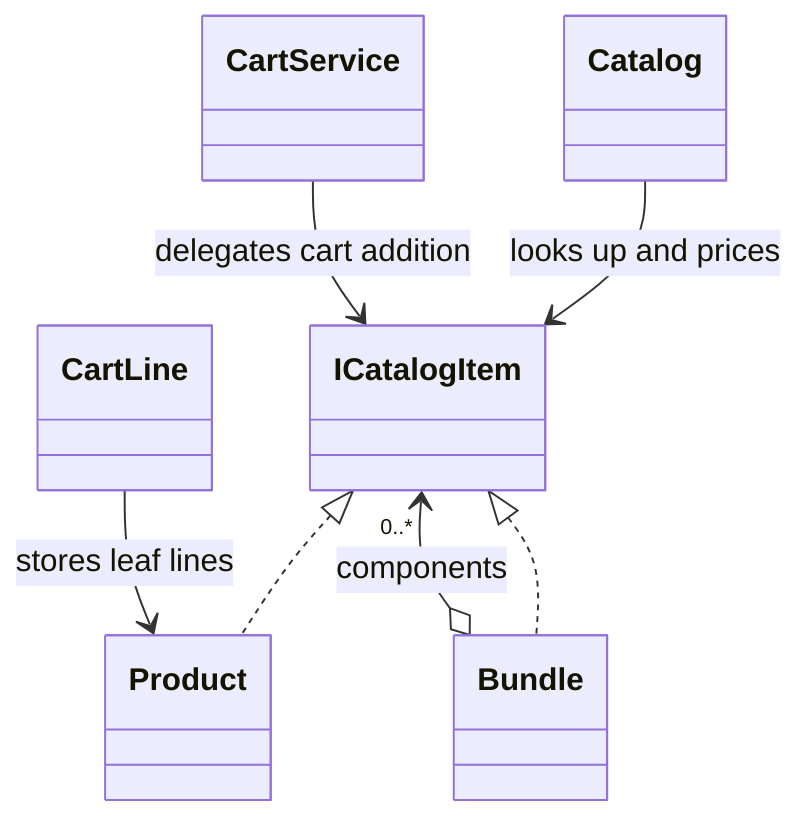

# Composite

## Intent

Composite gives individual objects and groups a common contract so callers can
use them in the same way (GoF, chapter 4).

## The smell

`Catalog.PriceOf` and `CartService.Add` used separate paths for products and
bundles, with `is Bundle` checks. `Catalog.AddToBundle` also rejects bundles
as components. The S08 markers are in
[`Catalog.cs`](../../../baseline/src/CornerStore/Catalog/Catalog.cs) and
[`CartService.cs`](../../../baseline/src/CornerStore/Cart/CartService.cs).

## The refactor

`ICatalogItem` is the shared contract for `Product` leaves and `Bundle`
composites. Catalog pricing reads the common `Price`, and cart addition
delegates to the item instead of branching on its type. A bundle expands its
components into product cart lines and allocates the discounted price across
those lines.

The catalog continues to reject nested bundles. That is a settled behavior
recorded in the approved transcript; the component model does not change this
business rule.

## Diff highlights

The component contract now owns price and cart behavior for products and
bundles. Catalog and cart clients share that contract, while the catalog keeps
the transcript-preserving nesting restriction. See [DIFF.md](DIFF.md) for the
exact source and test changes.

## Trade-offs

The shared interface makes pricing and cart behavior uniform, but adds a
contract and recursive component logic. It is unnecessary when there are only
a few fixed item types and clients do not need to treat groups like leaves.
Nested bundles are not enabled here because doing so would change the approved
scenario behavior.

## Related patterns and common confusions

Composite treats parts and groups uniformly through a shared interface.
Decorator also wraps a component, but adds a responsibility rather than
representing a group of child items. The bundle's discount is group behavior,
not a decoration around each product.

## Modern .NET notes

`IEnumerable<T>` and collection APIs provide common ways to traverse groups,
but they do not define the domain-specific price allocation or cart expansion
needed here. `ICatalogItem` keeps those operations explicit.

## Files changed

* `src/CornerStore/Cart/CartService.cs`
* `src/CornerStore/Catalog/Bundle.cs`
* `src/CornerStore/Catalog/Catalog.cs`
* `src/CornerStore/Catalog/ICatalogItem.cs`
* `src/CornerStore/Catalog/Product.cs`
* `tests/CornerStore.Tests/CompositeTests.cs`

## Blog post link

To be published.
