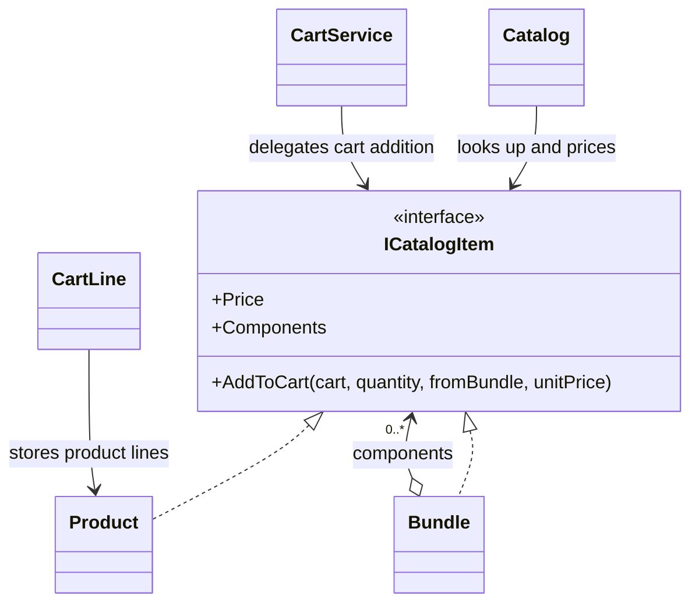
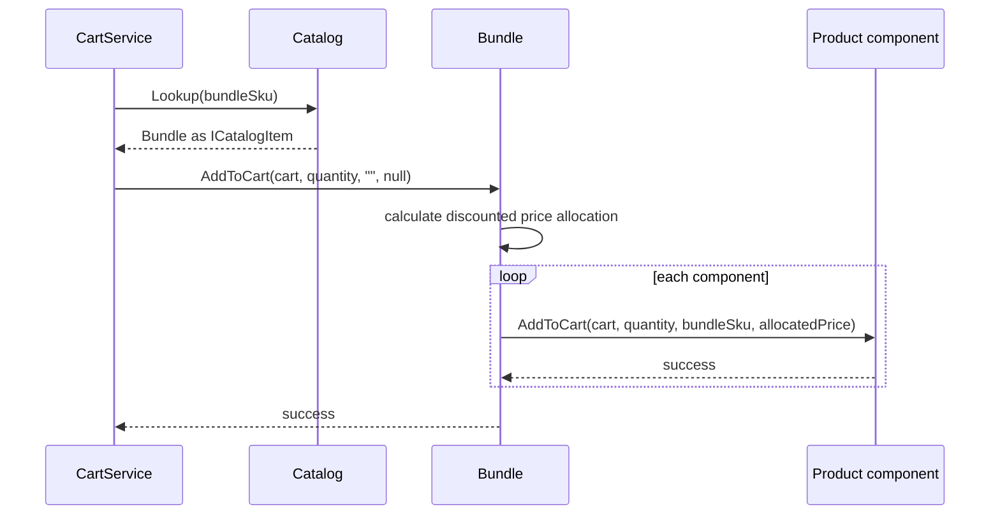

# Composite

## At a glance

| | |
| --- | --- |
| Intent | Give products and bundles one catalog-item contract for pricing and cart operations. |
| Category | Structural |
| Smell fixed | S08: catalog and cart code branch on bundles instead of treating items uniformly. |
| GoF chapter | Chapter 4, "Structural Patterns: Composite." |
| Files changed | `src/CornerStore/Cart/CartService.cs`; `src/CornerStore/Catalog/Bundle.cs`; `src/CornerStore/Catalog/Catalog.cs`; `src/CornerStore/Catalog/ICatalogItem.cs`; `src/CornerStore/Catalog/Product.cs`; `tests/CornerStore.Tests/CompositeTests.cs` ([DIFF.md](DIFF.md)) |
| File count | 6 files ([DIFF.md](DIFF.md)) |
| Previous pattern | [Bridge](../bridge/README.md) |
| Next pattern | [Decorator](../decorator/README.md) |

## The problem

In the baseline, catalog pricing and cart addition use separate paths for products and bundles, with type checks and special-case expansion logic. Bundles also cannot contain other bundles. The S08 markers are in [`Catalog.cs`](../../../baseline/src/CornerStore/Catalog/Catalog.cs) and [`CartService.cs`](../../../baseline/src/CornerStore/Cart/CartService.cs).

```csharp
// SMELL S08: bundles take a separate pricing path picked with an is-check
if (item is Bundle bundle)
{
    var total = 0m;
    foreach (var componentSku in bundle.ComponentSkus)
    {
        total += products[componentSku].Price;
    }

    return Math.Round(total * (100 - bundle.DiscountPercent) / 100m, 2, MidpointRounding.AwayFromZero);
}
```

## The pattern

Composite models individual objects and groups behind the same component contract. Clients can ask either kind for its price or ask it to add itself to a cart, while a bundle delegates work to its components.

| Role | CornerStore participant |
| --- | --- |
| Component | `ICatalogItem` |
| Leaf | `Product` and its product subtypes |
| Composite | `Bundle` |
| Clients | `Catalog`, `CartService` |

## The refactor

`ICatalogItem` defines shared identity, price, components and cart-add behavior. `Product` is a leaf; `Bundle` contains components and calculates its discounted price. Catalog pricing and cart addition now use the common interface. Bundle expansion allocates the discounted price across product lines, and the existing rule against nested bundles remains unchanged.

Before, [`Catalog.cs`](../../../baseline/src/CornerStore/Catalog/Catalog.cs) calculated bundle price separately from product price:

```csharp
if (item is Bundle bundle)
{
    var total = 0m;
    foreach (var componentSku in bundle.ComponentSkus)
    {
        total += products[componentSku].Price;
    }

    return Math.Round(total * (100 - bundle.DiscountPercent) / 100m, 2, MidpointRounding.AwayFromZero);
}

if (item is Product product)
{
    return product.Price;
}
```

After, [`Catalog.cs`](src/CornerStore/Catalog/Catalog.cs) delegates pricing to the catalog item:

```csharp
var item = Lookup(sku);
return item?.Price ?? throw new KeyNotFoundException("unknown sku " + sku);
```



## How it runs

When a customer adds a bundle, `CartService` looks it up as an `ICatalogItem` and calls `AddToCart`. `Bundle` computes its discounted total, allocates that price across its product components and asks each component to add a cart line. The last component receives any rounding remainder so the line prices sum to the bundle price.



## Run it

Run these commands from the repository root. The build, tests and scenario command were verified for this solution.

```powershell
dotnet build patterns/structural/composite/Composite.slnx
dotnet test patterns/structural/composite/Composite.slnx
dotnet run --project patterns/structural/composite/src/CornerStore/CornerStore.csproj -- scenarios/trading-day.json
```

## Trade-offs

The shared component contract makes clients simpler, but adds a contract and recursive group behavior. Composite is unnecessary when there are only a few fixed item types and clients do not need to treat groups like individual items. This solution does not enable nested bundles because that would change the established scenario behavior.

## Related patterns

[Composite vs Decorator](../../../docs/comparisons.md#composite-vs-decorator) contrasts grouping child items with adding responsibilities around one component. [Decorator](../decorator/README.md) wraps an object to add behavior; a bundle represents a group and its discounted price.

## Modern .NET notes

`IEnumerable<T>` and collection APIs help traverse groups, but do not define CornerStore's domain-specific pricing or cart expansion. `ICatalogItem` keeps those operations explicit.

## Further reading

GoF, Chapter 4, "Structural Patterns: Composite."

Blog post: coming soon <!-- blog-link -->
