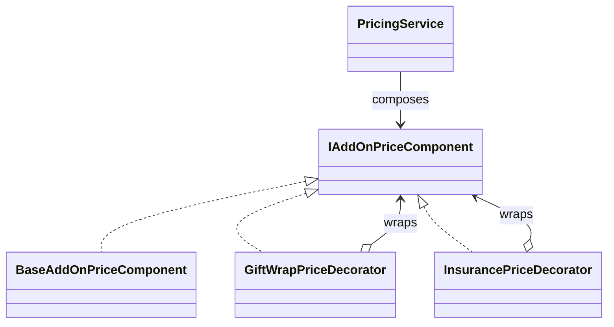

# Decorator

## Intent

Decorator wraps a component with another object that implements the same
interface, adding responsibility without changing the original component
(GoF, chapter 4).

## The smell

`Cart` represented gift wrap and insurance with booleans, and `PricingService`
used an if-chain to calculate the extra cost. Adding an option changed the
pricing method. The baseline marker is in
[`PricingService.cs`](../../../baseline/src/CornerStore/Pricing/PricingService.cs).

## The refactor

Pricing composes a base add-on component with `GiftWrapPriceDecorator` and
`InsurancePriceDecorator`. Each wrapper implements `IAddOnPriceComponent` and
adds its own cost. Insurance receives the discounted subtotal explicitly so
its basis does not include gift wrap.

## Diff highlights

Add-on cost calculations now live in composable wrappers rather than the
pricing if-chain. Cart flags remain as the options' activation state, while
the decorators own their costs. See [DIFF.md](DIFF.md) for the exact changes.

## Trade-offs

Each add-on introduces a wrapper and composition step. Decorator is overkill
for a small, fixed set of options that rarely changes; a direct calculation
can be easier to follow when composition is not useful.

## Related patterns and common confusions

Decorator keeps the component interface and adds behavior around an object.
Adapter changes an incompatible interface so a client can use an existing
implementation. Use Decorator for added responsibility, not protocol
translation.

See [Decorator vs Proxy](../../../docs/comparisons.md#decorator-vs-proxy) for a side-by-side comparison.

## Modern .NET notes

The .NET stream and middleware APIs use wrapper-style composition. This
example keeps an explicit domain interface because the add-on costs are
specific to CornerStore pricing.

## Files changed

* `src/CornerStore/Pricing/IAddOnPriceComponent.cs`
* `src/CornerStore/Pricing/BaseAddOnPriceComponent.cs`
* `src/CornerStore/Pricing/GiftWrapPriceDecorator.cs`
* `src/CornerStore/Pricing/InsurancePriceDecorator.cs`
* `src/CornerStore/Pricing/PricingService.cs`
* `src/CornerStore/Cart/Cart.cs`
* `src/CornerStore/StoreConsole.cs`
* `src/CornerStore/CornerStore.csproj`
* `tests/CornerStore.Tests/DecoratorTests.cs`

## Blog post link

To be published.
