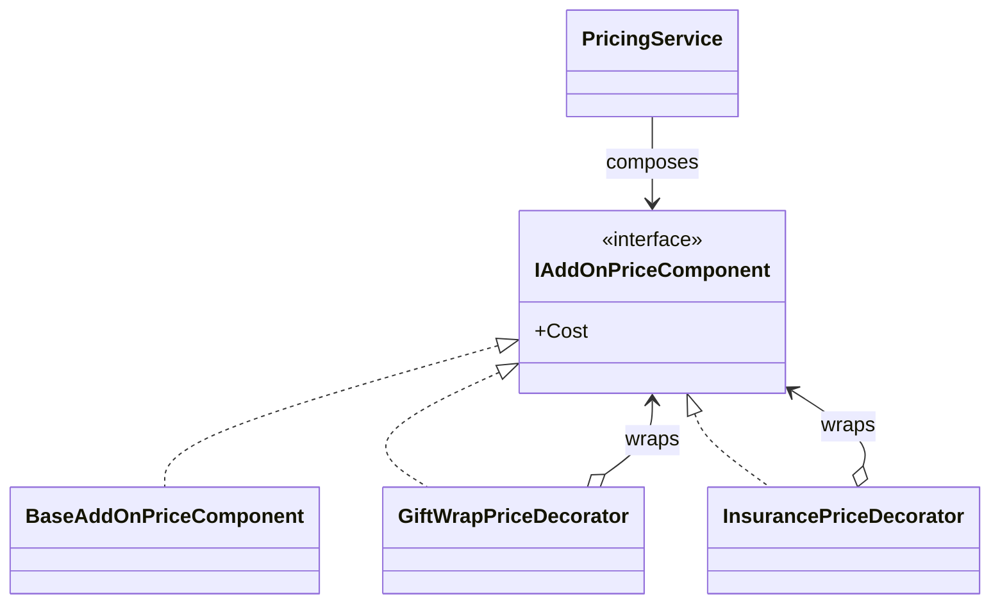

# Decorator

## At a glance

| | |
| --- | --- |
| Intent | Compose gift-wrap and insurance costs around a common add-on price component. |
| Category | Structural |
| Smell fixed | S09: add-on costs are calculated in an if-chain from cart flags. |
| GoF chapter | Chapter 4, "Structural Patterns: Decorator." |
| Files changed | `src/CornerStore/Cart/Cart.cs`; `src/CornerStore/CornerStore.csproj`; `src/CornerStore/Pricing/BaseAddOnPriceComponent.cs`; `src/CornerStore/Pricing/GiftWrapPriceDecorator.cs`; `src/CornerStore/Pricing/IAddOnPriceComponent.cs`; `src/CornerStore/Pricing/InsurancePriceDecorator.cs`; `src/CornerStore/Pricing/PricingService.cs`; `src/CornerStore/StoreConsole.cs`; `tests/CornerStore.Tests/DecoratorTests.cs` ([DIFF.md](DIFF.md)) |
| File count | 9 files ([DIFF.md](DIFF.md)) |
| Previous pattern | [Composite](../composite/README.md) |
| Next pattern | [Facade](../facade/README.md) |

## The problem

In the baseline, `Cart` stores gift wrap and insurance as boolean flags, and `PricingService` checks each flag in an if-chain. Adding an option requires changing the central calculation. The S09 markers are in [`Cart.cs`](../../../baseline/src/CornerStore/Cart/Cart.cs), [`PricingService.cs`](../../../baseline/src/CornerStore/Pricing/PricingService.cs) and [`StoreConsole.cs`](../../../baseline/src/CornerStore/StoreConsole.cs).

```csharp
var cost = 0m;
if (cart.GiftWrap)
{
    cost += 4.50m;
}

if (cart.Insurance)
{
    cost += Math.Round(discountedSubtotal * 0.02m, 2, MidpointRounding.AwayFromZero);
}
```

## The pattern

Decorator wraps an object that implements a component contract and adds responsibility while preserving that contract. A base component represents no add-on cost; each decorator adds the cost for one option.

| Role | CornerStore participant |
| --- | --- |
| Component | `IAddOnPriceComponent` |
| Concrete component | `BaseAddOnPriceComponent` |
| Concrete decorators | `GiftWrapPriceDecorator`, `InsurancePriceDecorator` |
| Client and composition point | `PricingService` |

## The refactor

`PricingService` starts with a base component and wraps it with decorators for the selected cart options. The cart flags remain the activation state; the decorators own the cost rules. Insurance receives the discounted subtotal directly, so its percentage does not include gift wrap.

Before, [`PricingService.cs`](../../../baseline/src/CornerStore/Pricing/PricingService.cs) contained both option calculations:

```csharp
if (cart.Insurance)
{
    cost += Math.Round(discountedSubtotal * 0.02m, 2, MidpointRounding.AwayFromZero);
}
```

After, [`PricingService.cs`](src/CornerStore/Pricing/PricingService.cs) composes the price component:

```csharp
IAddOnPriceComponent component = new BaseAddOnPriceComponent();
component = new GiftWrapPriceDecorator(component, cart.GiftWrap);
component = new InsurancePriceDecorator(component, cart.Insurance, discountedSubtotal);
return component.Cost;
```



## How it runs

When pricing a cart, `PricingService` creates a base component, wraps it for gift wrap and then wraps that result for insurance. Reading the final `Cost` delegates through the wrappers and sums the enabled costs. Insurance rounds two percent of the discounted subtotal to cents.

## Run it

Run these commands from the repository root. The build, tests and scenario command were verified for this solution.

```powershell
dotnet build patterns/structural/decorator/Decorator.slnx
dotnet test patterns/structural/decorator/Decorator.slnx
dotnet run --project patterns/structural/decorator/src/CornerStore/CornerStore.csproj -- scenarios/trading-day.json
```

## Trade-offs

Each add-on introduces a wrapper and a composition step. Decorator can be overkill for a small, fixed set of options that rarely changes; a direct calculation can be clearer when composition provides no benefit.

## Related patterns

[Decorator vs Proxy](../../../docs/comparisons.md#decorator-vs-proxy) contrasts adding responsibilities with controlling access to an object. [Composite](../composite/README.md) also wraps a component contract, but represents a group of child items rather than adding an option cost. [Proxy](../proxy/README.md) controls access and should not silently change the meaning of inventory operations.

## Modern .NET notes

The .NET stream and middleware APIs use wrapper-style composition. This example uses an explicit domain interface because add-on pricing is specific to CornerStore.

## Further reading

GoF, Chapter 4, "Structural Patterns: Decorator."

Blog post: coming soon <!-- blog-link -->
