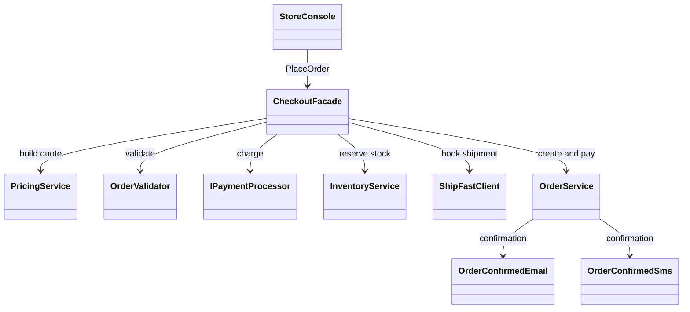

# Facade

## Intent

Facade is a structural pattern that gives a caller one entry point to a group of
services and keeps their coordination order behind that boundary (GoF,
chapter 4).

## The smell

`StoreConsole.Checkout` previously calculated the quote, validated the order,
selected payment, created the order, reserved inventory, booked shipping and
paid the order itself. The sequence and its failure handling were coupled to
the console flow. The baseline marker is in
[`StoreConsole.cs`](../../../baseline/src/CornerStore/StoreConsole.cs).

## The refactor

`StoreConsole` now delegates checkout to `CheckoutFacade.PlaceOrder`. The
facade coordinates pricing and validation, payment, inventory, shipping, and
order completion. The payment selection and courier protocol remain as they
were; those are separate smells for Factory Method and Adapter.

## Diff highlights

The console now makes one checkout call. The facade owns the original
subsystem sequence and compensates reserved stock if payment completion fails.
The checkout transcript remains byte-for-byte identical to the baseline. See
[DIFF.md](DIFF.md) for the source and test changes.

## Trade-offs

The facade centralizes policy and can become another god class if it absorbs
business rules instead of coordinating services. It is the wrong choice when
callers need different orchestration or direct access to individual services;
in that case, a shared facade can hide useful capabilities and constrain
callers unnecessarily.

## Related patterns and common confusions

Facade simplifies access to a subsystem from a caller. Mediator instead
coordinates peer objects that notify a central object, reducing direct
references between those peers. Facade does not require subsystem objects to
communicate through it.

## Modern .NET notes

The .NET dependency-injection container can compose the facade and its
collaborators, but it does not replace the facade's orchestration responsibility.

## Files changed

* `src/CornerStore/Checkout/CheckoutFacade.cs`
* `src/CornerStore/StoreConsole.cs`
* `src/CornerStore/CornerStore.csproj`
* `tests/CornerStore.Tests/CheckoutFacadeTests.cs`

## Blog post link

To be published.
