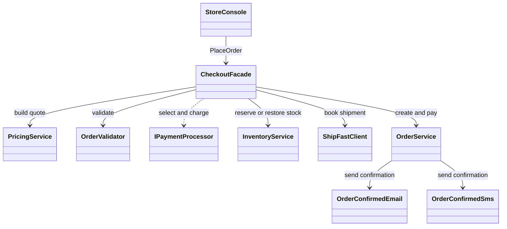
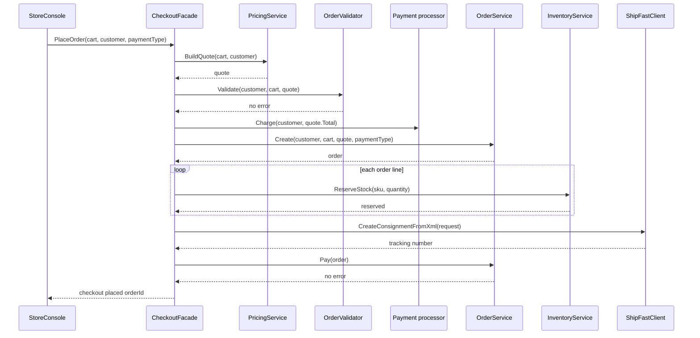

# Facade

## At a glance

| | |
| --- | --- |
| Intent | Give the console one entry point for coordinating checkout services. |
| Category | Structural |
| Smell fixed | S10: the console coordinates checkout subsystems in a fixed order. |
| GoF chapter | Chapter 4, "Structural Patterns: Facade." |
| Files changed | `src/CornerStore/Checkout/CheckoutFacade.cs`; `src/CornerStore/StoreConsole.cs`; `src/CornerStore/CornerStore.csproj`; `tests/CornerStore.Tests/CheckoutFacadeTests.cs` ([DIFF.md](DIFF.md)) |
| Previous pattern | [Decorator](../decorator/README.md) |
| Next pattern | [Flyweight](../flyweight/README.md) |

## The problem

In the baseline, `StoreConsole.Checkout` builds the quote, validates the order, charges payment, reserves stock, books shipping and completes the order. The console owns both the sequence and its failure handling, so checkout coordination is mixed into the scenario flow. The baseline marks this as S10 in [`StoreConsole.cs`](../../../baseline/src/CornerStore/StoreConsole.cs).

```csharp
var quote = pricing.BuildQuote(cart, customer);
var error = orderValidator.Validate(customer, cart, quote);
if (error is not null)
{
    Log.Info("checkout rejected: " + error);
    return;
}
```

## The pattern

Facade gives a caller a focused entry point to a set of services. The facade coordinates a larger operation while the services keep their own responsibilities. Callers can still use the services directly when they need finer control.

| Role | CornerStore participant |
| --- | --- |
| Client | `StoreConsole` |
| Facade | `CheckoutFacade` |
| Pricing subsystem | `PricingService` |
| Validation subsystem | `OrderValidator` |
| Payment subsystem | `IPaymentProcessor` and its concrete processors |
| Inventory subsystem | `InventoryService` |
| Shipping subsystem | `ShipFastClient` |
| Order subsystem | `OrderService`, which also records status changes and sends notifications |

## The refactor

`StoreConsole` now passes the cart, customer and payment choice to `CheckoutFacade.PlaceOrder`. The facade owns the checkout sequence, including stock reservation and rollback on a reservation or payment-completion failure. Payment processor selection and the courier's XML protocol remain inside the facade as separate smells addressed by Factory Method and Adapter.

Before, [`StoreConsole.cs`](../../../baseline/src/CornerStore/StoreConsole.cs) coordinated checkout itself:

```csharp
var quote = pricing.BuildQuote(cart, customer);
var error = orderValidator.Validate(customer, cart, quote);
```

After, [`StoreConsole.cs`](src/CornerStore/StoreConsole.cs) delegates the checkout operation to the facade:

```csharp
var customer = customers[cart.CustomerId];
Log.Info(checkoutFacade.PlaceOrder(cart, customer, Text(step, "payment")));
```

The facade uses these collaborators:



## How it runs

When the scenario reaches checkout, `StoreConsole` calls `PlaceOrder`. The facade rejects an empty cart, builds a quote and validates it. It then charges through the selected payment processor, creates the order, reserves each line's stock, books a shipment and asks `OrderService` to mark the order as paid. A stock reservation failure restores stock already reserved; a payment-completion failure also restores the reserved stock. `OrderService` records the status change and sends the confirmation through the customer's notification channel.



## Run it

Run these commands from the repository root. The build, tests and scenario command were verified for this solution.

```powershell
dotnet build patterns/structural/facade/Facade.slnx
dotnet test patterns/structural/facade/Facade.slnx
dotnet run --project patterns/structural/facade/src/CornerStore/CornerStore.csproj -- scenarios/trading-day.json
```

## Trade-offs

The facade makes a common operation easier to call and keeps its sequence out of the console. It adds a coordinating type and can become a god class if business rules accumulate there instead of staying with the services. Do not use one shared facade when callers need different orchestration or direct access to subsystem capabilities.

## Related patterns

[Facade vs Mediator](../../../docs/comparisons.md#facade-vs-mediator) compares a caller-facing entry point with coordination among peer objects. [Factory Method](../../creational/factory-method/README.md) can replace the payment processor construction that remains in this checkout facade. [Adapter](../adapter/README.md) can isolate the courier protocol currently called by the facade. [Mediator](../../behavioral/mediator/README.md) coordinates interactions among peer collaborators rather than presenting an entry point to a subsystem.

## Modern .NET notes

The .NET dependency-injection container can construct a facade and its collaborators, but it does not provide the checkout orchestration. This solution wires the facade and its services in `StoreConsole`.

## Further reading

GoF, Chapter 4, "Structural Patterns: Facade."

Blog post: coming soon <!-- blog-link -->
