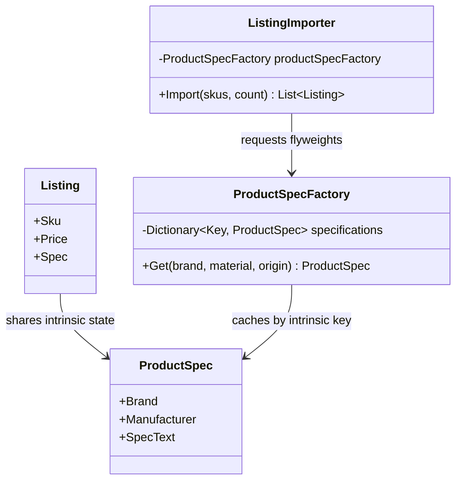

# Flyweight

## At a glance

| | |
| --- | --- |
| Intent | Share repeated product specification data across imported listings while keeping each listing's SKU and price. |
| Category | Structural |
| Smell fixed | S11: each imported listing owns copies of repeated brand, manufacturer and specification strings. |
| GoF chapter | Chapter 4, "Structural Patterns: Flyweight." |
| Files changed | `src/CornerStore/Catalog/Listing.cs`; `src/CornerStore/Catalog/ListingImporter.cs`; `src/CornerStore/Catalog/ProductSpec.cs`; `src/CornerStore/Catalog/ProductSpecFactory.cs`; `src/CornerStore/CornerStore.csproj`; `tests/CornerStore.Tests/FlyweightTests.cs` ([DIFF.md](DIFF.md)) |
| Previous pattern | [Facade](../facade/README.md) |
| Next pattern | [Proxy](../proxy/README.md) |

## The problem

The baseline importer constructs brand, manufacturer and specification strings for every listing, although their combinations repeat. That duplicates intrinsic data during the 100,000-listing bulk import, the extension used here to exercise Flyweight. The S11 markers are in [`Listing.cs`](../../../baseline/src/CornerStore/Catalog/Listing.cs) and [`ListingImporter.cs`](../../../baseline/src/CornerStore/Catalog/ListingImporter.cs).

```csharp
Brand = string.Concat(brand, " & Co"),
Manufacturer = string.Concat(brand, " Manufacturing Pty Ltd"),
SpecText = string.Concat("Material: ", material, "; origin: ", origin, "; care: machine wash cold"),
```

## The pattern

Flyweight separates shared intrinsic state from per-object extrinsic state. A factory reuses a flyweight for each distinct intrinsic key, while the context keeps its own unique state.

| Role | CornerStore participant |
| --- | --- |
| Flyweight | `ProductSpec` |
| Flyweight factory | `ProductSpecFactory` |
| Context | `Listing` |
| Client | `ListingImporter` |

## The refactor

`ProductSpec` holds the repeated brand, manufacturer and specification text. `ProductSpecFactory` caches specifications by brand, material and origin. A `Listing` stores the shared specification reference but continues to own its SKU and price.

The benchmark project is included in `Flyweight.slnx`. Its `CornerStore.Benchmarks.csproj`, `Program.cs` and `ListingImportBenchmarks.cs` files compare repeated metadata construction with the shared specification importer; BenchmarkDotNet 0.15.8 is centrally managed in `../../../Directory.Packages.props`.

Before, [`ListingImporter.cs`](../../../baseline/src/CornerStore/Catalog/ListingImporter.cs) built the repeated strings for every listing:

```csharp
listings.Add(new Listing
{
    Sku = string.Concat(skus[i % skus.Count], "-L", i.ToString(CultureInfo.InvariantCulture)),
    Brand = string.Concat(brand, " & Co"),
    Manufacturer = string.Concat(brand, " Manufacturing Pty Ltd"),
    SpecText = string.Concat("Material: ", material, "; origin: ", origin, "; care: machine wash cold"),
    Price = 10m + (i % 90),
});
```

After, [`ListingImporter.cs`](src/CornerStore/Catalog/ListingImporter.cs) obtains the shared specification:

```csharp
var spec = productSpecFactory.Get(brand, material, origin);
listings.Add(new Listing(spec)
{
    Sku = string.Concat(skus[i % skus.Count], "-L", i.ToString(CultureInfo.InvariantCulture)),
    Price = 10m + (i % 90),
});
```



## How it runs

For each listing, `ListingImporter` selects a brand, material and origin and asks the factory for the matching `ProductSpec`. The factory returns the existing instance for a repeated tuple or creates and stores a new one. Each listing still receives its own SKU and price. The benchmark project compares repeated metadata construction with the flyweight importer for 100,000 listings.

The existing short BenchmarkDotNet run on Windows 11 with .NET 10.0.10, .NET SDK 10.0.302 and an AMD Ryzen 7 4800H measured these allocations per 100,000-listing import:

| Method | Allocated | Ratio |
| --- | ---: | ---: |
| Repeated metadata | 42.23 MB | 1.00 |
| Shared product specs | 13.98 MB | 0.33 |

That run measured about 67% less managed allocation with shared specifications. BenchmarkDotNet used three iterations; results vary by runtime and hardware and are not a universal performance guarantee.

## Run it

Run these commands from the repository root. The build, tests, scenario and short benchmark commands were verified for this solution.

```powershell
dotnet build patterns/structural/flyweight/Flyweight.slnx
dotnet test patterns/structural/flyweight/Flyweight.slnx
dotnet run --project patterns/structural/flyweight/src/CornerStore/CornerStore.csproj -- scenarios/trading-day.json
dotnet run --configuration Release --project patterns/structural/flyweight/benchmarks/CornerStore.Benchmarks -- --job Short --filter "*ListingImportBenchmarks*"
```

## Trade-offs

Flyweight can reduce duplicated data when many objects share stable intrinsic state. It adds factory lookup and key-management costs. It is a poor fit when few objects share data, most state is unique, or the shared values change frequently and must be synchronized.

## Related patterns

[Decorator vs Proxy](../../../docs/comparisons.md#decorator-vs-proxy) discusses wrapper objects, one of which is the next pattern in the book order. [Proxy](../proxy/README.md) controls access to a real object; Flyweight instead shares immutable intrinsic state across many contexts. [Composite](../composite/README.md) also represents many related objects but models a part-whole structure rather than shared metadata.

## Modern .NET notes

Immutable reference objects make shared state safe from mutation by individual listings. The factory's dictionary provides canonical instances for the intrinsic keys used here. This is a domain-specific cache, not a reason to use global string interning.

## Further reading

GoF, Chapter 4, "Structural Patterns: Flyweight."

Blog post: coming soon <!-- blog-link -->
