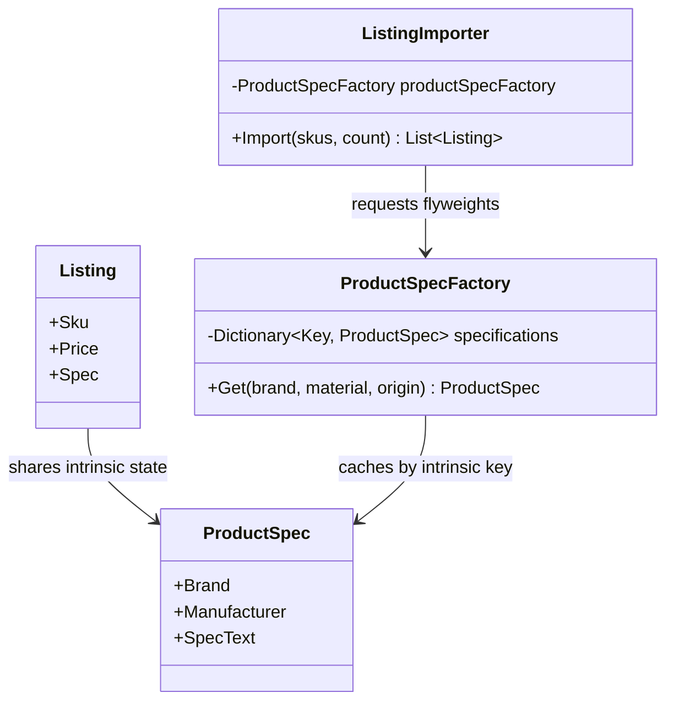

# Flyweight

## Intent

Flyweight shares common intrinsic state across many objects while keeping each object's extrinsic state separate. It is described in Chapter 4, "Structural Patterns," of *Design Patterns: Elements of Reusable Object-Oriented Software*.

## The smell

S11 stores brand, manufacturer and specification strings separately on every listing. The bulk importer allocates 100,000 listings even though those metadata combinations repeat.

## The refactor

`ProductSpec` is the immutable flyweight containing shared brand, manufacturer and specification text. `ProductSpecFactory` caches instances by brand, material and origin. Each `Listing` retains its own SKU and price and refers to the shared specification.



## Diff highlights

The importer now asks the factory for a shared specification and stores that reference on each listing. SKU and price remain unique listing data. See [DIFF.md](DIFF.md).

## Trade-offs

Flyweight is useful when a large number of objects share stable data and the factory can identify equal intrinsic state. It adds lookup and key-management costs. It is a poor choice when objects are few, their state rarely repeats, or the shared values change frequently and must be synchronized.

## Related patterns and common confusions

A Flyweight shares immutable intrinsic data among many context objects. A cache can improve repeated computation, but it does not define which object state is shared or separate that state from the per-context data.

## Modern .NET notes

Use immutable value objects for intrinsic state so consumers cannot mutate data shared by other listings. The factory owns canonical instances and retains them for reuse.

## Memory benchmark

The BenchmarkDotNet project compares the original per-listing string construction with the shared flyweight importer. `MemoryDiagnoser` reports allocated bytes and garbage-collection counts for importing 100,000 listings. Run a short comparison with:

```powershell
dotnet run --configuration Release --project benchmarks/CornerStore.Benchmarks -- --job Short
```

The comparison is workload- and runtime-dependent. Use it to evaluate allocation changes on the target machine, not as a universal performance guarantee.

The short run on Windows 11 with .NET 10.0.10, .NET SDK 10.0.302 and an AMD Ryzen 7 4800H measured these allocations per 100,000-listing import:

| Method | Allocated | Ratio |
| --- | ---: | ---: |
| Repeated metadata | 42.23 MB | 1.00 |
| Shared product specs | 13.98 MB | 0.33 |

This run measured about 67% less managed allocation with shared specifications. BenchmarkDotNet used three iterations; results vary by runtime and hardware.

## Files changed

* `src/CornerStore/Catalog/Listing.cs`
* `src/CornerStore/Catalog/ListingImporter.cs`
* `src/CornerStore/Catalog/ProductSpec.cs`
* `src/CornerStore/Catalog/ProductSpecFactory.cs`
* `src/CornerStore/CornerStore.csproj`
* `tests/CornerStore.Tests/FlyweightTests.cs`
* `benchmarks/CornerStore.Benchmarks/CornerStore.Benchmarks.csproj`
* `benchmarks/CornerStore.Benchmarks/Program.cs`
* `benchmarks/CornerStore.Benchmarks/ListingImportBenchmarks.cs`
* `Flyweight.slnx`
* `../../../Directory.Packages.props`

The pattern solution includes the benchmark project so it is built and testable with this pattern. BenchmarkDotNet 0.15.8 is centrally managed in `../../../Directory.Packages.props`.

## Blog post link

To be published.
