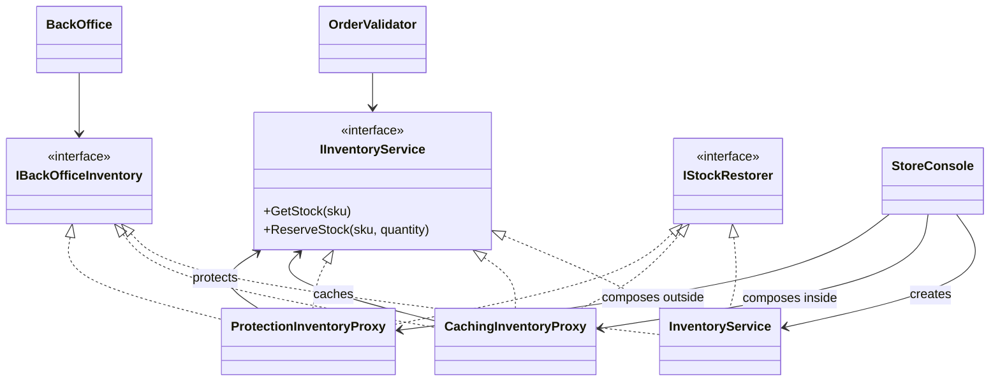
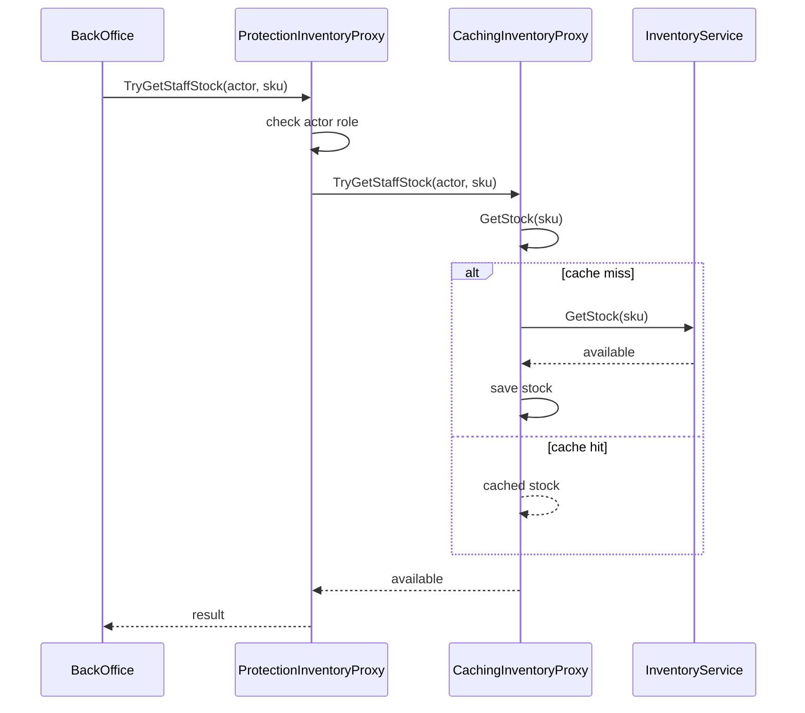

# Proxy

## At a glance

| | |
| --- | --- |
| Intent | Cache repeated stock reads and guard staff-only inventory operations behind service contracts. |
| Category | Structural |
| Smell fixed | S12: inventory reads are uncached and staff authorization is repeated at callers. |
| GoF chapter | Chapter 4, "Structural Patterns: Proxy." |
| Files changed | `src/CornerStore/Checkout/OrderValidator.cs`; `src/CornerStore/CornerStore.csproj`; `src/CornerStore/Inventory/CachingInventoryProxy.cs`; `src/CornerStore/Inventory/IInventoryService.cs`; `src/CornerStore/Inventory/InventoryService.cs`; `src/CornerStore/Inventory/ProtectionInventoryProxy.cs`; `src/CornerStore/Orders/BackOffice.cs`; `src/CornerStore/Orders/OrderService.cs`; `src/CornerStore/StoreConsole.cs`; `tests/CornerStore.Tests/ProxyTests.cs` ([DIFF.md](DIFF.md)) |
| Previous pattern | [Flyweight](../flyweight/README.md) |
| Next pattern | [Chain of Responsibility](../../behavioral/chain-of-responsibility/) |

## The problem

The baseline `InventoryService` adds simulated lookup cost on every stock read and allows direct stock adjustments without an authorization check. Callers such as `BackOffice` repeat role checks instead of relying on a service boundary. The S12 markers are in [`InventoryService.cs`](../../../baseline/src/CornerStore/Inventory/InventoryService.cs) and [`BackOffice.cs`](../../../baseline/src/CornerStore/Orders/BackOffice.cs).

```csharp
lookupCost += 10;
return stock.GetValueOrDefault(sku);
```

## The pattern

Proxy provides a stand-in that shares a service contract with the real object and controls access or adds work around calls. This solution composes a caching proxy with a protection proxy for distinct responsibilities.

| Role | CornerStore participant |
| --- | --- |
| Subject | `IInventoryService` and its staff/restoration capability interfaces |
| Real subject | `InventoryService` |
| Caching proxy | `CachingInventoryProxy` |
| Protection proxy | `ProtectionInventoryProxy` |
| Clients | `OrderValidator`, `OrderService`, `BackOffice` |
| Composition point | `StoreConsole` |

## The refactor

The real inventory service and both proxies implement the inventory capabilities. `CachingInventoryProxy` caches stock reads and removes or refreshes entries after reservations, restoration and staff adjustments. `ProtectionInventoryProxy` checks staff role before staff stock lookup or adjustment. `StoreConsole` composes protection outside caching and passes the relevant capability to each client. Refund and cancellation authorization remains in `BackOffice` because those operations are outside this inventory seam.

Before, [`InventoryService.cs`](../../../baseline/src/CornerStore/Inventory/InventoryService.cs) charged for each stock lookup:

```csharp
lookupCost += 10;
return stock.GetValueOrDefault(sku);
```

After, [`CachingInventoryProxy.cs`](src/CornerStore/Inventory/CachingInventoryProxy.cs) returns a cached value when available:

```csharp
if (!stockCache.TryGetValue(sku, out var available))
{
    available = inner.GetStock(sku);
    stockCache[sku] = available;
}

return available;
```

[`ProtectionInventoryProxy.cs`](src/CornerStore/Inventory/ProtectionInventoryProxy.cs) checks staff access before delegating:

```csharp
if (actor.Role != "staff")
{
    available = 0;
    return false;
}

return backOfficeInventory.TryGetStaffStock(actor, sku, out available);
```



## How it runs

`StoreConsole` wraps the real service in `CachingInventoryProxy`, then wraps that in `ProtectionInventoryProxy`. Ordinary validation reads pass through both proxies; the caching layer performs the underlying read once and serves subsequent reads from its dictionary until a stock mutation invalidates or refreshes the entry. Staff adjustments are checked by the outer protection proxy before reaching the caching proxy and real service.



## Run it

Run these commands from the repository root. The build, tests and scenario command were verified for this solution.

```powershell
dotnet build patterns/structural/proxy/Proxy.slnx
dotnet test patterns/structural/proxy/Proxy.slnx
dotnet run --project patterns/structural/proxy/src/CornerStore/CornerStore.csproj -- scenarios/trading-day.json
```

## Trade-offs

The cache uses memory and must stay coherent after each stock mutation. This local cache fits the synchronous in-memory example, not shared inventory across concurrent processes or machines. The protection proxy only covers calls made through its composed contract; untrusted callers must not receive the underlying service or trusted restoration capability directly.

## Related patterns

[Decorator vs Proxy](../../../docs/comparisons.md#decorator-vs-proxy) contrasts adding responsibilities with controlling access. [Decorator](../decorator/README.md) keeps the same component contract to add behavior. [Adapter](../adapter/README.md) translates an incompatible interface rather than standing in for a service. [Chain of Responsibility](../../behavioral/chain-of-responsibility/) is the next pattern in book order and passes a request along validation handlers rather than controlling access to one service.

## Modern .NET notes

Dependency-injection containers can compose service decorators, and `DispatchProxy` can generate runtime proxies. Explicit classes make this example's cache invalidation and authorization policy visible and testable.

## Further reading

GoF, Chapter 4, "Structural Patterns: Proxy."

Blog post: coming soon <!-- blog-link -->
