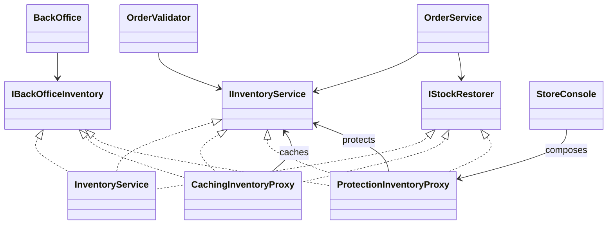

# Proxy

## Intent

Proxy presents the same service contract as a real object while controlling
access to that object or adding work around its calls (GoF, chapter 4).

## The smell

`InventoryService` adds simulated latency to every stock lookup, and stock
adjustments have no authorization boundary. `BackOffice` repeats role checks
for stock lookup and adjustment. The S12 markers are in
[`InventoryService.cs`](../../../baseline/src/CornerStore/Inventory/InventoryService.cs)
and
[`BackOffice.cs`](../../../baseline/src/CornerStore/Orders/BackOffice.cs).

## The refactor

`InventoryService`, `CachingInventoryProxy`, and
`ProtectionInventoryProxy` implement the inventory contracts. The cache
stores stock lookups, updates cached stock after staff adjustments, and
invalidates entries after reservations and internal stock restoration. The
protection proxy checks the actor's staff role before back-office stock lookup
or adjustment. `StoreConsole` composes protection outside caching, then passes
only the required capability to each service: ordinary inventory operations,
staff stock operations, or trusted stock restoration.

The staff checks for refund and cancellation remain in `BackOffice`; those
operations do not pass through the inventory contract and are outside this
proxy seam.

## Diff highlights

Repeated stock lookups are served from the cache until a mutation invalidates
or refreshes the entry. Staff stock operations are authorized by the outer
protection proxy rather than by `BackOffice`. Checkout reservations, rollback,
refund, and cancellation continue to use trusted inventory operations. See
[DIFF.md](DIFF.md) for the exact changes.

## Trade-offs

The cache adds memory use and must be kept coherent after every stock
mutation. This local cache is suited to the synchronous in-memory example, not
to shared inventory across concurrent processes or machines. The protection
proxy only protects staff operations made through the composed interface; the
underlying implementation and trusted restoration capability must not be
given directly to untrusted callers.

## Related patterns and common confusions

Proxy controls access to an object while keeping its interface. Decorator
adds responsibilities around an object, while Adapter translates an
incompatible interface. A proxy should not silently change the meaning of
inventory operations.

## Modern .NET notes

Dependency injection containers can register decorators around services, and
`DispatchProxy` can generate runtime proxies. Explicit classes make this
example's cache invalidation and authorization policy visible and testable.

## Files changed

* `src/CornerStore/Checkout/OrderValidator.cs`
* `src/CornerStore/CornerStore.csproj`
* `src/CornerStore/Inventory/CachingInventoryProxy.cs`
* `src/CornerStore/Inventory/IInventoryService.cs`
* `src/CornerStore/Inventory/InventoryService.cs`
* `src/CornerStore/Inventory/ProtectionInventoryProxy.cs`
* `src/CornerStore/Orders/BackOffice.cs`
* `src/CornerStore/Orders/OrderService.cs`
* `src/CornerStore/StoreConsole.cs`
* `tests/CornerStore.Tests/ProxyTests.cs`

## Blog post link

To be published.
